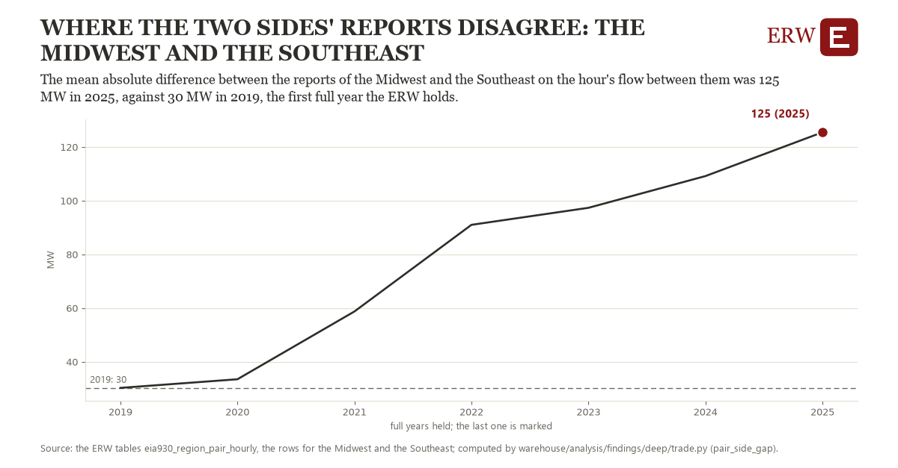

# Where the two sides' reports disagree: the Midwest and the Southeast

Draft `scan-deep-b78c565774a1` of the findings hunt over the whole warehouse (chain 502), 2026-11-19. State: draft, not reviewed. Review at `/internal/findings`.

**The finding.** The mean absolute difference between the reports of the Midwest and the Southeast on the hour's flow between them was 125 MW in 2025, against 30 MW in 2019, the first full year the ERW holds.

**The figure by full year** (MW): 2019: 30, 2020: 33, 2021: 59, 2022: 91, 2023: 97, 2024: 109, 2025: 125.

**The tables and rows.** `eia930_region_pair_hourly`; the rows for the Midwest and the Southeast, region key `rg_midw_se` (the card's `hunt.region`), years 2019 to 2025. The yearly values: `pair-side-gap-rg-midw-se.csv`.

**Its strength.** The change is 4.57 typical yearly moves (a typical move is 21 MW, 1.4826 times the median absolute change between full years). Holds in more than one year: 6 of the 6 full years after 2019 lie above 2019's value. Survives a change of window: from 2020 to 2025 the change is 92, from 2019 to 2024 it is 79. Sample large enough: 2019 holds 8,663 and 2025 holds 8,760 observations; the floor is 8,000. Half the change remains without the first year: from 2020 to 2025 the change is 92, 96.6 percent of the change from 2019. At least one typical yearly move: the change is 4.57 typical yearly moves (21 MW a year, the median move between full years); the floor is 1.

**Its limits.** Each side summed from its balancing authorities' reports on the ties between the two regions, hours both sides hold; which side is right is not known from these rows.

**Reproduce.** `python pair-side-gap-rg-midw-se.reproduce.py <the table's CSV>` and `do pair-side-gap-rg-midw-se.reproduce.do` (Stata) recompute the figures by year from the tables as the public downloads hold them; each names the expected values at its top.
