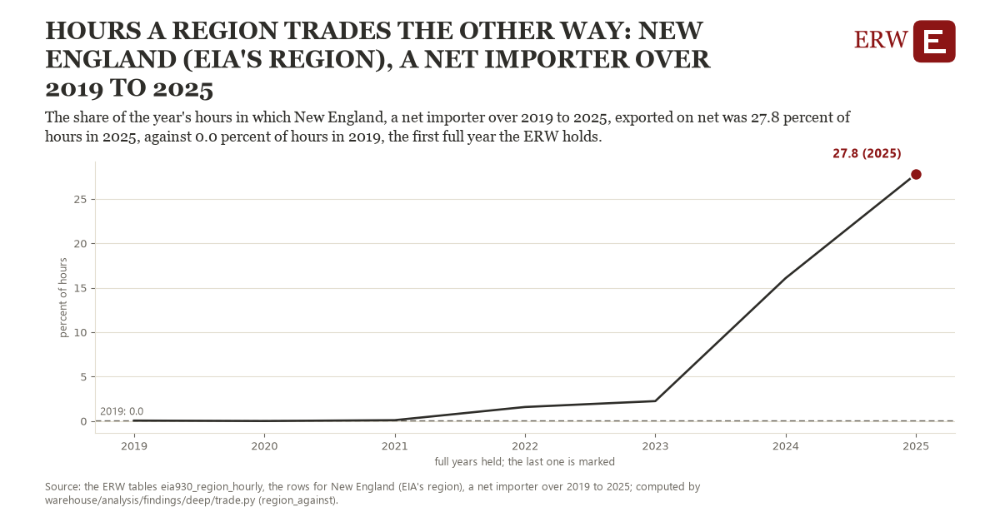

# Hours a region trades the other way: New England (EIA's region), a net importer over 2019 to 2025

Draft `scan-deep-f1c04aa6be10` of the findings hunt over the whole warehouse (chain 502), 2026-11-19. State: draft, not reviewed. Review at `/internal/findings`.

**The finding.** The share of the year's hours in which New England, a net importer over 2019 to 2025, exported on net was 27.8 percent of hours in 2025, against 0.0 percent of hours in 2019, the first full year the ERW holds.

**The figure by full year** (percent of hours): 2019: 0.0, 2020: 0.0, 2021: 0.1, 2022: 1.6, 2023: 2.2, 2024: 16.1, 2025: 27.8.

**The tables and rows.** `eia930_region_hourly`; the rows for New England (EIA's region), a net importer over 2019 to 2025, region key `rn_ne` (the card's `hunt.region`), years 2019 to 2025. The yearly values: `region-against-rn-ne.csv`.

**Its strength.** The change is 17.43 typical yearly moves (a typical move is 1.6 percent of hours, 1.4826 times the median absolute change between full years). Holds in more than one year: 5 of the 6 full years after 2019 lie above 2019's value. Survives a change of window: from 2020 to 2025 the change is 27.8, from 2019 to 2024 it is 16.0. Sample large enough: 2019 holds 8,760 and 2025 holds 8,758 observations; the floor is 8,000. Half the change remains without the first year: from 2020 to 2025 the change is 27.8, 100.2 percent of the change from 2019. At least one typical yearly move: the change is 17.43 typical yearly moves (1.6 percent of hours a year, the median move between full years); the floor is 1.

**Its limits.** EIA-930 as the balancing authorities report it, each region's figure summed from its authorities' reports; the ties between two regions can change over the years.

**Reproduce.** `python region-against-rn-ne.reproduce.py <the table's CSV>` and `do region-against-rn-ne.reproduce.do` (Stata) recompute the figures by year from the tables as the public downloads hold them; each names the expected values at its top.
