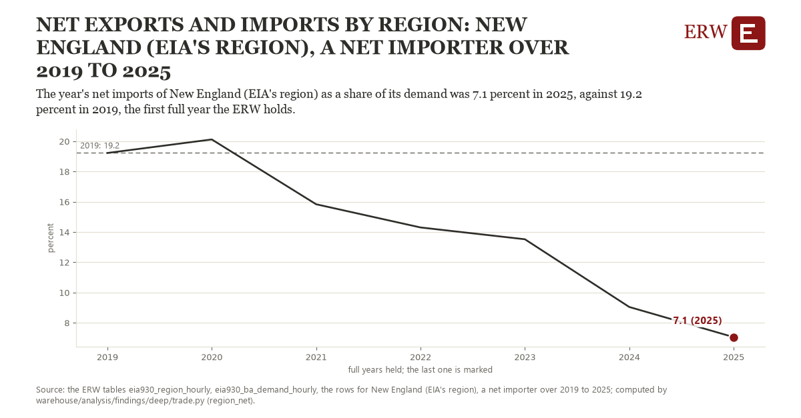

# Net exports and imports by region: New England (EIA's region), a net importer over 2019 to 2025

Draft `scan-deep-e7d82fef5f95` of the findings hunt over the whole warehouse (chain 502), 2026-11-19. State: draft, not reviewed. Review at `/internal/findings`.

**The finding.** The year's net imports of New England (EIA's region) as a share of its demand was 7.1 percent in 2025, against 19.2 percent in 2019, the first full year the ERW holds.

**The figure by full year** (percent): 2019: 19.2, 2020: 20.1, 2021: 15.8, 2022: 14.3, 2023: 13.5, 2024: 9.0, 2025: 7.1.

**The tables and rows.** `eia930_region_hourly`, `eia930_ba_demand_hourly`; the rows for New England (EIA's region), a net importer over 2019 to 2025, region key `rn_ne` (the card's `hunt.region`), years 2019 to 2025. The yearly values: `region-net-rn-ne.csv`.

**Its strength.** The change is 4.66 typical yearly moves (a typical move is 2.6 percent, 1.4826 times the median absolute change between full years). Holds in more than one year: 5 of the 6 full years after 2019 lie below 2019's value. Survives a change of window: from 2020 to 2025 the change is -13.1, from 2019 to 2024 it is -10.2. Sample large enough: 2019 holds 8,760 and 2025 holds 8,758 observations; the floor is 8,000. Half the change remains without the first year: from 2020 to 2025 the change is -13.1, 107.3 percent of the change from 2019. At least one typical yearly move: the change is 4.66 typical yearly moves (2.6 percent a year, the median move between full years); the floor is 1.

**Its limits.** EIA-930 as the balancing authorities report it, each region's figure summed from its authorities' reports; the ties between two regions can change over the years; flows between two authorities of one region cancel only as far as both report them alike; a negative figure is a year the region traded the other way on net; demand is summed from the region's authorities that file it.

**Reproduce.** `python region-net-rn-ne.reproduce.py <the table's CSV>` and `do region-net-rn-ne.reproduce.do` (Stata) recompute the figures by year from the tables as the public downloads hold them; each names the expected values at its top.
