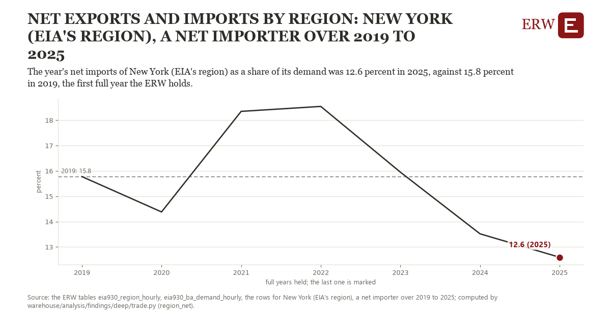

# Net exports and imports by region: New York (EIA's region), a net importer over 2019 to 2025

Draft `scan-deep-7890f31be73b` of the findings hunt over the whole warehouse (chain 502), 2026-11-19. State: draft, not reviewed. Review at `/internal/findings`.

**The finding.** The year's net imports of New York (EIA's region) as a share of its demand was 12.6 percent in 2025, against 15.8 percent in 2019, the first full year the ERW holds.

**The figure by full year** (percent): 2019: 15.8, 2020: 14.4, 2021: 18.3, 2022: 18.5, 2023: 16.0, 2024: 13.5, 2025: 12.6.

**The tables and rows.** `eia930_region_hourly`, `eia930_ba_demand_hourly`; the rows for New York (EIA's region), a net importer over 2019 to 2025, region key `rn_ny` (the card's `hunt.region`), years 2019 to 2025. The yearly values: `region-net-rn-ny.csv`.

**Its strength.** The change is 1.12 typical yearly moves (a typical move is 2.8 percent, 1.4826 times the median absolute change between full years). Holds in more than one year: 3 of the 6 full years after 2019 lie below 2019's value. Survives a change of window: from 2020 to 2025 the change is -1.8, from 2019 to 2024 it is -2.3. Sample large enough: 2019 holds 8,759 and 2025 holds 8,758 observations; the floor is 8,000. Half the change remains without the first year: from 2020 to 2025 the change is -1.8, 56.2 percent of the change from 2019. At least one typical yearly move: the change is 1.12 typical yearly moves (2.8 percent a year, the median move between full years); the floor is 1.

**Its limits.** EIA-930 as the balancing authorities report it, each region's figure summed from its authorities' reports; the ties between two regions can change over the years; flows between two authorities of one region cancel only as far as both report them alike; a negative figure is a year the region traded the other way on net; demand is summed from the region's authorities that file it.

**Reproduce.** `python region-net-rn-ny.reproduce.py <the table's CSV>` and `do region-net-rn-ny.reproduce.do` (Stata) recompute the figures by year from the tables as the public downloads hold them; each names the expected values at its top.
