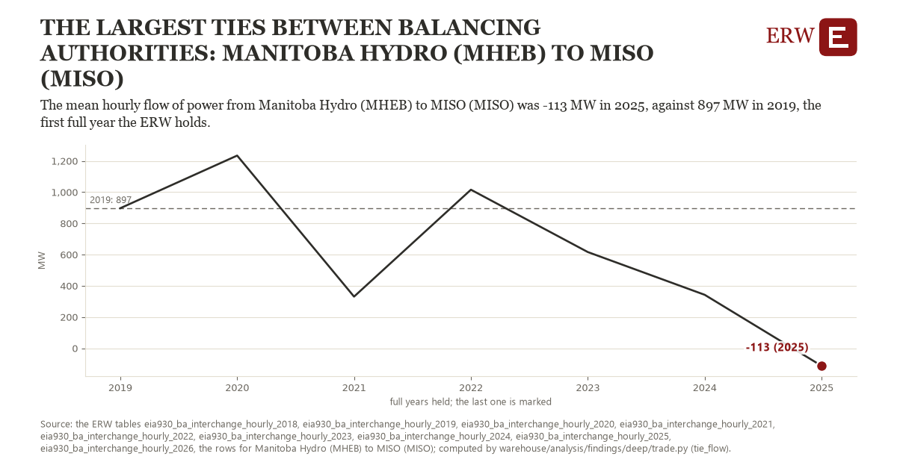

# The largest ties between balancing authorities: Manitoba Hydro (MHEB) to MISO (MISO)

Draft `scan-deep-d60a16ef9696` of the findings hunt over the whole warehouse (chain 502), 2026-11-19. State: draft, not reviewed. Review at `/internal/findings`.

**The finding.** The mean hourly flow of power from Manitoba Hydro (MHEB) to MISO (MISO) was -113 MW in 2025, against 897 MW in 2019, the first full year the ERW holds.

**The figure by full year** (MW): 2019: 897, 2020: 1,234, 2021: 330, 2022: 1,015, 2023: 616, 2024: 342, 2025: -113.

**The tables and rows.** `eia930_ba_interchange_hourly_2018`, `eia930_ba_interchange_hourly_2019`, `eia930_ba_interchange_hourly_2020`, `eia930_ba_interchange_hourly_2021`, `eia930_ba_interchange_hourly_2022`, `eia930_ba_interchange_hourly_2023`, `eia930_ba_interchange_hourly_2024`, `eia930_ba_interchange_hourly_2025`, `eia930_ba_interchange_hourly_2026`; the rows for Manitoba Hydro (MHEB) to MISO (MISO), region key `bt_mheb_miso` (the card's `hunt.region`), years 2019 to 2025. The yearly values: `tie-flow-bt-mheb-miso.csv`.

**Its strength.** The change is 1.59 typical yearly moves (a typical move is 633 MW, 1.4826 times the median absolute change between full years). Holds in more than one year: 4 of the 6 full years after 2019 lie below 2019's value. Survives a change of window: from 2020 to 2025 the change is -1,347, from 2019 to 2024 it is -555. Sample large enough: 2019 holds 8,759 and 2025 holds 8,760 observations; the floor is 8,000. Half the change remains without the first year: from 2020 to 2025 the change is -1,347, 133.4 percent of the change from 2019. At least one typical yearly move: the change is 1.59 typical yearly moves (633 MW a year, the median move between full years); the floor is 1.

**Its limits.** EIA-930 as one of the two authorities filed it; a tie is read when its mean flow is at least 300 MW, and its other side moved the same way. A negative mean is a year power flowed the other way on balance.

**Reproduce.** `python tie-flow-bt-mheb-miso.reproduce.py <the table's CSV>` and `do tie-flow-bt-mheb-miso.reproduce.do` (Stata) recompute the figures by year from the tables as the public downloads hold them; each names the expected values at its top.
