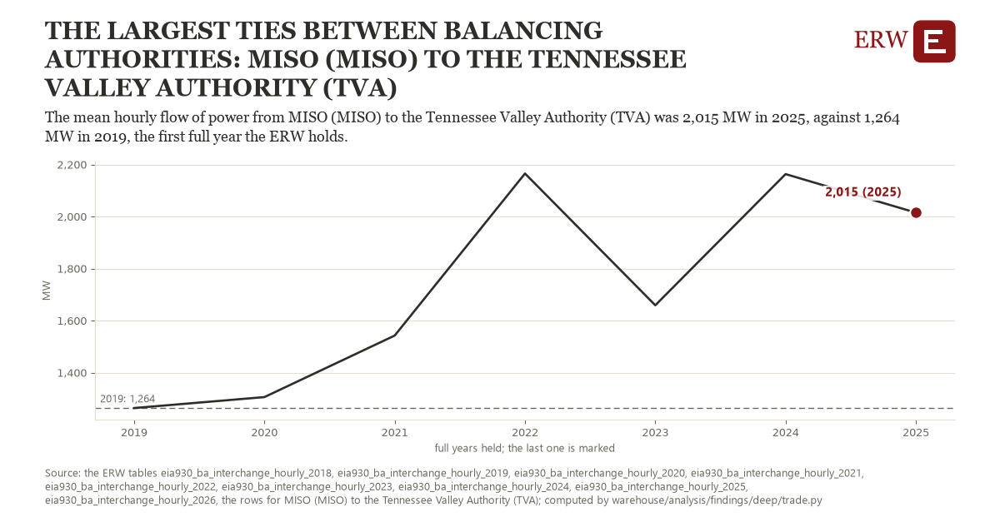

# The largest ties between balancing authorities: MISO (MISO) to the Tennessee Valley Authority (TVA)

Draft `scan-deep-2cc8e0f36fd0` of the findings hunt over the whole warehouse (chain 502), 2026-11-19. State: draft, not reviewed. Review at `/internal/findings`.

**The finding.** The mean hourly flow of power from MISO (MISO) to the Tennessee Valley Authority (TVA) was 2,015 MW in 2025, against 1,264 MW in 2019, the first full year the ERW holds.

**The figure by full year** (MW): 2019: 1,264, 2020: 1,306, 2021: 1,542, 2022: 2,165, 2023: 1,659, 2024: 2,163, 2025: 2,015.

**The tables and rows.** `eia930_ba_interchange_hourly_2018`, `eia930_ba_interchange_hourly_2019`, `eia930_ba_interchange_hourly_2020`, `eia930_ba_interchange_hourly_2021`, `eia930_ba_interchange_hourly_2022`, `eia930_ba_interchange_hourly_2023`, `eia930_ba_interchange_hourly_2024`, `eia930_ba_interchange_hourly_2025`, `eia930_ba_interchange_hourly_2026`; the rows for MISO (MISO) to the Tennessee Valley Authority (TVA), region key `bt_miso_tva` (the card's `hunt.region`), years 2019 to 2025. The yearly values: `tie-flow-bt-miso-tva.csv`.

**Its strength.** The change is 1.37 typical yearly moves (a typical move is 549 MW, 1.4826 times the median absolute change between full years). Holds in more than one year: 6 of the 6 full years after 2019 lie above 2019's value. Survives a change of window: from 2020 to 2025 the change is 709, from 2019 to 2024 it is 899. Sample large enough: 2019 holds 8,760 and 2025 holds 8,759 observations; the floor is 8,000. Half the change remains without the first year: from 2020 to 2025 the change is 709, 94.4 percent of the change from 2019. At least one typical yearly move: the change is 1.37 typical yearly moves (549 MW a year, the median move between full years); the floor is 1.

**Its limits.** EIA-930 as one of the two authorities filed it; a tie is read when its mean flow is at least 300 MW, and its other side moved the same way. A negative mean is a year power flowed the other way on balance.

**Reproduce.** `python tie-flow-bt-miso-tva.reproduce.py <the table's CSV>` and `do tie-flow-bt-miso-tva.reproduce.do` (Stata) recompute the figures by year from the tables as the public downloads hold them; each names the expected values at its top.
