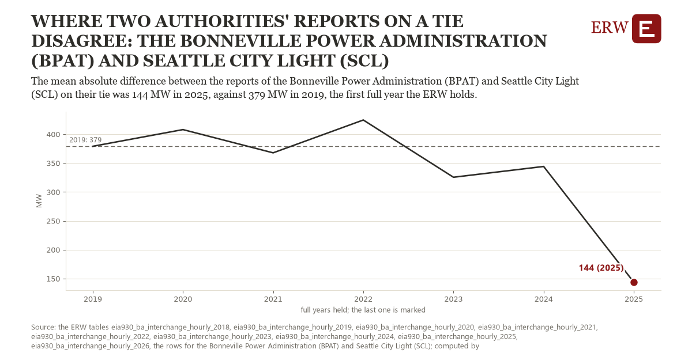

# Where two authorities' reports on a tie disagree: the Bonneville Power Administration (BPAT) and Seattle City Light (SCL)

Draft `scan-deep-3fae7db27325` of the findings hunt over the whole warehouse (chain 502), 2026-11-19. State: draft, not reviewed. Review at `/internal/findings`.

**The finding.** The mean absolute difference between the reports of the Bonneville Power Administration (BPAT) and Seattle City Light (SCL) on their tie was 144 MW in 2025, against 379 MW in 2019, the first full year the ERW holds.

**The figure by full year** (MW): 2019: 379, 2020: 408, 2021: 368, 2022: 425, 2023: 325, 2024: 344, 2025: 144.

**The tables and rows.** `eia930_ba_interchange_hourly_2018`, `eia930_ba_interchange_hourly_2019`, `eia930_ba_interchange_hourly_2020`, `eia930_ba_interchange_hourly_2021`, `eia930_ba_interchange_hourly_2022`, `eia930_ba_interchange_hourly_2023`, `eia930_ba_interchange_hourly_2024`, `eia930_ba_interchange_hourly_2025`, `eia930_ba_interchange_hourly_2026`; the rows for the Bonneville Power Administration (BPAT) and Seattle City Light (SCL), region key `bg_bpat_scl` (the card's `hunt.region`), years 2019 to 2025. The yearly values: `tie-side-gap-bg-bpat-scl.csv`.

**Its strength.** The change is 3.27 typical yearly moves (a typical move is 72 MW, 1.4826 times the median absolute change between full years). Holds in more than one year: 4 of the 6 full years after 2019 lie below 2019's value. Survives a change of window: from 2020 to 2025 the change is -264, from 2019 to 2024 it is -35. Sample large enough: 2019 holds 8,735 and 2025 holds 8,760 observations; the floor is 8,000. Half the change remains without the first year: from 2020 to 2025 the change is -264, 112.3 percent of the change from 2019. At least one typical yearly move: the change is 3.27 typical yearly moves (72 MW a year, the median move between full years); the floor is 1.

**Its limits.** EIA-930 as each authority filed it, hours both hold, ties with a mean flow of at least 300 MW; which side is right is not known from these rows.

**Reproduce.** `python tie-side-gap-bg-bpat-scl.reproduce.py <the table's CSV>` and `do tie-side-gap-bg-bpat-scl.reproduce.do` (Stata) recompute the figures by year from the tables as the public downloads hold them; each names the expected values at its top.
