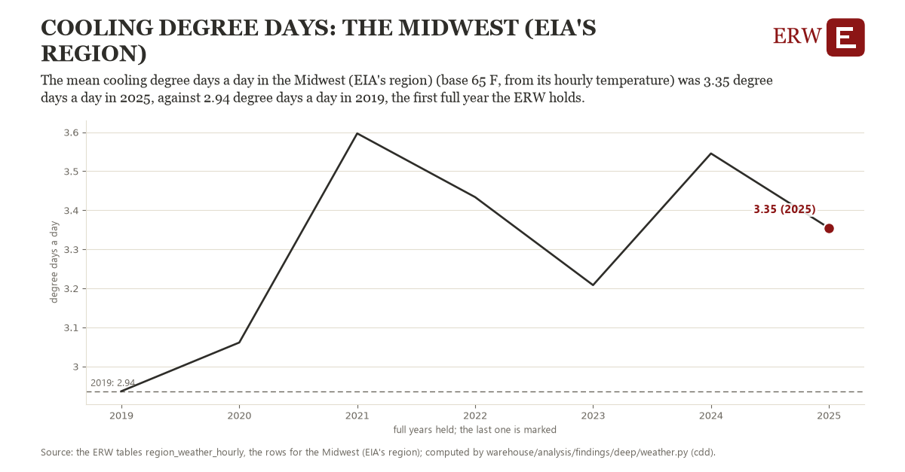

# Cooling degree days: the Midwest (EIA's region)

Draft `scan-deep-de563b9d5c57` of the findings hunt over the whole warehouse (chain 502), 2026-11-19. State: draft, not reviewed. Review at `/internal/findings`.

**The finding.** The mean cooling degree days a day in the Midwest (EIA's region) (base 65 F, from its hourly temperature) was 3.35 degree days a day in 2025, against 2.94 degree days a day in 2019, the first full year the ERW holds.

**The figure by full year** (degree days a day): 2019: 2.94, 2020: 3.06, 2021: 3.60, 2022: 3.43, 2023: 3.21, 2024: 3.55, 2025: 3.35.

**The tables and rows.** `region_weather_hourly`; the rows for the Midwest (EIA's region), region key `wd_midw` (the card's `hunt.region`), years 2019 to 2025. The yearly values: `cdd-wd-midw.csv`.

**Its strength.** The change is 1.36 typical yearly moves (a typical move is 0.31 degree days a day, 1.4826 times the median absolute change between full years). Holds in more than one year: 6 of the 6 full years after 2019 lie above 2019's value. Survives a change of window: from 2020 to 2025 the change is 0.29, from 2019 to 2024 it is 0.61. Sample large enough: 2019 holds 8,526 and 2025 holds 8,190 observations; the floor is 8,000. Half the change remains without the first year: from 2020 to 2025 the change is 0.29, 70.2 percent of the change from 2019. At least one typical yearly move: the change is 1.36 typical yearly moves (0.31 degree days a day a year, the median move between full years); the floor is 1.

**Its limits.** The region's population-weighted temperature, hours every chosen station holds; a mean over the hours held, so a year with missing hours is not understated.

**Reproduce.** `python cdd-wd-midw.reproduce.py <the table's CSV>` and `do cdd-wd-midw.reproduce.do` (Stata) recompute the figures by year from the tables as the public downloads hold them; each names the expected values at its top.
