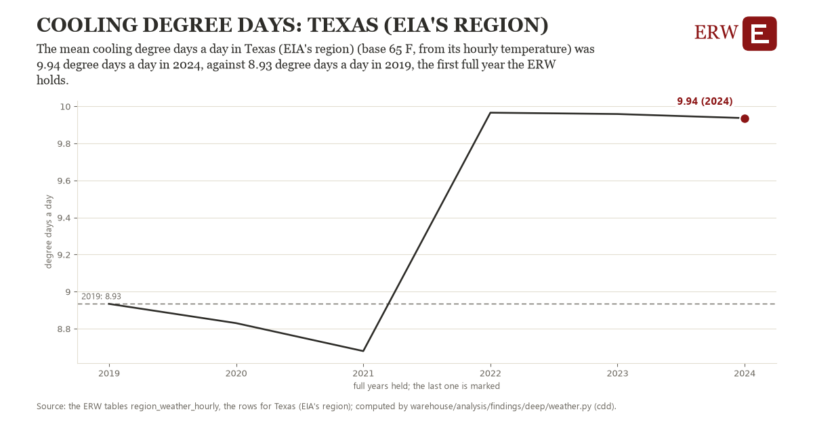

# Cooling degree days: Texas (EIA's region)

Draft `scan-deep-f30dd29c8a4a` of the findings hunt over the whole warehouse (chain 502), 2026-11-19. State: draft, not reviewed. Review at `/internal/findings`.

**The finding.** The mean cooling degree days a day in Texas (EIA's region) (base 65 F, from its hourly temperature) was 9.94 degree days a day in 2024, against 8.93 degree days a day in 2019, the first full year the ERW holds.

**The figure by full year** (degree days a day): 2019: 8.93, 2020: 8.83, 2021: 8.68, 2022: 9.97, 2023: 9.96, 2024: 9.94.

**The tables and rows.** `region_weather_hourly`; the rows for Texas (EIA's region), region key `wd_tex` (the card's `hunt.region`), years 2019 to 2024. The yearly values: `cdd-wd-tex.csv`.

**Its strength.** The change is 6.50 typical yearly moves (a typical move is 0.15 degree days a day, 1.4826 times the median absolute change between full years). Holds in more than one year: 3 of the 5 full years after 2019 lie above 2019's value. Survives a change of window: from 2020 to 2024 the change is 1.11, from 2019 to 2023 it is 1.02. Sample large enough: 2019 holds 8,288 and 2024 holds 8,110 observations; the floor is 8,000. Half the change remains without the first year: from 2020 to 2024 the change is 1.11, 110.4 percent of the change from 2019. At least one typical yearly move: the change is 6.50 typical yearly moves (0.15 degree days a day a year, the median move between full years); the floor is 1.

**Its limits.** The region's population-weighted temperature, hours every chosen station holds; a mean over the hours held, so a year with missing hours is not understated.

**Reproduce.** `python cdd-wd-tex.reproduce.py <the table's CSV>` and `do cdd-wd-tex.reproduce.do` (Stata) recompute the figures by year from the tables as the public downloads hold them; each names the expected values at its top.
