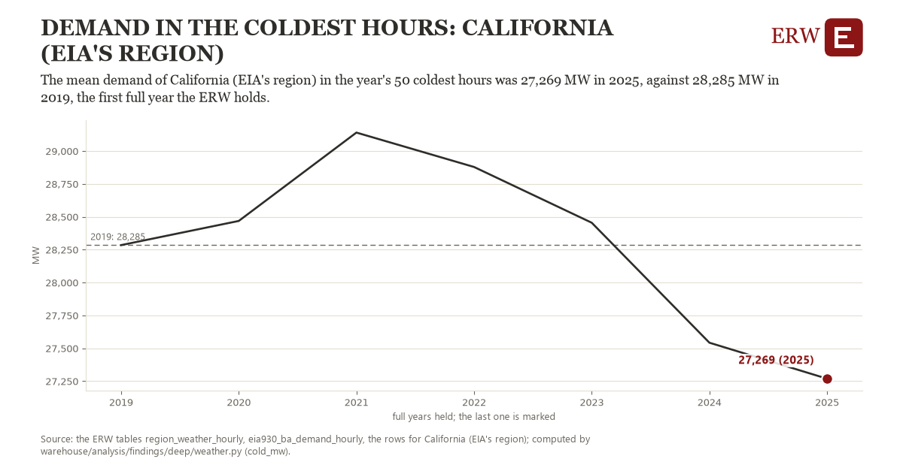

# Demand in the coldest hours: California (EIA's region)

Draft `scan-deep-b7deb5ff111c` of the findings hunt over the whole warehouse (chain 502), 2026-11-19. State: draft, not reviewed. Review at `/internal/findings`.

**The finding.** The mean demand of California (EIA's region) in the year's 50 coldest hours was 27,269 MW in 2025, against 28,285 MW in 2019, the first full year the ERW holds.

**The figure by full year** (MW): 2019: 28,285, 2020: 28,469, 2021: 29,141, 2022: 28,879, 2023: 28,455, 2024: 27,543, 2025: 27,269.

**The tables and rows.** `region_weather_hourly`, `eia930_ba_demand_hourly`; the rows for California (EIA's region), region key `wx_cal` (the card's `hunt.region`), years 2019 to 2025. The yearly values: `cold-mw-wx-cal.csv`.

**Its strength.** The change is 1.96 typical yearly moves (a typical move is 517 MW, 1.4826 times the median absolute change between full years). Holds in more than one year: 2 of the 6 full years after 2019 lie below 2019's value. Survives a change of window: from 2020 to 2025 the change is -1,200, from 2019 to 2024 it is -742. Sample large enough: 2019 holds 8,239 and 2025 holds 8,017 observations; the floor is 8,000. Half the change remains without the first year: from 2020 to 2025 the change is -1,200, 118.1 percent of the change from 2019. At least one typical yearly move: the change is 1.96 typical yearly moves (517 MW a year, the median move between full years); the floor is 1.

**Its limits.** The region's temperature is the population-weighted mean of its chosen stations (docs/methods/region_weather.md); demand is the sum of its authorities that file it; a description of the year's extreme hours, not a model, and not adjusted for anything.

**Reproduce.** `python cold-mw-wx-cal.reproduce.py <the table's CSV>` and `do cold-mw-wx-cal.reproduce.do` (Stata) recompute the figures by year from the tables as the public downloads hold them; each names the expected values at its top.
