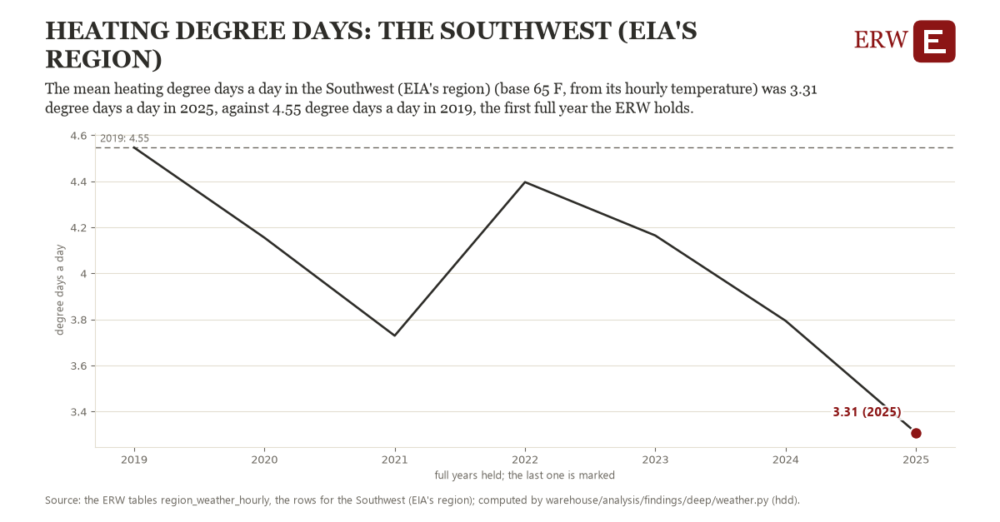

# Heating degree days: the Southwest (EIA's region)

Draft `scan-deep-4d7190efa748` of the findings hunt over the whole warehouse (chain 502), 2026-11-19. State: draft, not reviewed. Review at `/internal/findings`.

**The finding.** The mean heating degree days a day in the Southwest (EIA's region) (base 65 F, from its hourly temperature) was 3.31 degree days a day in 2025, against 4.55 degree days a day in 2019, the first full year the ERW holds.

**The figure by full year** (degree days a day): 2019: 4.55, 2020: 4.16, 2021: 3.73, 2022: 4.40, 2023: 4.16, 2024: 3.79, 2025: 3.31.

**The tables and rows.** `region_weather_hourly`; the rows for the Southwest (EIA's region), region key `wd_sw` (the card's `hunt.region`), years 2019 to 2025. The yearly values: `hdd-wd-sw.csv`.

**Its strength.** The change is 2.04 typical yearly moves (a typical move is 0.61 degree days a day, 1.4826 times the median absolute change between full years). Holds in more than one year: 6 of the 6 full years after 2019 lie below 2019's value. Survives a change of window: from 2020 to 2025 the change is -0.85, from 2019 to 2024 it is -0.75. Sample large enough: 2019 holds 8,760 and 2025 holds 8,628 observations; the floor is 8,000. Half the change remains without the first year: from 2020 to 2025 the change is -0.85, 68.4 percent of the change from 2019. At least one typical yearly move: the change is 2.04 typical yearly moves (0.61 degree days a day a year, the median move between full years); the floor is 1.

**Its limits.** The region's population-weighted temperature, hours every chosen station holds; a mean over the hours held, so a year with missing hours is not understated.

**Reproduce.** `python hdd-wd-sw.reproduce.py <the table's CSV>` and `do hdd-wd-sw.reproduce.do` (Stata) recompute the figures by year from the tables as the public downloads hold them; each names the expected values at its top.
