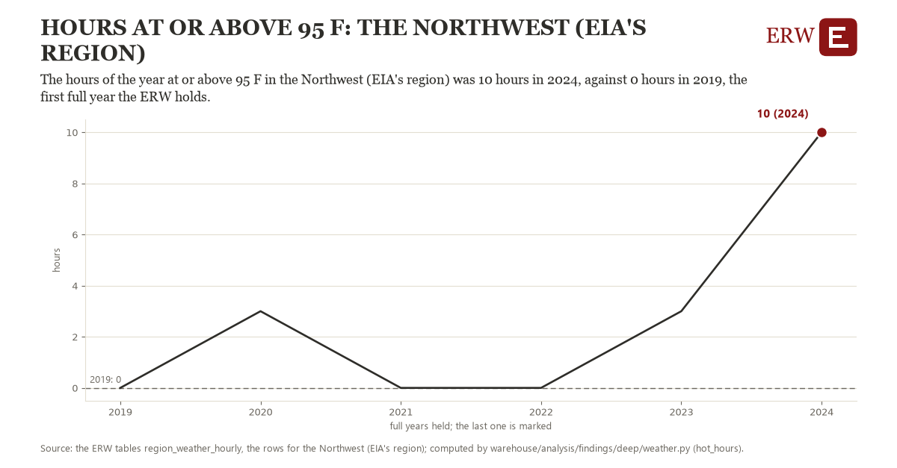

# Hours at or above 95 f: the Northwest (EIA's region)

Draft `scan-deep-073b9aa6867a` of the findings hunt over the whole warehouse (chain 502), 2026-11-19. State: draft, not reviewed. Review at `/internal/findings`.

**The finding.** The hours of the year at or above 95 F in the Northwest (EIA's region) was 10 hours in 2024, against 0 hours in 2019, the first full year the ERW holds.

**The figure by full year** (hours): 2019: 0, 2020: 3, 2021: 0, 2022: 0, 2023: 3, 2024: 10.

**The tables and rows.** `region_weather_hourly`; the rows for the Northwest (EIA's region), region key `wh_nw` (the card's `hunt.region`), years 2019 to 2024. The yearly values: `hot-hours-wh-nw.csv`.

**Its strength.** The change is 2.25 typical yearly moves (a typical move is 4 hours, 1.4826 times the median absolute change between full years). Holds in more than one year: 3 of the 5 full years after 2019 lie above 2019's value. Survives a change of window: from 2020 to 2024 the change is 7, from 2019 to 2023 it is 3. Sample large enough: 2019 holds 8,042 and 2024 holds 8,290 observations; the floor is 8,000. Half the change remains without the first year: from 2020 to 2024 the change is 7, 70.0 percent of the change from 2019. At least one typical yearly move: the change is 2.25 typical yearly moves (4 hours a year, the median move between full years); the floor is 1.

**Its limits.** The region's population-weighted temperature (docs/methods/region_weather.md), hours every chosen station holds.

**Reproduce.** `python hot-hours-wh-nw.reproduce.py <the table's CSV>` and `do hot-hours-wh-nw.reproduce.do` (Stata) recompute the figures by year from the tables as the public downloads hold them; each names the expected values at its top.
