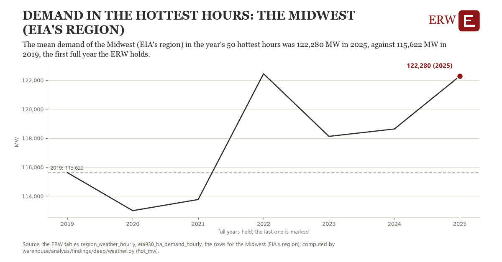

# Demand in the hottest hours: the Midwest (EIA's region)

Draft `scan-deep-fed4befff622` of the findings hunt over the whole warehouse (chain 502), 2026-11-19. State: draft, not reviewed. Review at `/internal/findings`.

**The finding.** The mean demand of the Midwest (EIA's region) in the year's 50 hottest hours was 122,280 MW in 2025, against 115,622 MW in 2019, the first full year the ERW holds.

**The figure by full year** (MW): 2019: 115,622, 2020: 112,996, 2021: 113,763, 2022: 122,442, 2023: 118,121, 2024: 118,631, 2025: 122,280.

**The tables and rows.** `region_weather_hourly`, `eia930_ba_demand_hourly`; the rows for the Midwest (EIA's region), region key `wx_midw` (the card's `hunt.region`), years 2019 to 2025. The yearly values: `hot-mw-wx-midw.csv`.

**Its strength.** The change is 1.43 typical yearly moves (a typical move is 4,652 MW, 1.4826 times the median absolute change between full years). Holds in more than one year: 4 of the 6 full years after 2019 lie above 2019's value. Survives a change of window: from 2020 to 2025 the change is 9,285, from 2019 to 2024 it is 3,010. Sample large enough: 2019 holds 8,526 and 2025 holds 8,190 observations; the floor is 8,000. Half the change remains without the first year: from 2020 to 2025 the change is 9,285, 139.4 percent of the change from 2019. At least one typical yearly move: the change is 1.43 typical yearly moves (4,652 MW a year, the median move between full years); the floor is 1.

**Its limits.** The region's temperature is the population-weighted mean of its chosen stations (docs/methods/region_weather.md); demand is the sum of its authorities that file it; a description of the year's extreme hours, not a model, and not adjusted for anything.

**Reproduce.** `python hot-mw-wx-midw.reproduce.py <the table's CSV>` and `do hot-mw-wx-midw.reproduce.do` (Stata) recompute the figures by year from the tables as the public downloads hold them; each names the expected values at its top.
