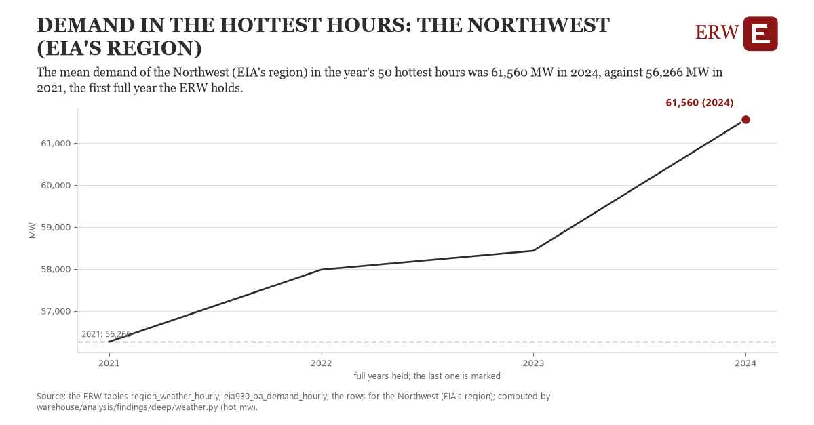

# Demand in the hottest hours: the Northwest (EIA's region)

Draft `scan-deep-2cece337b9a6` of the findings hunt over the whole warehouse (chain 502), 2026-11-19. State: draft, not reviewed. Review at `/internal/findings`.

**The finding.** The mean demand of the Northwest (EIA's region) in the year's 50 hottest hours was 61,560 MW in 2024, against 56,266 MW in 2021, the first full year the ERW holds.

**The figure by full year** (MW): 2021: 56,266, 2022: 57,982, 2023: 58,434, 2024: 61,560.

**The tables and rows.** `region_weather_hourly`, `eia930_ba_demand_hourly`; the rows for the Northwest (EIA's region), region key `wx_nw` (the card's `hunt.region`), years 2021 to 2024. The yearly values: `hot-mw-wx-nw.csv`.

**Its strength.** The change is 2.08 typical yearly moves (a typical move is 2,545 MW, 1.4826 times the median absolute change between full years). Holds in more than one year: 3 of the 3 full years after 2021 lie above 2021's value. Survives a change of window: from 2022 to 2024 the change is 3,578, from 2021 to 2023 it is 2,168. Sample large enough: 2021 holds 8,356 and 2024 holds 8,290 observations; the floor is 8,000. Half the change remains without the first year: from 2022 to 2024 the change is 3,578, 67.6 percent of the change from 2021. At least one typical yearly move: the change is 2.08 typical yearly moves (2,545 MW a year, the median move between full years); the floor is 1.

**Its limits.** The region's temperature is the population-weighted mean of its chosen stations (docs/methods/region_weather.md); demand is the sum of its authorities that file it; a description of the year's extreme hours, not a model, and not adjusted for anything.

**Reproduce.** `python hot-mw-wx-nw.reproduce.py <the table's CSV>` and `do hot-mw-wx-nw.reproduce.do` (Stata) recompute the figures by year from the tables as the public downloads hold them; each names the expected values at its top.
