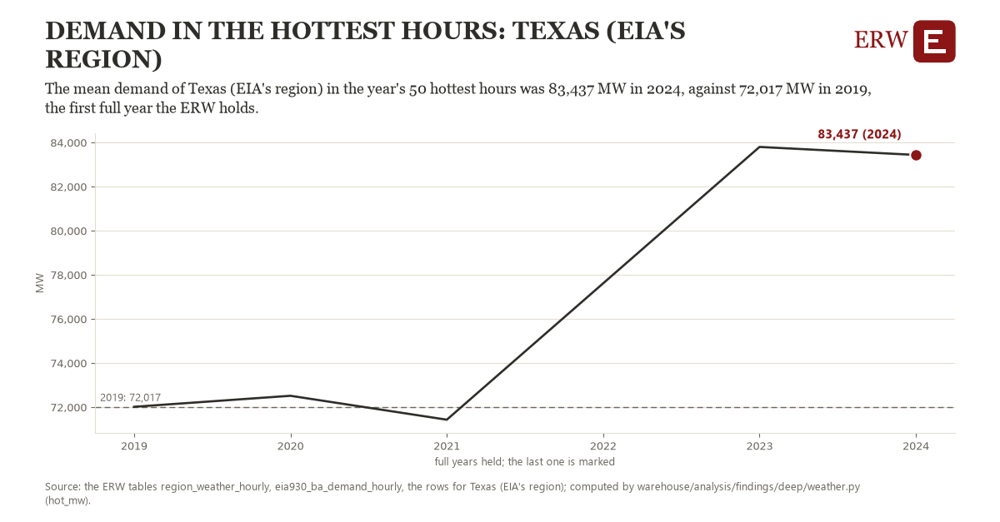

# Demand in the hottest hours: Texas (EIA's region)

Draft `scan-deep-3d3746ca4b65` of the findings hunt over the whole warehouse (chain 502), 2026-11-19. State: draft, not reviewed. Review at `/internal/findings`.

**The finding.** The mean demand of Texas (EIA's region) in the year's 50 hottest hours was 83,437 MW in 2024, against 72,017 MW in 2019, the first full year the ERW holds.

**The figure by full year** (MW): 2019: 72,017, 2020: 72,517, 2021: 71,432, 2022: 77,616, 2023: 83,800, 2024: 83,437.

**The tables and rows.** `region_weather_hourly`, `eia930_ba_demand_hourly`; the rows for Texas (EIA's region), region key `wx_tex` (the card's `hunt.region`), years 2019 to 2024. The yearly values: `hot-mw-wx-tex.csv`.

**Its strength.** The change is 7.10 typical yearly moves (a typical move is 1,608 MW, 1.4826 times the median absolute change between full years). Holds in more than one year: 4 of the 5 full years after 2019 lie above 2019's value. Survives a change of window: from 2020 to 2024 the change is 10,921, from 2019 to 2023 it is 11,783. Sample large enough: 2019 holds 8,288 and 2024 holds 8,110 observations; the floor is 8,000. Half the change remains without the first year: from 2020 to 2024 the change is 10,921, 95.6 percent of the change from 2019. At least one typical yearly move: the change is 7.10 typical yearly moves (1,608 MW a year, the median move between full years); the floor is 1.

**Its limits.** The region's temperature is the population-weighted mean of its chosen stations (docs/methods/region_weather.md); demand is the sum of its authorities that file it; a description of the year's extreme hours, not a model, and not adjusted for anything.

**Reproduce.** `python hot-mw-wx-tex.reproduce.py <the table's CSV>` and `do hot-mw-wx-tex.reproduce.do` (Stata) recompute the figures by year from the tables as the public downloads hold them; each names the expected values at its top.
