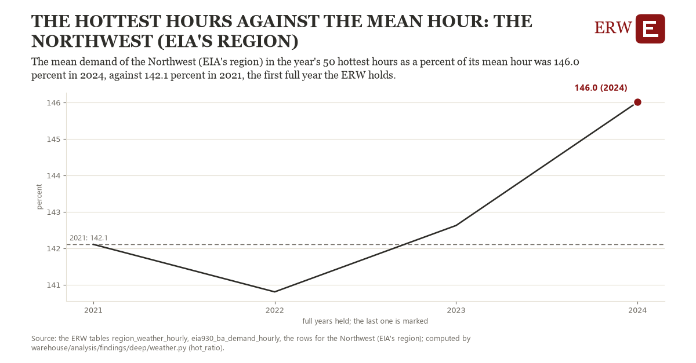

# The hottest hours against the mean hour: the Northwest (EIA's region)

Draft `scan-deep-ed8cf06c8a93` of the findings hunt over the whole warehouse (chain 502), 2026-11-19. State: draft, not reviewed. Review at `/internal/findings`.

**The finding.** The mean demand of the Northwest (EIA's region) in the year's 50 hottest hours as a percent of its mean hour was 146.0 percent in 2024, against 142.1 percent in 2021, the first full year the ERW holds.

**The figure by full year** (percent): 2021: 142.1, 2022: 140.8, 2023: 142.6, 2024: 146.0.

**The tables and rows.** `region_weather_hourly`, `eia930_ba_demand_hourly`; the rows for the Northwest (EIA's region), region key `wx_nw` (the card's `hunt.region`), years 2021 to 2024. The yearly values: `hot-ratio-wx-nw.csv`.

**Its strength.** The change is 1.44 typical yearly moves (a typical move is 2.7 percent, 1.4826 times the median absolute change between full years). Holds in more than one year: 2 of the 3 full years after 2021 lie above 2021's value. Survives a change of window: from 2022 to 2024 the change is 5.2, from 2021 to 2023 it is 0.5. Sample large enough: 2021 holds 8,356 and 2024 holds 8,290 observations; the floor is 8,000. Half the change remains without the first year: from 2022 to 2024 the change is 5.2, 133.4 percent of the change from 2021. At least one typical yearly move: the change is 1.44 typical yearly moves (2.7 percent a year, the median move between full years); the floor is 1.

**Its limits.** The region's temperature is the population-weighted mean of its chosen stations (docs/methods/region_weather.md); demand is the sum of its authorities that file it; a description of the year's extreme hours, not a model, and not adjusted for anything.

**Reproduce.** `python hot-ratio-wx-nw.reproduce.py <the table's CSV>` and `do hot-ratio-wx-nw.reproduce.do` (Stata) recompute the figures by year from the tables as the public downloads hold them; each names the expected values at its top.
