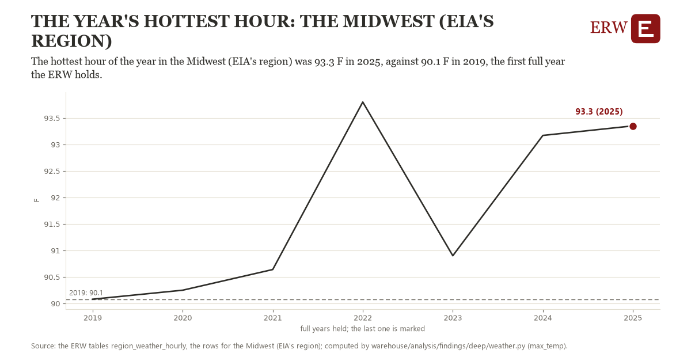

# The year's hottest hour: the Midwest (EIA's region)

Draft `scan-deep-feb9754d6bbb` of the findings hunt over the whole warehouse (chain 502), 2026-11-19. State: draft, not reviewed. Review at `/internal/findings`.

**The finding.** The hottest hour of the year in the Midwest (EIA's region) was 93.3 F in 2025, against 90.1 F in 2019, the first full year the ERW holds.

**The figure by full year** (F): 2019: 90.1, 2020: 90.2, 2021: 90.6, 2022: 93.8, 2023: 90.9, 2024: 93.2, 2025: 93.3.

**The tables and rows.** `region_weather_hourly`; the rows for the Midwest (EIA's region), region key `wt_midw` (the card's `hunt.region`), years 2019 to 2025. The yearly values: `max-temp-wt-midw.csv`.

**Its strength.** The change is 1.66 typical yearly moves (a typical move is 2.0 F, 1.4826 times the median absolute change between full years). Holds in more than one year: 6 of the 6 full years after 2019 lie above 2019's value. Survives a change of window: from 2020 to 2025 the change is 3.1, from 2019 to 2024 it is 3.1. Sample large enough: 2019 holds 8,526 and 2025 holds 8,190 observations; the floor is 8,000. Half the change remains without the first year: from 2020 to 2025 the change is 3.1, 94.8 percent of the change from 2019. At least one typical yearly move: the change is 1.66 typical yearly moves (2.0 F a year, the median move between full years); the floor is 1.

**Its limits.** The region's population-weighted temperature, one hour; a weighted mean is milder than its hottest station.

**Reproduce.** `python max-temp-wt-midw.reproduce.py <the table's CSV>` and `do max-temp-wt-midw.reproduce.do` (Stata) recompute the figures by year from the tables as the public downloads hold them; each names the expected values at its top.
