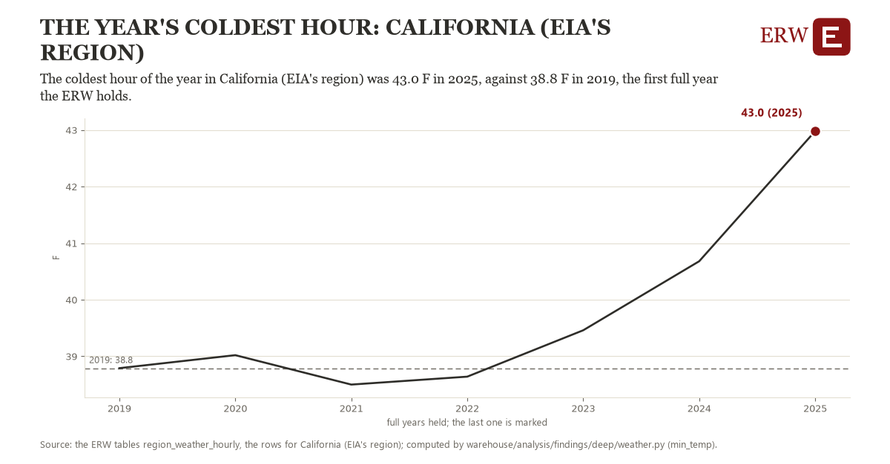

# The year's coldest hour: California (EIA's region)

Draft `scan-deep-89a5d3fb3dff` of the findings hunt over the whole warehouse (chain 502), 2026-11-19. State: draft, not reviewed. Review at `/internal/findings`.

**The finding.** The coldest hour of the year in California (EIA's region) was 43.0 F in 2025, against 38.8 F in 2019, the first full year the ERW holds.

**The figure by full year** (F): 2019: 38.8, 2020: 39.0, 2021: 38.5, 2022: 38.6, 2023: 39.5, 2024: 40.7, 2025: 43.0.

**The tables and rows.** `region_weather_hourly`; the rows for California (EIA's region), region key `wt_cal` (the card's `hunt.region`), years 2019 to 2025. The yearly values: `min-temp-wt-cal.csv`.

**Its strength.** The change is 4.22 typical yearly moves (a typical move is 1.0 F, 1.4826 times the median absolute change between full years). Holds in more than one year: 4 of the 6 full years after 2019 lie above 2019's value. Survives a change of window: from 2020 to 2025 the change is 4.0, from 2019 to 2024 it is 1.9. Sample large enough: 2019 holds 8,452 and 2025 holds 8,200 observations; the floor is 8,000. Half the change remains without the first year: from 2020 to 2025 the change is 4.0, 94.5 percent of the change from 2019. At least one typical yearly move: the change is 4.22 typical yearly moves (1.0 F a year, the median move between full years); the floor is 1.

**Its limits.** The region's population-weighted temperature, one hour; a weighted mean is milder than its coldest station.

**Reproduce.** `python min-temp-wt-cal.reproduce.py <the table's CSV>` and `do min-temp-wt-cal.reproduce.do` (Stata) recompute the figures by year from the tables as the public downloads hold them; each names the expected values at its top.
