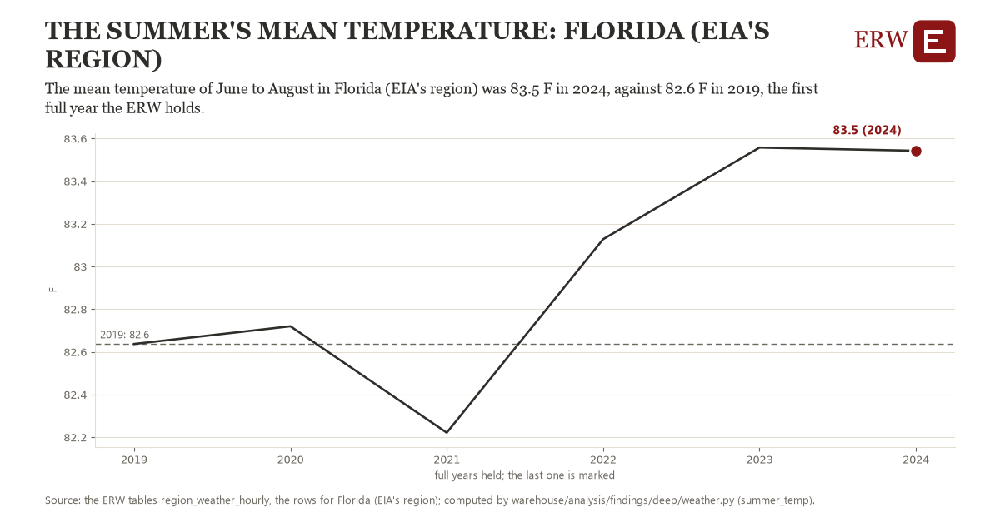

# The summer's mean temperature: Florida (EIA's region)

Draft `scan-deep-6a34396af3ae` of the findings hunt over the whole warehouse (chain 502), 2026-11-19. State: draft, not reviewed. Review at `/internal/findings`.

**The finding.** The mean temperature of June to August in Florida (EIA's region) was 83.5 F in 2024, against 82.6 F in 2019, the first full year the ERW holds.

**The figure by full year** (F): 2019: 82.6, 2020: 82.7, 2021: 82.2, 2022: 83.1, 2023: 83.6, 2024: 83.5.

**The tables and rows.** `region_weather_hourly`; the rows for Florida (EIA's region), region key `wt_fla` (the card's `hunt.region`), years 2019 to 2024. The yearly values: `summer-temp-wt-fla.csv`.

**Its strength.** The change is 1.42 typical yearly moves (a typical move is 0.6 F, 1.4826 times the median absolute change between full years). Holds in more than one year: 4 of the 5 full years after 2019 lie above 2019's value. Survives a change of window: from 2020 to 2024 the change is 0.8, from 2019 to 2023 it is 0.9. Sample large enough: 2019 holds 2,070 and 2024 holds 2,157 observations; the floor is 2,000. Half the change remains without the first year: from 2020 to 2024 the change is 0.8, 90.8 percent of the change from 2019. At least one typical yearly move: the change is 1.42 typical yearly moves (0.6 F a year, the median move between full years); the floor is 1.

**Its limits.** The region's population-weighted temperature, hours every chosen station holds.

**Reproduce.** `python summer-temp-wt-fla.reproduce.py <the table's CSV>` and `do summer-temp-wt-fla.reproduce.do` (Stata) recompute the figures by year from the tables as the public downloads hold them; each names the expected values at its top.
