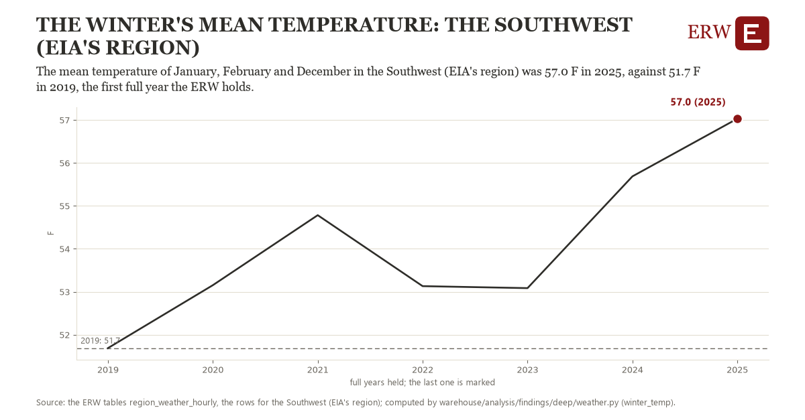

# The winter's mean temperature: the Southwest (EIA's region)

Draft `scan-deep-1f60eeb79427` of the findings hunt over the whole warehouse (chain 502), 2026-11-19. State: draft, not reviewed. Review at `/internal/findings`.

**The finding.** The mean temperature of January, February and December in the Southwest (EIA's region) was 57.0 F in 2025, against 51.7 F in 2019, the first full year the ERW holds.

**The figure by full year** (F): 2019: 51.7, 2020: 53.2, 2021: 54.8, 2022: 53.1, 2023: 53.1, 2024: 55.7, 2025: 57.0.

**The tables and rows.** `region_weather_hourly`; the rows for the Southwest (EIA's region), region key `wt_sw` (the card's `hunt.region`), years 2019 to 2025. The yearly values: `winter-temp-wt-sw.csv`.

**Its strength.** The change is 2.33 typical yearly moves (a typical move is 2.3 F, 1.4826 times the median absolute change between full years). Holds in more than one year: 6 of the 6 full years after 2019 lie above 2019's value. Survives a change of window: from 2020 to 2025 the change is 3.9, from 2019 to 2024 it is 4.0. Sample large enough: 2019 holds 2,160 and 2025 holds 2,160 observations; the floor is 2,000. Half the change remains without the first year: from 2020 to 2025 the change is 3.9, 72.6 percent of the change from 2019. At least one typical yearly move: the change is 2.33 typical yearly moves (2.3 F a year, the median move between full years); the floor is 1.

**Its limits.** The region's population-weighted temperature, hours every chosen station holds; a year's winter is its own January, February and December.

**Reproduce.** `python winter-temp-wt-sw.reproduce.py <the table's CSV>` and `do winter-temp-wt-sw.reproduce.do` (Stata) recompute the figures by year from the tables as the public downloads hold them; each names the expected values at its top.
