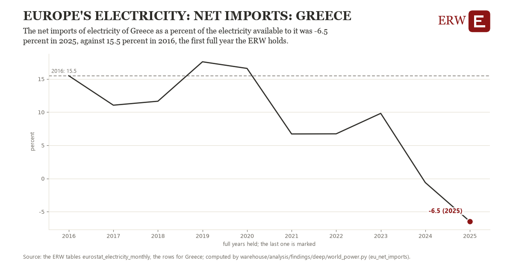

# Europe's electricity: net imports: Greece

Draft `scan-deep-4ff2bcb0d82f` of the findings hunt over the whole warehouse (chain 502), 2026-11-19. State: draft, not reviewed. Review at `/internal/findings`.

**The finding.** The net imports of electricity of Greece as a percent of the electricity available to it were -6.5 percent in 2025, against 15.5 percent in 2016, the first full year the ERW holds.

**The figure by full year** (percent): 2016: 15.5, 2017: 11.0, 2018: 11.6, 2019: 17.6, 2020: 16.6, 2021: 6.7, 2022: 6.7, 2023: 9.8, 2024: -0.6, 2025: -6.5.

**The tables and rows.** `eurostat_electricity_monthly`; the rows for Greece, region key `eu_el` (the card's `hunt.region`), years 2016 to 2025. The yearly values: `eu-net-imports-eu-el.csv`.

**Its strength.** The change is 3.34 typical yearly moves (a typical move is 6.6 percent, 1.4826 times the median absolute change between full years). Holds in more than one year: 7 of the 9 full years after 2016 lie below 2016's value. Survives a change of window: from 2017 to 2025 the change is -17.5, from 2016 to 2024 it is -16.1. Sample large enough: 2016 holds 12 and 2025 holds 12 observations; the floor is 12. Half the change remains without the first year: from 2017 to 2025 the change is -17.5, 79.8 percent of the change from 2016. At least one typical yearly move: the change is 3.34 typical yearly moves (6.6 percent a year, the median move between full years); the floor is 1.

**Its limits.** Eurostat's monthly electricity statistics as published, the latest months provisional; net production; a year counts with all twelve months of every figure. A negative figure is a year of net exports.

**Reproduce.** `python eu-net-imports-eu-el.reproduce.py <the table's CSV>` and `do eu-net-imports-eu-el.reproduce.do` (Stata) recompute the figures by year from the tables as the public downloads hold them; each names the expected values at its top.
