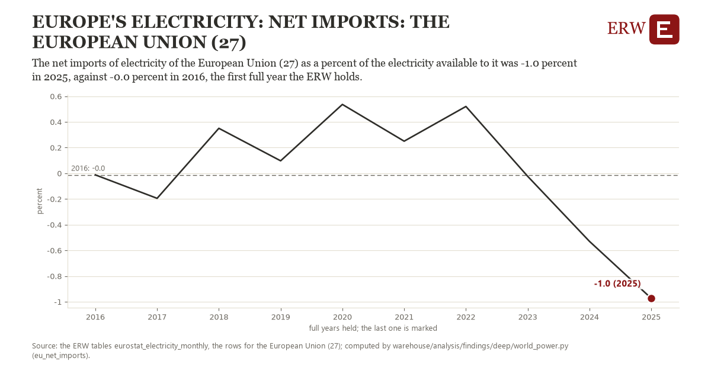

# Europe's electricity: net imports: the European Union (27)

Draft `scan-deep-452a9453718a` of the findings hunt over the whole warehouse (chain 502), 2026-11-19. State: draft, not reviewed. Review at `/internal/findings`.

**The finding.** The net imports of electricity of the European Union (27) as a percent of the electricity available to it were -1.0 percent in 2025, against -0.0 percent in 2016, the first full year the ERW holds.

**The figure by full year** (percent): 2016: -0.0, 2017: -0.2, 2018: 0.4, 2019: 0.1, 2020: 0.5, 2021: 0.2, 2022: 0.5, 2023: -0.0, 2024: -0.5, 2025: -1.0.

**The tables and rows.** `eurostat_electricity_monthly`; the rows for the European Union (27), region key `eu_eu27_2020` (the card's `hunt.region`), years 2016 to 2025. The yearly values: `eu-net-imports-eu-eu27-2020.csv`.

**Its strength.** The change is 1.48 typical yearly moves (a typical move is 0.7 percent, 1.4826 times the median absolute change between full years). Holds in more than one year: 4 of the 9 full years after 2016 lie below 2016's value. Survives a change of window: from 2017 to 2025 the change is -0.8, from 2016 to 2024 it is -0.5. Sample large enough: 2016 holds 12 and 2025 holds 12 observations; the floor is 12. Half the change remains without the first year: from 2017 to 2025 the change is -0.8, 81.0 percent of the change from 2016. At least one typical yearly move: the change is 1.48 typical yearly moves (0.7 percent a year, the median move between full years); the floor is 1.

**Its limits.** Eurostat's monthly electricity statistics as published, the latest months provisional; net production; a year counts with all twelve months of every figure. A negative figure is a year of net exports.

**Reproduce.** `python eu-net-imports-eu-eu27-2020.reproduce.py <the table's CSV>` and `do eu-net-imports-eu-eu27-2020.reproduce.do` (Stata) recompute the figures by year from the tables as the public downloads hold them; each names the expected values at its top.
