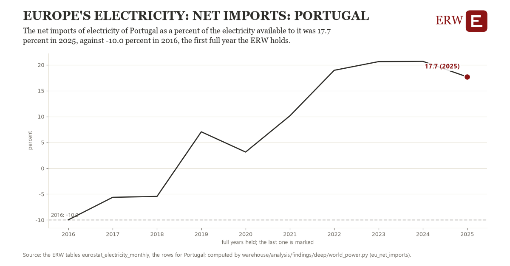

# Europe's electricity: net imports: Portugal

Draft `scan-deep-516ff5645088` of the findings hunt over the whole warehouse (chain 502), 2026-11-19. State: draft, not reviewed. Review at `/internal/findings`.

**The finding.** The net imports of electricity of Portugal as a percent of the electricity available to it were 17.7 percent in 2025, against -10.0 percent in 2016, the first full year the ERW holds.

**The figure by full year** (percent): 2016: -10.0, 2017: -5.6, 2018: -5.5, 2019: 7.0, 2020: 3.1, 2021: 10.1, 2022: 18.9, 2023: 20.6, 2024: 20.7, 2025: 17.7.

**The tables and rows.** `eurostat_electricity_monthly`; the rows for Portugal, region key `eu_pt` (the card's `hunt.region`), years 2016 to 2025. The yearly values: `eu-net-imports-eu-pt.csv`.

**Its strength.** The change is 4.76 typical yearly moves (a typical move is 5.8 percent, 1.4826 times the median absolute change between full years). Holds in more than one year: 9 of the 9 full years after 2016 lie above 2016's value. Survives a change of window: from 2017 to 2025 the change is 23.3, from 2016 to 2024 it is 30.6. Sample large enough: 2016 holds 12 and 2025 holds 12 observations; the floor is 12. Half the change remains without the first year: from 2017 to 2025 the change is 23.3, 84.3 percent of the change from 2016. At least one typical yearly move: the change is 4.76 typical yearly moves (5.8 percent a year, the median move between full years); the floor is 1.

**Its limits.** Eurostat's monthly electricity statistics as published, the latest months provisional; net production; a year counts with all twelve months of every figure. A negative figure is a year of net exports.

**Reproduce.** `python eu-net-imports-eu-pt.reproduce.py <the table's CSV>` and `do eu-net-imports-eu-pt.reproduce.do` (Stata) recompute the figures by year from the tables as the public downloads hold them; each names the expected values at its top.
