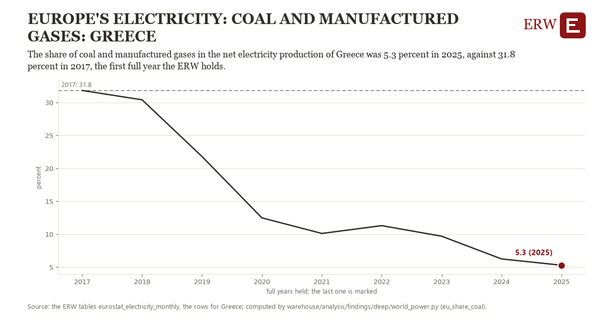

# Europe's electricity: coal and manufactured gases: Greece

Draft `scan-deep-4ea41746e6f5` of the findings hunt over the whole warehouse (chain 502), 2026-11-19. State: draft, not reviewed. Review at `/internal/findings`.

**The finding.** The share of coal and manufactured gases in the net electricity production of Greece was 5.3 percent in 2025, against 31.8 percent in 2017, the first full year the ERW holds.

**The figure by full year** (percent): 2017: 31.8, 2018: 30.4, 2019: 21.8, 2020: 12.5, 2021: 10.1, 2022: 11.3, 2023: 9.7, 2024: 6.2, 2025: 5.3.

**The tables and rows.** `eurostat_electricity_monthly`; the rows for Greece, region key `eu_el` (the card's `hunt.region`), years 2017 to 2025. The yearly values: `eu-share-coal-eu-el.csv`.

**Its strength.** The change is 9.01 typical yearly moves (a typical move is 2.9 percent, 1.4826 times the median absolute change between full years). Holds in more than one year: 8 of the 8 full years after 2017 lie below 2017's value. Survives a change of window: from 2018 to 2025 the change is -25.1, from 2017 to 2024 it is -25.6. Sample large enough: 2017 holds 12 and 2025 holds 12 observations; the floor is 12. Half the change remains without the first year: from 2018 to 2025 the change is -25.1, 94.6 percent of the change from 2017. At least one typical yearly move: the change is 9.01 typical yearly moves (2.9 percent a year, the median move between full years); the floor is 1.

**Its limits.** Eurostat's monthly electricity statistics as published, the latest months provisional; net production; a year counts with all twelve months of every figure.

**Reproduce.** `python eu-share-coal-eu-el.reproduce.py <the table's CSV>` and `do eu-share-coal-eu-el.reproduce.do` (Stata) recompute the figures by year from the tables as the public downloads hold them; each names the expected values at its top.
