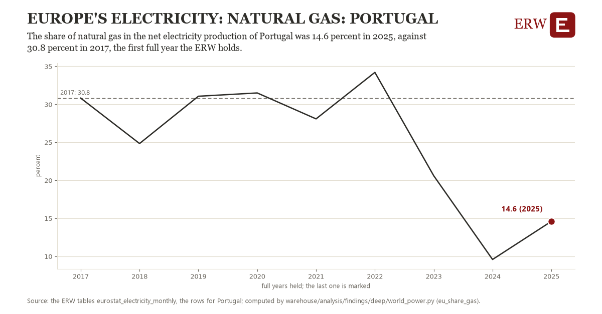

# Europe's electricity: natural gas: Portugal

Draft `scan-deep-883110dbaf5c` of the findings hunt over the whole warehouse (chain 502), 2026-11-19. State: draft, not reviewed. Review at `/internal/findings`.

**The finding.** The share of natural gas in the net electricity production of Portugal was 14.6 percent in 2025, against 30.8 percent in 2017, the first full year the ERW holds.

**The figure by full year** (percent): 2017: 30.8, 2018: 24.8, 2019: 31.1, 2020: 31.5, 2021: 28.1, 2022: 34.2, 2023: 20.6, 2024: 9.6, 2025: 14.6.

**The tables and rows.** `eurostat_electricity_monthly`; the rows for Portugal, region key `eu_pt` (the card's `hunt.region`), years 2017 to 2025. The yearly values: `eu-share-gas-eu-pt.csv`.

**Its strength.** The change is 1.81 typical yearly moves (a typical move is 9.0 percent, 1.4826 times the median absolute change between full years). Holds in more than one year: 5 of the 8 full years after 2017 lie below 2017's value. Survives a change of window: from 2018 to 2025 the change is -10.2, from 2017 to 2024 it is -21.2. Sample large enough: 2017 holds 12 and 2025 holds 12 observations; the floor is 12. Half the change remains without the first year: from 2018 to 2025 the change is -10.2, 63.2 percent of the change from 2017. At least one typical yearly move: the change is 1.81 typical yearly moves (9.0 percent a year, the median move between full years); the floor is 1.

**Its limits.** Eurostat's monthly electricity statistics as published, the latest months provisional; net production; a year counts with all twelve months of every figure.

**Reproduce.** `python eu-share-gas-eu-pt.reproduce.py <the table's CSV>` and `do eu-share-gas-eu-pt.reproduce.do` (Stata) recompute the figures by year from the tables as the public downloads hold them; each names the expected values at its top.
