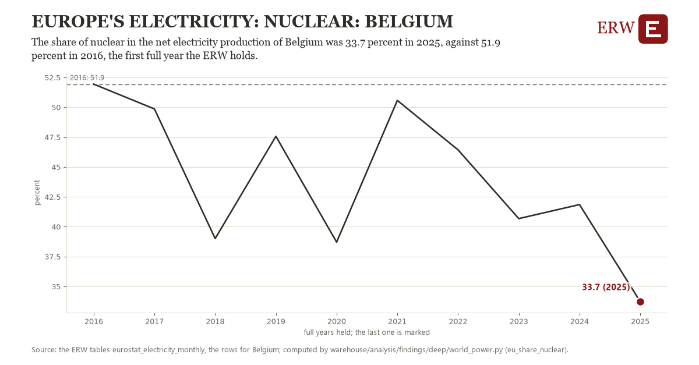

# Europe's electricity: nuclear: Belgium

Draft `scan-deep-41e126a41753` of the findings hunt over the whole warehouse (chain 502), 2026-11-19. State: draft, not reviewed. Review at `/internal/findings`.

**The finding.** The share of nuclear in the net electricity production of Belgium was 33.7 percent in 2025, against 51.9 percent in 2016, the first full year the ERW holds.

**The figure by full year** (percent): 2016: 51.9, 2017: 49.9, 2018: 39.0, 2019: 47.6, 2020: 38.7, 2021: 50.6, 2022: 46.4, 2023: 40.7, 2024: 41.8, 2025: 33.7.

**The tables and rows.** `eurostat_electricity_monthly`; the rows for Belgium, region key `eu_be` (the card's `hunt.region`), years 2016 to 2025. The yearly values: `eu-share-nuclear-eu-be.csv`.

**Its strength.** The change is 1.51 typical yearly moves (a typical move is 12.0 percent, 1.4826 times the median absolute change between full years). Holds in more than one year: 9 of the 9 full years after 2016 lie below 2016's value. Survives a change of window: from 2017 to 2025 the change is -16.1, from 2016 to 2024 it is -10.1. Sample large enough: 2016 holds 12 and 2025 holds 12 observations; the floor is 12. Half the change remains without the first year: from 2017 to 2025 the change is -16.1, 88.6 percent of the change from 2016. At least one typical yearly move: the change is 1.51 typical yearly moves (12.0 percent a year, the median move between full years); the floor is 1.

**Its limits.** Eurostat's monthly electricity statistics as published, the latest months provisional; net production; a year counts with all twelve months of every figure.

**Reproduce.** `python eu-share-nuclear-eu-be.reproduce.py <the table's CSV>` and `do eu-share-nuclear-eu-be.reproduce.do` (Stata) recompute the figures by year from the tables as the public downloads hold them; each names the expected values at its top.
