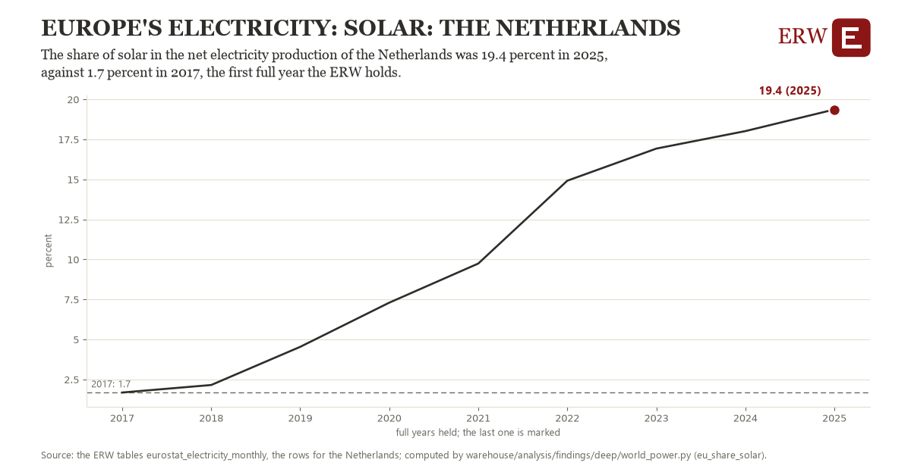

# Europe's electricity: solar: the Netherlands

Draft `scan-deep-22f4fef1531f` of the findings hunt over the whole warehouse (chain 502), 2026-11-19. State: draft, not reviewed. Review at `/internal/findings`.

**The finding.** The share of solar in the net electricity production of the Netherlands was 19.4 percent in 2025, against 1.7 percent in 2017, the first full year the ERW holds.

**The figure by full year** (percent): 2017: 1.7, 2018: 2.2, 2019: 4.5, 2020: 7.3, 2021: 9.7, 2022: 14.9, 2023: 16.9, 2024: 18.0, 2025: 19.4.

**The tables and rows.** `eurostat_electricity_monthly`; the rows for the Netherlands, region key `eu_nl` (the card's `hunt.region`), years 2017 to 2025. The yearly values: `eu-share-solar-eu-nl.csv`.

**Its strength.** The change is 5.43 typical yearly moves (a typical move is 3.3 percent, 1.4826 times the median absolute change between full years). Holds in more than one year: 8 of the 8 full years after 2017 lie above 2017's value. Survives a change of window: from 2018 to 2025 the change is 17.2, from 2017 to 2024 it is 16.3. Sample large enough: 2017 holds 12 and 2025 holds 12 observations; the floor is 12. Half the change remains without the first year: from 2018 to 2025 the change is 17.2, 97.3 percent of the change from 2017. At least one typical yearly move: the change is 5.43 typical yearly moves (3.3 percent a year, the median move between full years); the floor is 1.

**Its limits.** Eurostat's monthly electricity statistics as published, the latest months provisional; net production; a year counts with all twelve months of every figure.

**Reproduce.** `python eu-share-solar-eu-nl.reproduce.py <the table's CSV>` and `do eu-share-solar-eu-nl.reproduce.do` (Stata) recompute the figures by year from the tables as the public downloads hold them; each names the expected values at its top.
