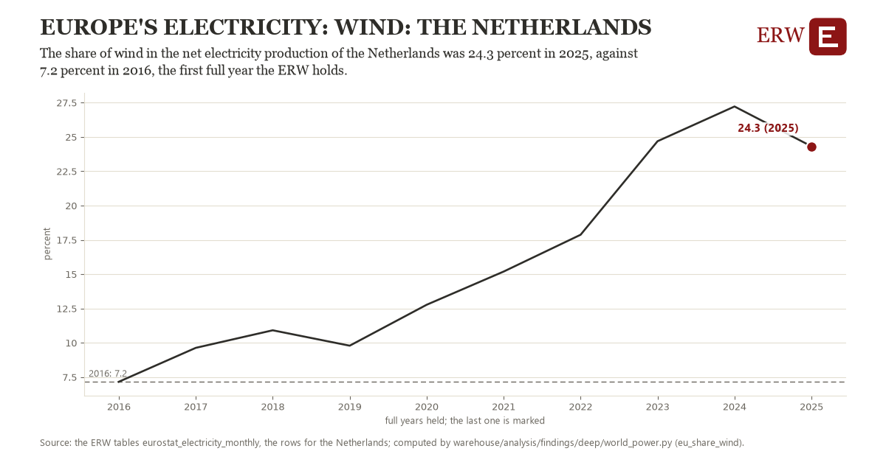

# Europe's electricity: wind: the Netherlands

Draft `scan-deep-24a5e99510de` of the findings hunt over the whole warehouse (chain 502), 2026-11-19. State: draft, not reviewed. Review at `/internal/findings`.

**The finding.** The share of wind in the net electricity production of the Netherlands was 24.3 percent in 2025, against 7.2 percent in 2016, the first full year the ERW holds.

**The figure by full year** (percent): 2016: 7.2, 2017: 9.6, 2018: 10.9, 2019: 9.8, 2020: 12.8, 2021: 15.2, 2022: 17.9, 2023: 24.7, 2024: 27.2, 2025: 24.3.

**The tables and rows.** `eurostat_electricity_monthly`; the rows for the Netherlands, region key `eu_nl` (the card's `hunt.region`), years 2016 to 2025. The yearly values: `eu-share-wind-eu-nl.csv`.

**Its strength.** The change is 4.57 typical yearly moves (a typical move is 3.8 percent, 1.4826 times the median absolute change between full years). Holds in more than one year: 9 of the 9 full years after 2016 lie above 2016's value. Survives a change of window: from 2017 to 2025 the change is 14.7, from 2016 to 2024 it is 20.1. Sample large enough: 2016 holds 12 and 2025 holds 12 observations; the floor is 12. Half the change remains without the first year: from 2017 to 2025 the change is 14.7, 85.6 percent of the change from 2016. At least one typical yearly move: the change is 4.57 typical yearly moves (3.8 percent a year, the median move between full years); the floor is 1.

**Its limits.** Eurostat's monthly electricity statistics as published, the latest months provisional; net production; a year counts with all twelve months of every figure.

**Reproduce.** `python eu-share-wind-eu-nl.reproduce.py <the table's CSV>` and `do eu-share-wind-eu-nl.reproduce.do` (Stata) recompute the figures by year from the tables as the public downloads hold them; each names the expected values at its top.
