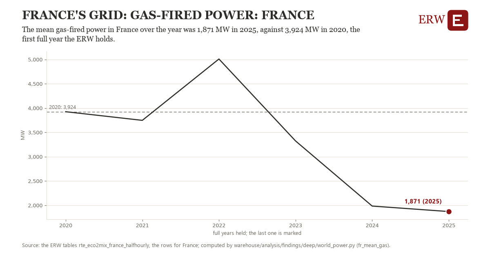

# France's grid: gas-fired power: France

Draft `scan-deep-f65330177ee3` of the findings hunt over the whole warehouse (chain 502), 2026-11-19. State: draft, not reviewed. Review at `/internal/findings`.

**The finding.** The mean gas-fired power in France over the year was 1,871 MW in 2025, against 3,924 MW in 2020, the first full year the ERW holds.

**The figure by full year** (MW): 2020: 3,924, 2021: 3,747, 2022: 5,008, 2023: 3,323, 2024: 1,984, 2025: 1,871.

**The tables and rows.** `rte_eco2mix_france_halfhourly`; the rows for France, region key `fr` (the card's `hunt.region`), years 2020 to 2025. The yearly values: `fr-mean-gas-fr.csv`.

**Its strength.** The change is 1.10 typical yearly moves (a typical move is 1,870 MW, 1.4826 times the median absolute change between full years). Holds in more than one year: 4 of the 5 full years after 2020 lie below 2020's value. Survives a change of window: from 2021 to 2025 the change is -1,876, from 2020 to 2024 it is -1,941. Sample large enough: 2020 holds 17,564 and 2025 holds 17,515 observations; the floor is 15,000. Half the change remains without the first year: from 2021 to 2025 the change is -1,876, 91.3 percent of the change from 2020. At least one typical yearly move: the change is 1.10 typical yearly moves (1,870 MW a year, the median move between full years); the floor is 1.

**Its limits.** RTE's eCO2mix national data, final for past years and consolidated or real-time for the latest; mainland France; a mean over the half-hours held.

**Reproduce.** `python fr-mean-gas-fr.reproduce.py <the table's CSV>` and `do fr-mean-gas-fr.reproduce.do` (Stata) recompute the figures by year from the tables as the public downloads hold them; each names the expected values at its top.
