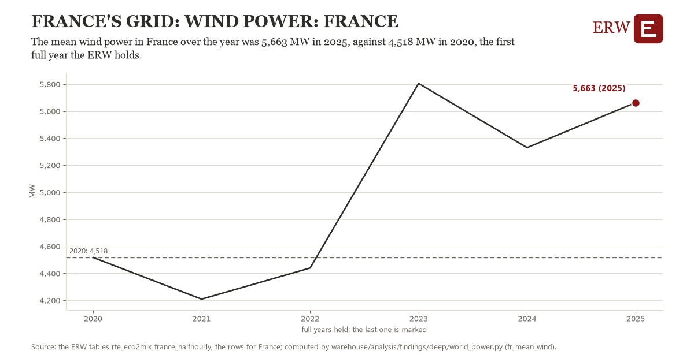

# France's grid: wind power: France

Draft `scan-deep-8ccc0cf88aa8` of the findings hunt over the whole warehouse (chain 502), 2026-11-19. State: draft, not reviewed. Review at `/internal/findings`.

**The finding.** The mean wind power in France over the year was 5,663 MW in 2025, against 4,518 MW in 2020, the first full year the ERW holds.

**The figure by full year** (MW): 2020: 4,518, 2021: 4,209, 2022: 4,440, 2023: 5,805, 2024: 5,330, 2025: 5,663.

**The tables and rows.** `rte_eco2mix_france_halfhourly`; the rows for France, region key `fr` (the card's `hunt.region`), years 2020 to 2025. The yearly values: `fr-mean-wind-fr.csv`.

**Its strength.** The change is 2.32 typical yearly moves (a typical move is 494 MW, 1.4826 times the median absolute change between full years). Holds in more than one year: 3 of the 5 full years after 2020 lie above 2020's value. Survives a change of window: from 2021 to 2025 the change is 1,454, from 2020 to 2024 it is 812. Sample large enough: 2020 holds 17,564 and 2025 holds 17,515 observations; the floor is 15,000. Half the change remains without the first year: from 2021 to 2025 the change is 1,454, 127.0 percent of the change from 2020. At least one typical yearly move: the change is 2.32 typical yearly moves (494 MW a year, the median move between full years); the floor is 1.

**Its limits.** RTE's eCO2mix national data, final for past years and consolidated or real-time for the latest; mainland France; a mean over the half-hours held.

**Reproduce.** `python fr-mean-wind-fr.reproduce.py <the table's CSV>` and `do fr-mean-wind-fr.reproduce.do` (Stata) recompute the figures by year from the tables as the public downloads hold them; each names the expected values at its top.
