# LinkedIn video posts, 24 November 2026 (session 9900)

Chain of 24 November 2026, night, on lab-desktop. Branch `wip/linkedin-posts-2026-11-24`, not landed. Nothing was posted or published anywhere. Model spend USD 0. Every video uses the approved template of 17 November unchanged (Part A: pixel-identical regression, in the note).

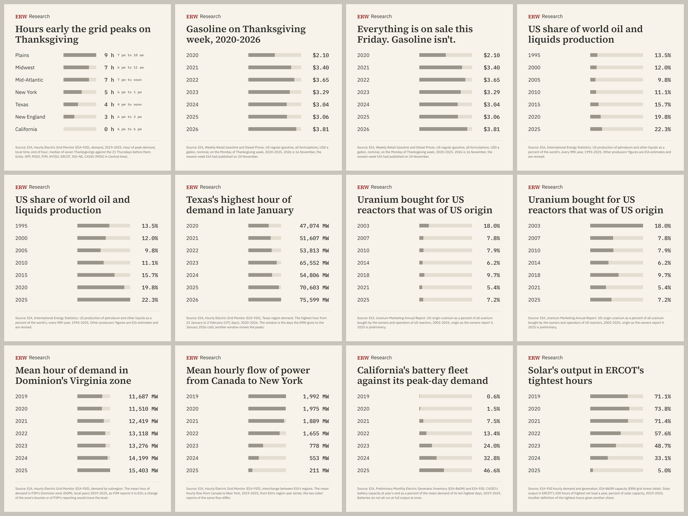

Final frames, left to right, top to bottom: Thanksgiving peak hour; gasoline A; gasoline B; US oil share A; US oil share B; Texas late-January peak; uranium A; uranium B; Dominion mean hour; Canada to New York; California batteries; ERCOT solar.

## Ready

- B2, Thanksgiving: the hour the grid peaks (seven grids, square and tall).
- B3, gasoline on Thanksgiving week, versions A and B (square and tall).
- C1, US share of world oil and liquids production, versions A (full scale 100%) and B (scale to the largest row).
- C2, Texas's highest hour of demand in late January, 2020-2026.
- C3, uranium of US origin, versions A (100%) and B (largest row).
- C4, the mean hour of demand in Dominion's Virginia zone.
- C5, the mean hourly flow from Canada to New York.
- C6, California's battery fleet against its peak-day demand.
- C7, solar's output in ERCOT's tightest hours.
- Every version passed the fit checks and the number check (84 rows, 0 mismatches).

## Decisions made without you

- MISO is drawn in Central time (where most of its load is); EIA's file stamps MISO in Eastern Standard Time, which is why the chat's cross-check read one hour later (11 to 13 and 19 or 20). The shift (7 hours) is the same in either clock.
- California is kept in B2: its 2024 and 2025 midday peaks are battery charging counted as demand (explained below); both medians are 6 pm either way.
- Clock times in B2 are the end of the peak hour (hour ending 19 is "7 pm"), as the chat's example "7 pm to noon" reads. B2's bars use the largest shift (9 h) as full.
- The 200 px track floor is applied to the 1080 x 1080 layout, as written; the tall layout scales every column by the template's 1.08 to 1.15, and B2's tall track is about 145 px (checked by eye, nothing overlaps).
- Number columns with a display text get the template's own 18 px of slack past the widest number. JavaScript's rounding is never used for a drawn figure: every display is written from the source digits rounded half up (toFixed would print 3.805 as $3.80 and 3.395 as $3.39).
- Percent posts use 100% as a full bar (the template's scale); MW and dollar posts use the largest row. For the two low shares (oil 22%, uranium 18%) both scales are rendered.
- Uranium: seven evenly spaced years from 2003 cannot all be held (EIA prints no US-origin figure for 2019, 2020 and 2022), so the years are 2003 plus steps of 22/6 rounded: 2003, 2007, 2010, 2014, 2018, 2021, 2025.
- Oil: 1995 to 2025 every five years (the table starts in 1993, within three years).
- Texas title shortened to "Texas's highest hour of demand in late January" (the first wording took three lines); the window, 23 January to 2 February, is in the source line.
- B3 uses 16 November 2026: at 10:32 UTC on 24 November EIA's API had not published 23 November.
- Sections 9 and 12 were not added: B1 is blocked, so not all ten posts were done.

## For Samuel's ruling

- **B1 (Nvidia) is blocked.** SEC EDGAR answered 403 ("Request Rate Threshold Exceeded") to the ERW's contact string at its robots file, as in sessions 2049 and 3304: SEC asks for a company name and a contact email in the User-Agent. Name the email (or decline) and a later session can pull the shares. For the closes, Stooq's robots file allows only Bing and Google, and Nasdaq reset the connection; no other price source was read. The data file holds the header and the block only: https://github.com/SamuelEnrique/erw/blob/wip/linkedin-posts-2026-11-24/docs/research/motion/posts/data/nvidia_energy_caps.csv
- B3 version B, "Everything is on sale this Friday. Gasoline isn't.": true against past Thanksgiving weeks (2026 is the highest since 1990), but gasoline fell 35 cents in the two weeks to 16 November ($4.153 to $3.805). Keep B, or use A?
- Oil and uranium: full scale (A) or largest row (B)? A is the template's scale and the honest one for a share; B shows the year-to-year change better.
- B2's tall layout: the bar track is about 145 px. Keep, or shorten the clock texts (for example "7pm-noon") for the tall master?
- California in B2: keep with "0 h", or drop it and render six grids with "Seven grids together" first?

## B1. Nvidia's one-day gain against US energy industries: blocked

Not rendered. SEC EDGAR refused the ERW's contact string at https://www.sec.gov/robots.txt (HTTP 403, 2026-11-24T10:24:39Z), so no shares were pulled; no price source was cleared either (Stooq disallows all but Bing and Google; Nasdaq reset the connection). The data file holds the header and the block: https://github.com/SamuelEnrique/erw/blob/wip/linkedin-posts-2026-11-24/docs/research/motion/posts/data/nvidia_energy_caps.csv. Under "For Samuel's ruling".

## B2. Thanksgiving: the hour the grid peaks

From `eia930_ba_demand_hourly` (retrieved 20261123T193514Z): for each grid, the local hour (end of hour) of highest demand on each Thanksgiving 2019-2025 and on the three Thursdays before each; the row is the median of the 21 Thursdays minus the median of the seven Thanksgivings. Every day's peak: https://github.com/SamuelEnrique/erw/blob/wip/linkedin-posts-2026-11-24/docs/research/motion/posts/data/thanksgiving_peak_hour_days.csv

- Cross-check with the chat's figures from EIA's raw files: MISO's Thanksgiving peaks are hour ending 10 to 12 Central (11 to 13 in EIA's Eastern Standard stamp) in all seven years, as the chat found; on normal Thursdays 18 of 21 peak at hour ending 18 or 19 Central (19 or 20 Eastern), and three peak in the morning (hour ending 8 Central: 4 November 2021, 17 November 2022, 2 November 2023). New England and New York peaked in the evening (hour ending 18) on Thanksgiving 2022, 2023 and 2025, as the chat found.
- California: on 13 November 2025 EIA-930 demand at hour ending 11 was 29,706 MW against CAISO's own forecast of 23,813 MW, while CAISO's batteries were charging at 6,899 MW (CAISO Today's Outlook, `caiso_fuel_supply`, the hour from 10:00 PST). The battery column of CISO's EIA-930 rows is empty, and evening demand matches the forecast (27,243 against 27,385 at hour ending 19), so battery charging is counted in demand while discharge is not subtracted: as the fleet grew, the midday hours overtook the evening on some days (2025's three Thursdays, Thanksgiving 2024 and 2025). Both medians are hour ending 18 either way, so the row (0 h) stands.

### Frames

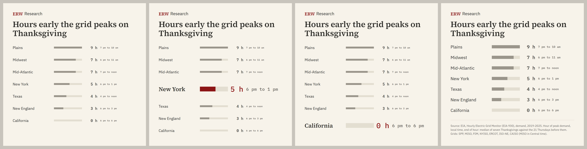

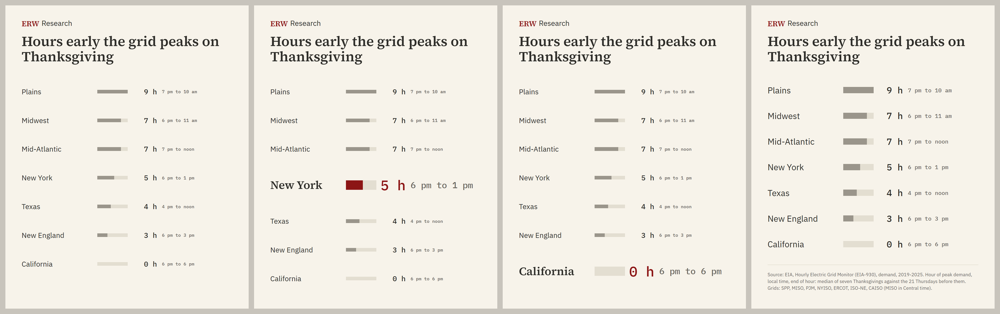

- Square video: https://github.com/SamuelEnrique/erw/blob/wip/linkedin-posts-2026-11-24/docs/research/motion/posts/thanksgiving_peak_hour_2160x2160.mp4
- Tall video: https://github.com/SamuelEnrique/erw/blob/wip/linkedin-posts-2026-11-24/docs/research/motion/posts/thanksgiving_peak_hour_2160x2700.mp4

Fit checks:

- 1080 x 1080: 32 checks passed, 0 failed (title in 2 line(s); source in 3 line(s); every label clear of its bar at its peak, nothing outside the margins). The final frame opened and read; the peaks checked by script and sampled by eye.
- 1080 x 1350: 32 checks passed, 0 failed (title in 2 line(s); source in 3 line(s); every label clear of its bar at its peak, nothing outside the margins). The final frame opened and read; the peaks checked by script and sampled by eye.

### Number check

| Row | Drawn | Second figure | Source value | Source | Equal to the last digit |
|---|---|---|---|---|---|
| Plains | 9 h | 7 pm to 10 am | SWPP: normal HE 19, Thanksgiving HE 10, shift 9 | eia930_ba_demand_hourly (20261123T193514Z), per-day peaks | yes |
| Midwest | 7 h | 6 pm to 11 am | MISO: normal HE 18, Thanksgiving HE 11, shift 7 | eia930_ba_demand_hourly (20261123T193514Z), per-day peaks | yes |
| Mid-Atlantic | 7 h | 7 pm to noon | PJM: normal HE 19, Thanksgiving HE 12, shift 7 | eia930_ba_demand_hourly (20261123T193514Z), per-day peaks | yes |
| New York | 5 h | 6 pm to 1 pm | NYIS: normal HE 18, Thanksgiving HE 13, shift 5 | eia930_ba_demand_hourly (20261123T193514Z), per-day peaks | yes |
| Texas | 4 h | 4 pm to noon | ERCO: normal HE 16, Thanksgiving HE 12, shift 4 | eia930_ba_demand_hourly (20261123T193514Z), per-day peaks | yes |
| New England | 3 h | 6 pm to 3 pm | ISNE: normal HE 18, Thanksgiving HE 15, shift 3 | eia930_ba_demand_hourly (20261123T193514Z), per-day peaks | yes |
| California | 0 h | 6 pm to 6 pm | CISO: normal HE 18, Thanksgiving HE 18, shift 0 | eia930_ba_demand_hourly (20261123T193514Z), per-day peaks | yes |

### Five facts for the caption

1. In all seven years, 2019-2025, the Midwest grid (MISO) peaked between 9 am and noon Central on Thanksgiving (hour ending 10 to 12). Source: EIA-930 via `eia930_ba_demand_hourly`; https://github.com/SamuelEnrique/erw/blob/wip/linkedin-posts-2026-11-24/docs/research/motion/posts/data/thanksgiving_peak_hour_days.csv.
2. The Plains grid (SPP) moves most: its normal November Thursday peak is the hour ending 7 pm, its Thanksgiving peak the hour ending 10 am (medians). Source: same.
3. PJM peaks at the hour ending noon on Thanksgiving against 7 pm on a normal Thursday (medians, Eastern time). Source: same.
4. New York peaked at the hour ending 1 pm on Thanksgiving in 2019, 2020, 2021 and 2024, and at the usual evening hour in 2022, 2023 and 2025. Source: same.
5. California's evening peak holds on Thanksgiving: the median is the hour ending 6 pm on both days. Source: same; note on battery charging above.

## B3. Black Friday: gasoline

From `eia_retail_fuel_prices` (EIA API v2, retrieved 20261120T150214Z), series EMM_EPMR_PTE_NUS_DPG, the Monday of Thanksgiving week 2020-2025; 2026 is 16 November, confirmed against EIA's API at 2026-11-24T10:32:45Z, which had not yet published 23 November. Bars full at $4.19 (1.1 times $3.805, rounded up). Cross-check from the chat (2.10, 3.40, 3.65, 3.29, 3.04, 3.06, 3.81): equal. Data: https://github.com/SamuelEnrique/erw/blob/wip/linkedin-posts-2026-11-24/docs/research/motion/posts/data/thanksgiving_week_fuel.csv

- Diesel (No. 2, US retail, EMD_EPD2D_PTE_NUS_DPG), Thanksgiving-week Monday, for the caption: 2020 $2.462, 2021 $3.724, 2022 $5.233, 2023 $4.209, 2024 $3.539, 2025 $3.831, 2026 (16 November) $5.937. 2026 is the highest Thanksgiving week in EIA's series (from 1994), nominal; it is not the series high, which is $6.529 on 21 September 2026.

### Frames (version A)

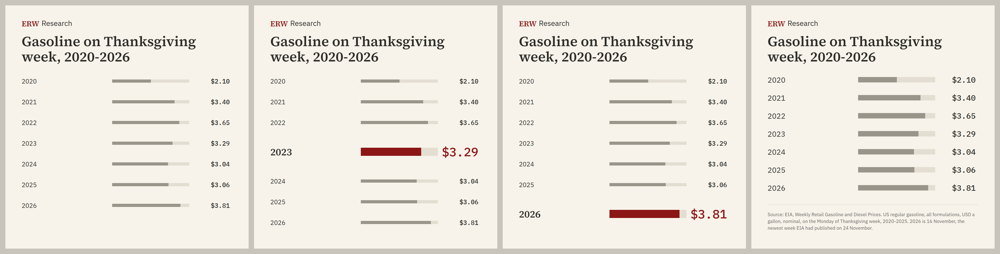

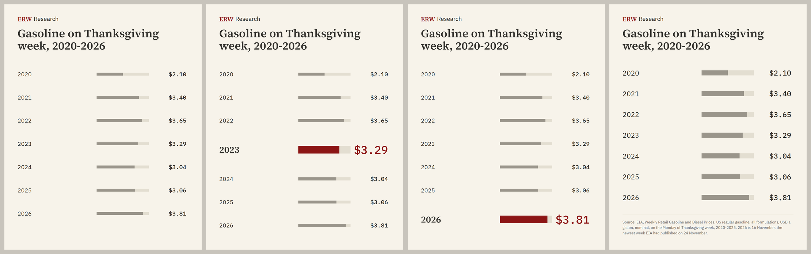

- Square video: https://github.com/SamuelEnrique/erw/blob/wip/linkedin-posts-2026-11-24/docs/research/motion/posts/thanksgiving_gasoline_a_2160x2160.mp4
- Tall video: https://github.com/SamuelEnrique/erw/blob/wip/linkedin-posts-2026-11-24/docs/research/motion/posts/thanksgiving_gasoline_a_2160x2700.mp4

Fit checks:

- 1080 x 1080: 25 checks passed, 0 failed (title in 2 line(s); source in 3 line(s); every label clear of its bar at its peak, nothing outside the margins). The final frame opened and read; the peaks checked by script and sampled by eye.
- 1080 x 1350: 25 checks passed, 0 failed (title in 2 line(s); source in 3 line(s); every label clear of its bar at its peak, nothing outside the margins). The final frame opened and read; the peaks checked by script and sampled by eye.

### Frames (version B)

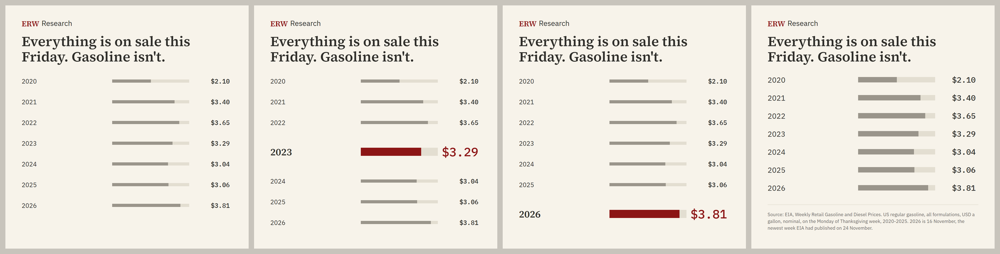

- Square video: https://github.com/SamuelEnrique/erw/blob/wip/linkedin-posts-2026-11-24/docs/research/motion/posts/thanksgiving_gasoline_b_2160x2160.mp4
- Tall video: https://github.com/SamuelEnrique/erw/blob/wip/linkedin-posts-2026-11-24/docs/research/motion/posts/thanksgiving_gasoline_b_2160x2700.mp4

Fit checks:

- 1080 x 1080: 25 checks passed, 0 failed (title in 2 line(s); source in 3 line(s); every label clear of its bar at its peak, nothing outside the margins). The final frame opened and read; the peaks checked by script and sampled by eye.
- 1080 x 1350: 25 checks passed, 0 failed (title in 2 line(s); source in 3 line(s); every label clear of its bar at its peak, nothing outside the margins). The final frame opened and read; the peaks checked by script and sampled by eye.

### Number check

| Row | Drawn | Second figure | Source value | Source | Equal to the last digit |
|---|---|---|---|---|---|
| 2020 | $2.10 |  | 2.102 (week of 2020-11-23) | eia_retail_fuel_prices, EMM_EPMR_PTE_NUS_DPG | yes |
| 2021 | $3.40 |  | 3.395 (week of 2021-11-22) | eia_retail_fuel_prices, EMM_EPMR_PTE_NUS_DPG | yes |
| 2022 | $3.65 |  | 3.648 (week of 2022-11-21) | eia_retail_fuel_prices, EMM_EPMR_PTE_NUS_DPG | yes |
| 2023 | $3.29 |  | 3.289 (week of 2023-11-20) | eia_retail_fuel_prices, EMM_EPMR_PTE_NUS_DPG | yes |
| 2024 | $3.04 |  | 3.044 (week of 2024-11-25) | eia_retail_fuel_prices, EMM_EPMR_PTE_NUS_DPG | yes |
| 2025 | $3.06 |  | 3.061 (week of 2025-11-24) | eia_retail_fuel_prices, EMM_EPMR_PTE_NUS_DPG | yes |
| 2026 | $3.81 |  | 3.805 (week of 2026-11-16; EIA API 3.805) | eia_retail_fuel_prices, EMM_EPMR_PTE_NUS_DPG | yes |

Version B carries the same rows (its own check: 7 of 7 equal).

### Five facts for the caption

1. $3.805 a gallon on 16 November 2026 is above every Thanksgiving-week Monday in EIA's series back to 1990, in nominal dollars; the previous high was $3.648 in 2022. Source: EIA Weekly Retail Gasoline and Diesel Prices via `eia_retail_fuel_prices`; https://github.com/SamuelEnrique/erw/blob/wip/linkedin-posts-2026-11-24/docs/research/motion/posts/data/thanksgiving_week_fuel.csv.
2. Gasoline has fallen for two weeks: $4.153 on 2 November, $3.995 on 9 November, $3.805 on 16 November 2026. Source: EIA API v2, read 2026-11-24T10:32:45Z: https://github.com/SamuelEnrique/erw/blob/wip/linkedin-posts-2026-11-24/docs/research/motion/posts/data/eia_fuel_latest_2026-11-24.json.
3. Thanksgiving-week gasoline is 81 percent above 2020's $2.102. Source: same table.
4. Diesel was $5.937 on 16 November 2026, the highest Thanksgiving-week price since EIA's diesel series began in 1994 (previous high $5.233 in 2022). Source: same table.
5. Diesel's record in EIA's series is $6.529, on 21 September 2026; 16 November is $0.59 below it. Source: same table.

## C1. Section 37: the US share of world oil production

Section 37's reproduce.py run again on `eia_world_oil_monthly`: https://github.com/SamuelEnrique/erw/blob/main/docs/findings/oil_products_world/us-liquids-share-us-world-liquids.reproduce.py (output: https://github.com/SamuelEnrique/erw/blob/wip/linkedin-posts-2026-11-24/docs/research/motion/posts/data/shortlist_s37_reproduce_2026-11-24.txt). Seven years every five from 1995 (the table starts in 1993).

### Frames (version A)

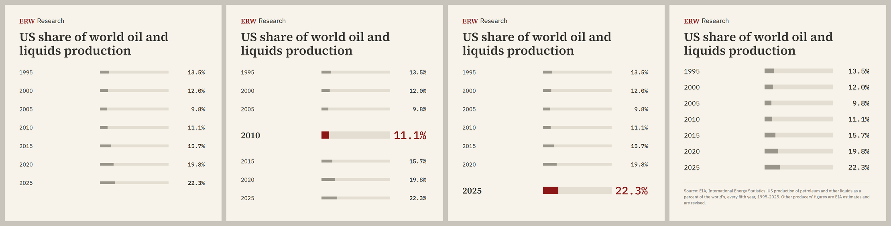

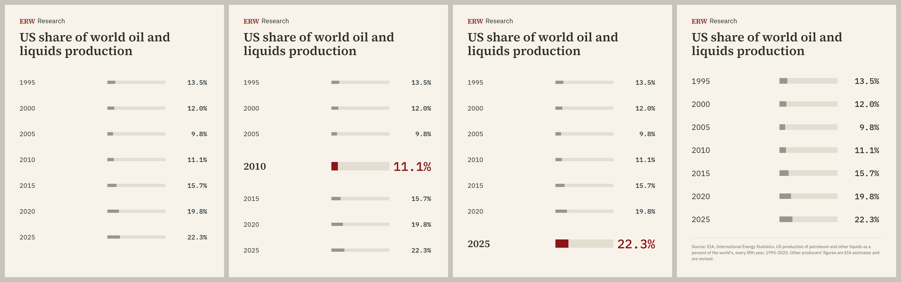

- Square video: https://github.com/SamuelEnrique/erw/blob/wip/linkedin-posts-2026-11-24/docs/research/motion/posts/us_share_world_oil_a_2160x2160.mp4
- Tall video: https://github.com/SamuelEnrique/erw/blob/wip/linkedin-posts-2026-11-24/docs/research/motion/posts/us_share_world_oil_a_2160x2700.mp4

Fit checks:

- 1080 x 1080: 25 checks passed, 0 failed (title in 2 line(s); source in 3 line(s); every label clear of its bar at its peak, nothing outside the margins). The final frame opened and read; the peaks checked by script and sampled by eye.
- 1080 x 1350: 25 checks passed, 0 failed (title in 2 line(s); source in 3 line(s); every label clear of its bar at its peak, nothing outside the margins). The final frame opened and read; the peaks checked by script and sampled by eye.

### Frames (version B)

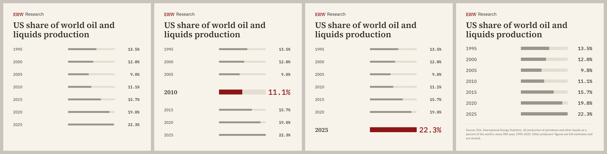

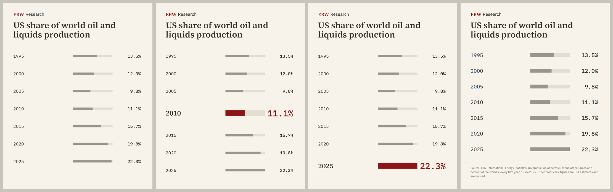

- Square video: https://github.com/SamuelEnrique/erw/blob/wip/linkedin-posts-2026-11-24/docs/research/motion/posts/us_share_world_oil_b_2160x2160.mp4
- Tall video: https://github.com/SamuelEnrique/erw/blob/wip/linkedin-posts-2026-11-24/docs/research/motion/posts/us_share_world_oil_b_2160x2700.mp4

Fit checks:

- 1080 x 1080: 25 checks passed, 0 failed (title in 2 line(s); source in 3 line(s); every label clear of its bar at its peak, nothing outside the margins). The final frame opened and read; the peaks checked by script and sampled by eye.
- 1080 x 1350: 25 checks passed, 0 failed (title in 2 line(s); source in 3 line(s); every label clear of its bar at its peak, nothing outside the margins). The final frame opened and read; the peaks checked by script and sampled by eye.

### Number check

| Row | Drawn | Second figure | Source value | Source | Equal to the last digit |
|---|---|---|---|---|---|
| 1995 | 13.5% |  | 13.481377 | section 37 reproduce.py, run 2026-11-24 | yes |
| 2000 | 12.0% |  | 11.979223 | section 37 reproduce.py, run 2026-11-24 | yes |
| 2005 | 9.8% |  | 9.833324 | section 37 reproduce.py, run 2026-11-24 | yes |
| 2010 | 11.1% |  | 11.098804 | section 37 reproduce.py, run 2026-11-24 | yes |
| 2015 | 15.7% |  | 15.681109 | section 37 reproduce.py, run 2026-11-24 | yes |
| 2020 | 19.8% |  | 19.794642 | section 37 reproduce.py, run 2026-11-24 | yes |
| 2025 | 22.3% |  | 22.322314 | section 37 reproduce.py, run 2026-11-24 | yes |

Version B carries the same rows (its own check: 7 of 7 equal).

### Five facts for the caption

1. The US produced 22.3 percent of the world's petroleum and other liquids in 2025, against 14.5 percent in 1993. Source: EIA International Energy Statistics, section 37's reproduction.
2. The low point was 9.8 percent, in 2006. Source: same.
3. The share has risen every year from 2019 (19.4 percent) to 2025 (22.3 percent). Source: same.
4. The first six months of 2026 give 24.0 percent (a half year). Source: same.
5. Caveat: other producers' figures are EIA estimates and are revised. Source: shortlist section 37.

## C2. Section 21: Texas in the late January cold

Section 21's reproduce.py run again on `eia930_ba_demand_hourly`: https://github.com/SamuelEnrique/erw/blob/main/docs/findings/events/cold-2026-tex.reproduce.py (output: https://github.com/SamuelEnrique/erw/blob/wip/linkedin-posts-2026-11-24/docs/research/motion/posts/data/shortlist_s21_reproduce_2026-11-24.txt). Years 2020 to 2026 as the chain asks; every year holds all 264 hours of the window.

### Frames

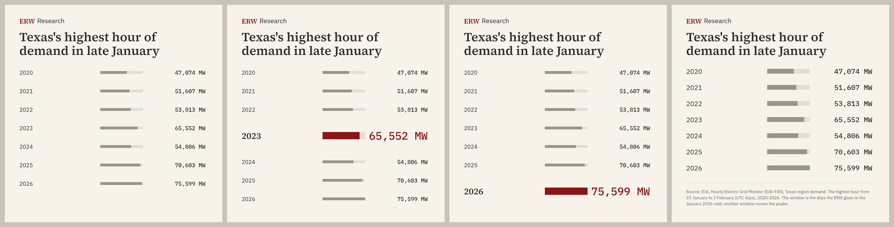

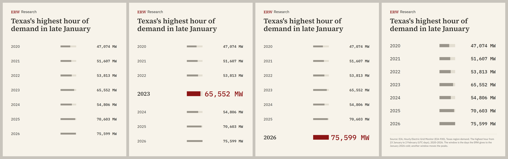

- Square video: https://github.com/SamuelEnrique/erw/blob/wip/linkedin-posts-2026-11-24/docs/research/motion/posts/texas_cold_peak_2160x2160.mp4
- Tall video: https://github.com/SamuelEnrique/erw/blob/wip/linkedin-posts-2026-11-24/docs/research/motion/posts/texas_cold_peak_2160x2700.mp4

Fit checks:

- 1080 x 1080: 25 checks passed, 0 failed (title in 2 line(s); source in 3 line(s); every label clear of its bar at its peak, nothing outside the margins). The final frame opened and read; the peaks checked by script and sampled by eye.
- 1080 x 1350: 25 checks passed, 0 failed (title in 2 line(s); source in 3 line(s); every label clear of its bar at its peak, nothing outside the margins). The final frame opened and read; the peaks checked by script and sampled by eye.

### Number check

| Row | Drawn | Second figure | Source value | Source | Equal to the last digit |
|---|---|---|---|---|---|
| 2020 | 47,074 MW |  | 47074.0 | section 21 reproduce.py, run 2026-11-24 | yes |
| 2021 | 51,607 MW |  | 51607.0 | section 21 reproduce.py, run 2026-11-24 | yes |
| 2022 | 53,813 MW |  | 53813.0 | section 21 reproduce.py, run 2026-11-24 | yes |
| 2023 | 65,552 MW |  | 65552.0 | section 21 reproduce.py, run 2026-11-24 | yes |
| 2024 | 54,806 MW |  | 54806.0 | section 21 reproduce.py, run 2026-11-24 | yes |
| 2025 | 70,603 MW |  | 70603.0 | section 21 reproduce.py, run 2026-11-24 | yes |
| 2026 | 75,599 MW |  | 75599.0 | section 21 reproduce.py, run 2026-11-24 | yes |

### Five facts for the caption

1. Texas's highest hour of demand from 23 January to 2 February 2026 was 75,599 MW. Source: EIA-930 via `eia930_ba_demand_hourly`, section 21's reproduction.
2. That is 32.9 percent above the mean of the same days' highest hours in 2019-2025 (56,873 MW). Source: same.
3. The same window peaked at 70,603 MW in 2025 and 47,074 MW in 2020. Source: same.
4. 2026's window peak is the highest of the eight years the ERW holds (2019-2026). Source: same.
5. Caveat: the window is the days the ERW's events page gives to the cold; another window moves the peaks. Source: shortlist section 21.

## C3. Section 24: uranium of US origin

Section 24's reproduce.py run again on `eia_uranium_marketing_annual`: https://github.com/SamuelEnrique/erw/blob/main/docs/findings/coal_uranium_metals/us-origin-uranium-us-uranium-origin.reproduce.py (output: https://github.com/SamuelEnrique/erw/blob/wip/linkedin-posts-2026-11-24/docs/research/motion/posts/data/shortlist_s24_reproduce_2026-11-24.txt). EIA prints no US-origin figure for 2019, 2020 and 2022 (the table keeps no row for W or -), so the years are 2003, 2007, 2010, 2014, 2018, 2021, 2025.

### Frames (version A)

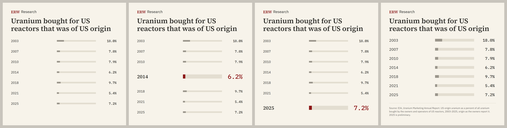

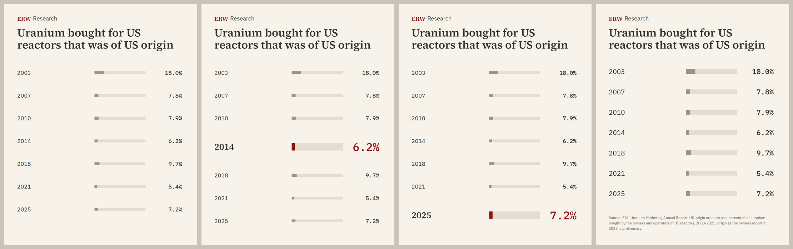

- Square video: https://github.com/SamuelEnrique/erw/blob/wip/linkedin-posts-2026-11-24/docs/research/motion/posts/uranium_us_origin_a_2160x2160.mp4
- Tall video: https://github.com/SamuelEnrique/erw/blob/wip/linkedin-posts-2026-11-24/docs/research/motion/posts/uranium_us_origin_a_2160x2700.mp4

Fit checks:

- 1080 x 1080: 25 checks passed, 0 failed (title in 2 line(s); source in 3 line(s); every label clear of its bar at its peak, nothing outside the margins). The final frame opened and read; the peaks checked by script and sampled by eye.
- 1080 x 1350: 25 checks passed, 0 failed (title in 2 line(s); source in 3 line(s); every label clear of its bar at its peak, nothing outside the margins). The final frame opened and read; the peaks checked by script and sampled by eye.

### Frames (version B)

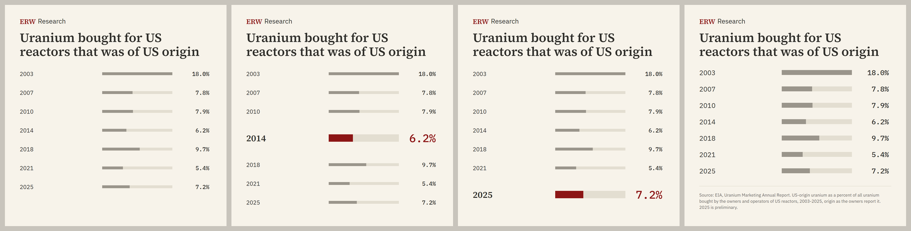

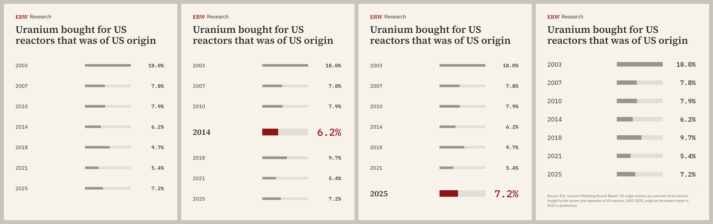

- Square video: https://github.com/SamuelEnrique/erw/blob/wip/linkedin-posts-2026-11-24/docs/research/motion/posts/uranium_us_origin_b_2160x2160.mp4
- Tall video: https://github.com/SamuelEnrique/erw/blob/wip/linkedin-posts-2026-11-24/docs/research/motion/posts/uranium_us_origin_b_2160x2700.mp4

Fit checks:

- 1080 x 1080: 25 checks passed, 0 failed (title in 2 line(s); source in 3 line(s); every label clear of its bar at its peak, nothing outside the margins). The final frame opened and read; the peaks checked by script and sampled by eye.
- 1080 x 1350: 25 checks passed, 0 failed (title in 2 line(s); source in 3 line(s); every label clear of its bar at its peak, nothing outside the margins). The final frame opened and read; the peaks checked by script and sampled by eye.

### Number check

| Row | Drawn | Second figure | Source value | Source | Equal to the last digit |
|---|---|---|---|---|---|
| 2003 | 18.0% |  | 18.036497 | section 24 reproduce.py, run 2026-11-24 | yes |
| 2007 | 7.8% |  | 7.792794 | section 24 reproduce.py, run 2026-11-24 | yes |
| 2010 | 7.9% |  | 7.915074 | section 24 reproduce.py, run 2026-11-24 | yes |
| 2014 | 6.2% |  | 6.215674 | section 24 reproduce.py, run 2026-11-24 | yes |
| 2018 | 9.7% |  | 9.677419 | section 24 reproduce.py, run 2026-11-24 | yes |
| 2021 | 5.4% |  | 5.353319 | section 24 reproduce.py, run 2026-11-24 | yes |
| 2025 | 7.2% |  | 7.249467 | section 24 reproduce.py, run 2026-11-24 | yes |

Version B carries the same rows (its own check: 7 of 7 equal).

### Five facts for the caption

1. 7.2 percent of the uranium bought for US reactors in 2025 was of US origin, against 18.0 percent in 2003. Source: EIA Uranium Marketing Annual Report, section 24's reproduction.
2. The highest share in EIA's report is 19.3 percent, in 2004. Source: same.
3. The lowest is 4.7 percent, in 2023. Source: same.
4. The share has not been above 10 percent since 2016 (10.7 percent). Source: same.
5. Caveat: origin as owners report it to EIA; 2025 is preliminary. Source: shortlist section 24.

## C4. Section 1: the mean hour of demand in the Dominion zone

Section 1's reproduce.py run again on `eia930_subba_demand_hourly_2019` to `_2025`: https://github.com/SamuelEnrique/erw/blob/main/docs/findings/demand/sub-mean-pjm-sub-dom.reproduce.py (output: https://github.com/SamuelEnrique/erw/blob/wip/linkedin-posts-2026-11-24/docs/research/motion/posts/data/shortlist_s1_reproduce_2026-11-24.txt).

### Frames

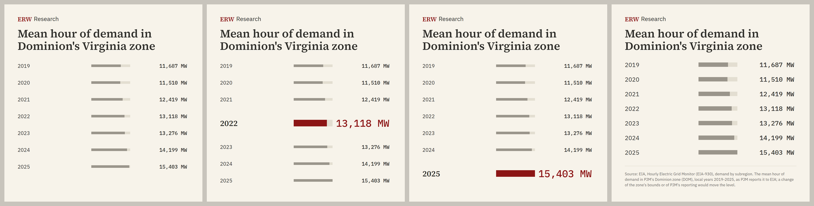

- Square video: https://github.com/SamuelEnrique/erw/blob/wip/linkedin-posts-2026-11-24/docs/research/motion/posts/dominion_mean_hour_2160x2160.mp4
- Tall video: https://github.com/SamuelEnrique/erw/blob/wip/linkedin-posts-2026-11-24/docs/research/motion/posts/dominion_mean_hour_2160x2700.mp4

Fit checks:

- 1080 x 1080: 25 checks passed, 0 failed (title in 2 line(s); source in 3 line(s); every label clear of its bar at its peak, nothing outside the margins). The final frame opened and read; the peaks checked by script and sampled by eye.
- 1080 x 1350: 25 checks passed, 0 failed (title in 2 line(s); source in 3 line(s); every label clear of its bar at its peak, nothing outside the margins). The final frame opened and read; the peaks checked by script and sampled by eye.

### Number check

| Row | Drawn | Second figure | Source value | Source | Equal to the last digit |
|---|---|---|---|---|---|
| 2019 | 11,687 MW |  | 11686.987407 | section 1 reproduce.py, run 2026-11-24 | yes |
| 2020 | 11,510 MW |  | 11509.635188 | section 1 reproduce.py, run 2026-11-24 | yes |
| 2021 | 12,419 MW |  | 12418.987668 | section 1 reproduce.py, run 2026-11-24 | yes |
| 2022 | 13,118 MW |  | 13118.070584 | section 1 reproduce.py, run 2026-11-24 | yes |
| 2023 | 13,276 MW |  | 13275.504994 | section 1 reproduce.py, run 2026-11-24 | yes |
| 2024 | 14,199 MW |  | 14198.916886 | section 1 reproduce.py, run 2026-11-24 | yes |
| 2025 | 15,403 MW |  | 15403.008477 | section 1 reproduce.py, run 2026-11-24 | yes |

### Five facts for the caption

1. The mean hour of demand in PJM's Dominion zone was 15,403 MW in 2025, against 11,687 MW in 2019: 31.8 percent higher. Source: EIA-930 subregion demand, section 1's reproduction.
2. It rose every year except 2020 (11,510 MW). Source: same.
3. 2025 alone added 1,204 MW to the mean hour (8.5 percent over 2024). Source: same.
4. Growth sped up: 12.2 percent from 2019 to 2022, 17.4 percent from 2022 to 2025. Source: same.
5. Caveat: the zone's demand as PJM reports it to EIA; a change of bounds or reporting would move the level. Source: shortlist section 1.

## C5. Section 8: the mean hourly flow from Canada to New York

Section 8's reproduce.py run again on `eia930_region_pair_hourly`: https://github.com/SamuelEnrique/erw/blob/main/docs/findings/trade/pair-flow-rp-can-ny.reproduce.py (output: https://github.com/SamuelEnrique/erw/blob/wip/linkedin-posts-2026-11-24/docs/research/motion/posts/data/shortlist_s8_reproduce_2026-11-24.txt).

### Frames

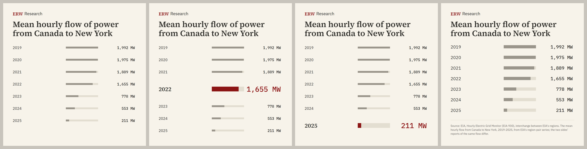

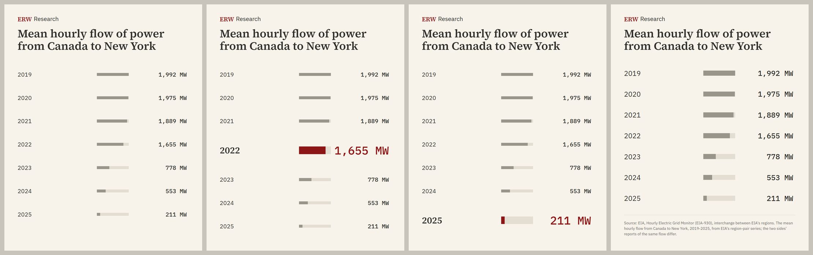

- Square video: https://github.com/SamuelEnrique/erw/blob/wip/linkedin-posts-2026-11-24/docs/research/motion/posts/canada_new_york_flow_2160x2160.mp4
- Tall video: https://github.com/SamuelEnrique/erw/blob/wip/linkedin-posts-2026-11-24/docs/research/motion/posts/canada_new_york_flow_2160x2700.mp4

Fit checks:

- 1080 x 1080: 25 checks passed, 0 failed (title in 2 line(s); source in 3 line(s); every label clear of its bar at its peak, nothing outside the margins). The final frame opened and read; the peaks checked by script and sampled by eye.
- 1080 x 1350: 25 checks passed, 0 failed (title in 2 line(s); source in 3 line(s); every label clear of its bar at its peak, nothing outside the margins). The final frame opened and read; the peaks checked by script and sampled by eye.

### Number check

| Row | Drawn | Second figure | Source value | Source | Equal to the last digit |
|---|---|---|---|---|---|
| 2019 | 1,992 MW |  | 1991.598516 | section 8 reproduce.py, run 2026-11-24 | yes |
| 2020 | 1,975 MW |  | 1974.572404 | section 8 reproduce.py, run 2026-11-24 | yes |
| 2021 | 1,889 MW |  | 1889.02032 | section 8 reproduce.py, run 2026-11-24 | yes |
| 2022 | 1,655 MW |  | 1654.924087 | section 8 reproduce.py, run 2026-11-24 | yes |
| 2023 | 778 MW |  | 777.827397 | section 8 reproduce.py, run 2026-11-24 | yes |
| 2024 | 553 MW |  | 552.940005 | section 8 reproduce.py, run 2026-11-24 | yes |
| 2025 | 211 MW |  | 211.028082 | section 8 reproduce.py, run 2026-11-24 | yes |

### Five facts for the caption

1. The mean hourly flow from Canada to New York was 211 MW in 2025, against 1,992 MW in 2019. Source: EIA-930 region-pair interchange, section 8's reproduction.
2. The largest one-year fall came in 2023: from 1,655 MW to 778 MW. Source: same.
3. 2026 to date (7,805 hours) gives 215 MW. Source: same.
4. 2019 to 2021 each held above 1,880 MW. Source: same.
5. Caveat: the two sides' reports of the same flow differ; this is EIA's region-pair series. Source: shortlist section 8.

## C6. Section 10: California's battery fleet against its peak-day demand

Section 10's reproduce.py run again on `storage_buildout_monthly` and `eia930_daily_demand`: https://github.com/SamuelEnrique/erw/blob/main/docs/findings/cross_family/battery-per-peak-caiso-bat-peak.reproduce.py (output: https://github.com/SamuelEnrique/erw/blob/wip/linkedin-posts-2026-11-24/docs/research/motion/posts/data/shortlist_s10_reproduce_2026-11-24.txt). The run prints 46.619278 for 2025, the draft's own figure (the shortlist's run printed 46.5676).

### Frames

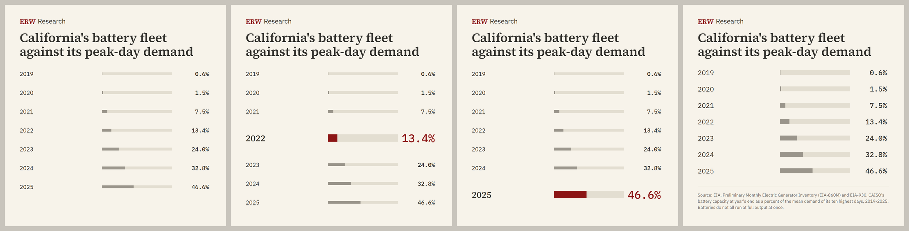

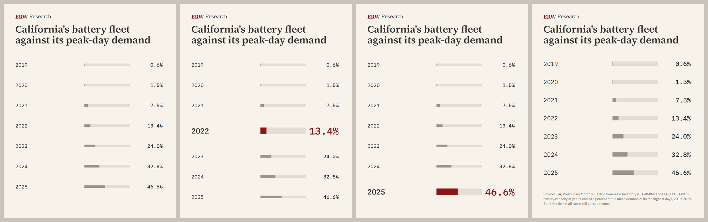

- Square video: https://github.com/SamuelEnrique/erw/blob/wip/linkedin-posts-2026-11-24/docs/research/motion/posts/caiso_battery_peak_2160x2160.mp4
- Tall video: https://github.com/SamuelEnrique/erw/blob/wip/linkedin-posts-2026-11-24/docs/research/motion/posts/caiso_battery_peak_2160x2700.mp4

Fit checks:

- 1080 x 1080: 25 checks passed, 0 failed (title in 2 line(s); source in 3 line(s); every label clear of its bar at its peak, nothing outside the margins). The final frame opened and read; the peaks checked by script and sampled by eye.
- 1080 x 1350: 25 checks passed, 0 failed (title in 2 line(s); source in 3 line(s); every label clear of its bar at its peak, nothing outside the margins). The final frame opened and read; the peaks checked by script and sampled by eye.

### Number check

| Row | Drawn | Second figure | Source value | Source | Equal to the last digit |
|---|---|---|---|---|---|
| 2019 | 0.6% |  | 0.554036 | section 10 reproduce.py, run 2026-11-24 | yes |
| 2020 | 1.5% |  | 1.545048 | section 10 reproduce.py, run 2026-11-24 | yes |
| 2021 | 7.5% |  | 7.531181 | section 10 reproduce.py, run 2026-11-24 | yes |
| 2022 | 13.4% |  | 13.402308 | section 10 reproduce.py, run 2026-11-24 | yes |
| 2023 | 24.0% |  | 23.991584 | section 10 reproduce.py, run 2026-11-24 | yes |
| 2024 | 32.8% |  | 32.807125 | section 10 reproduce.py, run 2026-11-24 | yes |
| 2025 | 46.6% |  | 46.619278 | section 10 reproduce.py, run 2026-11-24 | yes |

### Five facts for the caption

1. CAISO's battery fleet at the end of 2025 equalled 46.6 percent of the mean demand of its ten highest days. Source: EIA-860M and EIA-930, section 10's reproduction.
2. At the end of 2019 it was 0.6 percent. Source: same.
3. The ratio passed a quarter in 2024 (32.8 percent). Source: same.
4. It rose by 13.8 points in 2025 alone (32.8 to 46.6). Source: same.
5. Caveat: batteries do not all run at full output at once, and the fleet is EIA-860M's operating list. Source: shortlist section 10.

## C7. Section 3: solar's output in ERCOT's tightest hours

Section 3's reproduce.py run again on `grid_stress_yearly`: https://github.com/SamuelEnrique/erw/blob/main/docs/findings/markets_operations/tight-solar-ercot-tight-solar.reproduce.py (output: https://github.com/SamuelEnrique/erw/blob/wip/linkedin-posts-2026-11-24/docs/research/motion/posts/data/shortlist_s3_reproduce_2026-11-24.txt). The tightest hours are the year's 100 hours of highest net load (demand less wind less solar).

### Frames

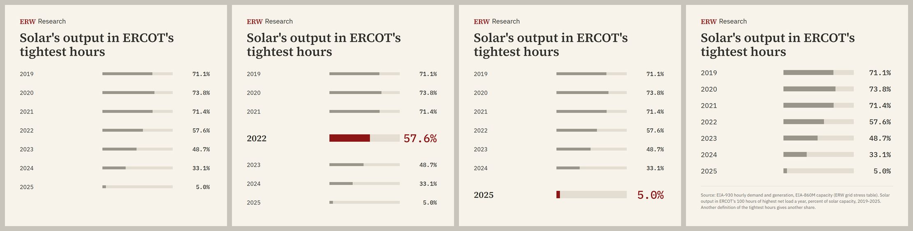

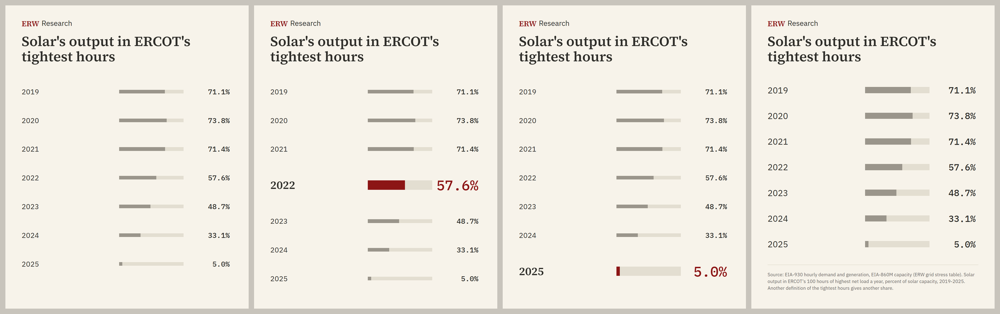

- Square video: https://github.com/SamuelEnrique/erw/blob/wip/linkedin-posts-2026-11-24/docs/research/motion/posts/ercot_solar_tight_hours_2160x2160.mp4
- Tall video: https://github.com/SamuelEnrique/erw/blob/wip/linkedin-posts-2026-11-24/docs/research/motion/posts/ercot_solar_tight_hours_2160x2700.mp4

Fit checks:

- 1080 x 1080: 25 checks passed, 0 failed (title in 2 line(s); source in 3 line(s); every label clear of its bar at its peak, nothing outside the margins). The final frame opened and read; the peaks checked by script and sampled by eye.
- 1080 x 1350: 25 checks passed, 0 failed (title in 2 line(s); source in 3 line(s); every label clear of its bar at its peak, nothing outside the margins). The final frame opened and read; the peaks checked by script and sampled by eye.

### Number check

| Row | Drawn | Second figure | Source value | Source | Equal to the last digit |
|---|---|---|---|---|---|
| 2019 | 71.1% |  | 71.103 | section 3 reproduce.py, run 2026-11-24 | yes |
| 2020 | 73.8% |  | 73.844 | section 3 reproduce.py, run 2026-11-24 | yes |
| 2021 | 71.4% |  | 71.434 | section 3 reproduce.py, run 2026-11-24 | yes |
| 2022 | 57.6% |  | 57.59 | section 3 reproduce.py, run 2026-11-24 | yes |
| 2023 | 48.7% |  | 48.655 | section 3 reproduce.py, run 2026-11-24 | yes |
| 2024 | 33.1% |  | 33.139 | section 3 reproduce.py, run 2026-11-24 | yes |
| 2025 | 5.0% |  | 5.022 | section 3 reproduce.py, run 2026-11-24 | yes |

### Five facts for the caption

1. In ERCOT's 100 tightest hours of 2025, solar gave 5.0 percent of its capacity, against 71.1 percent in 2019. Source: ERW grid stress table from EIA-930 and EIA-860M, section 3's reproduction.
2. The share was highest in 2020, 73.8 percent. Source: same.
3. It has been under half since 2023 (48.7 percent). Source: same.
4. 2026 to date gives 5.2 percent. Source: same.
5. Caveat: the tightest hours are the ERW's own definition; another would give another share. Source: shortlist section 3.
