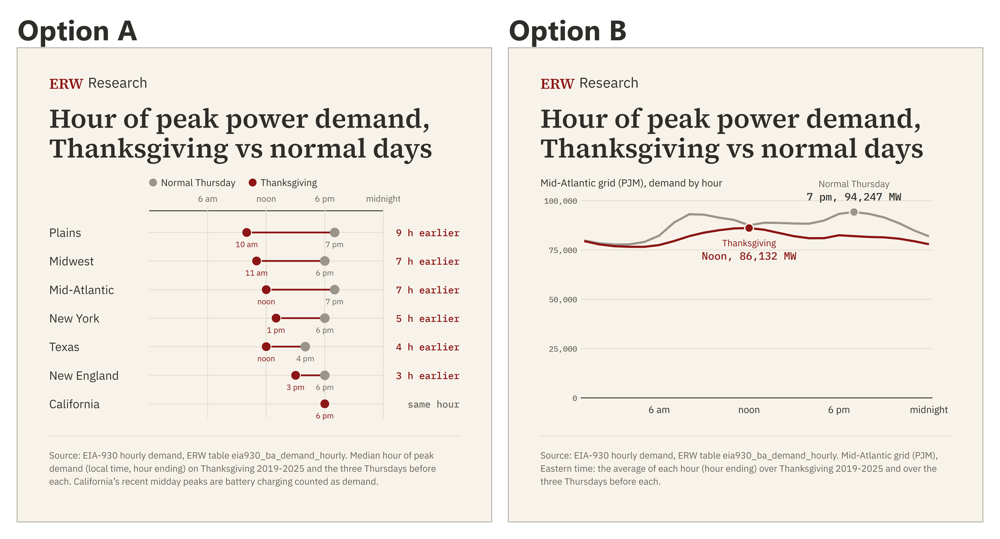
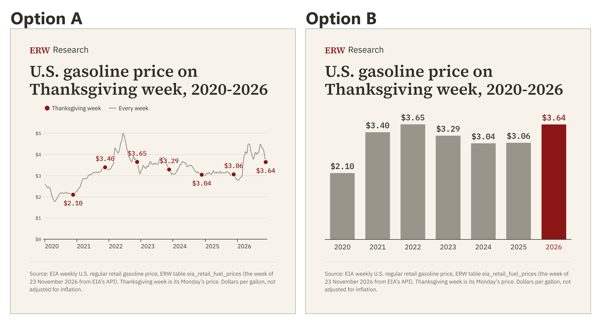
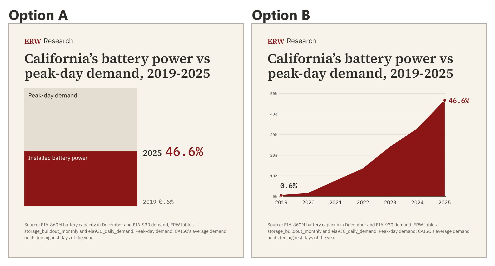
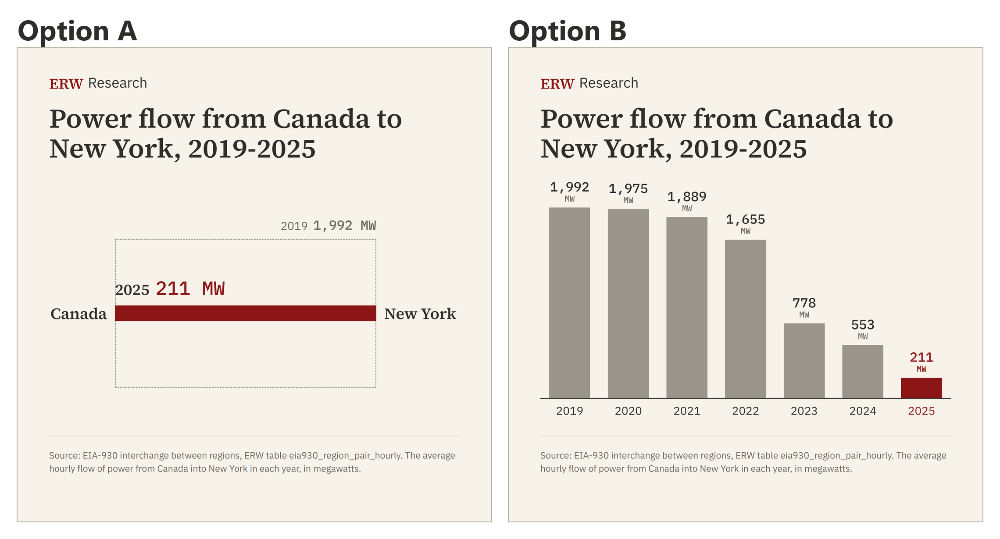
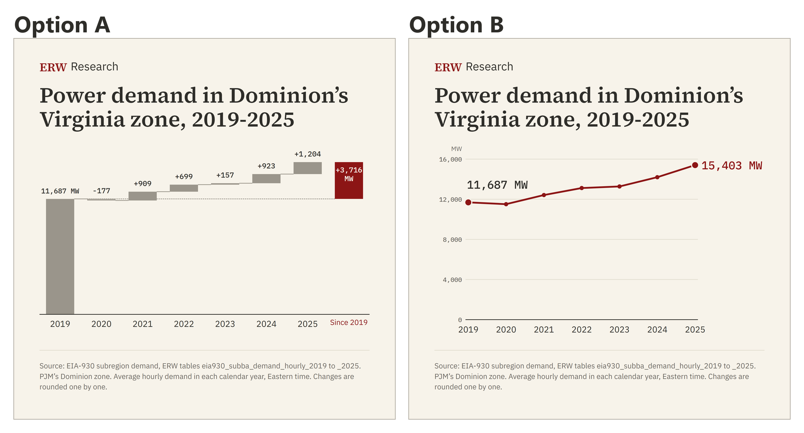
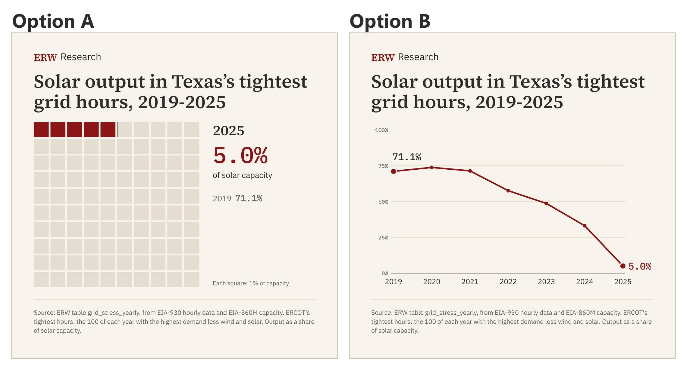
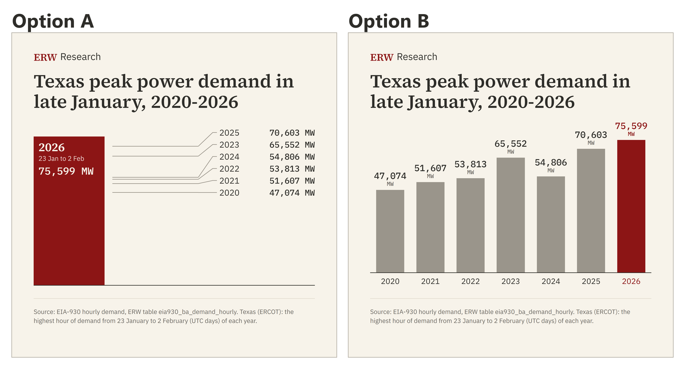
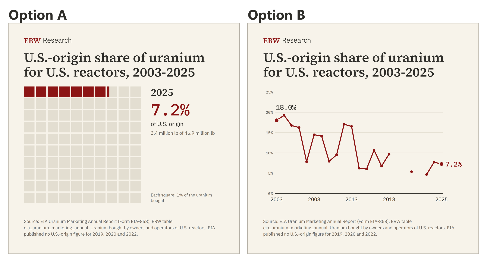
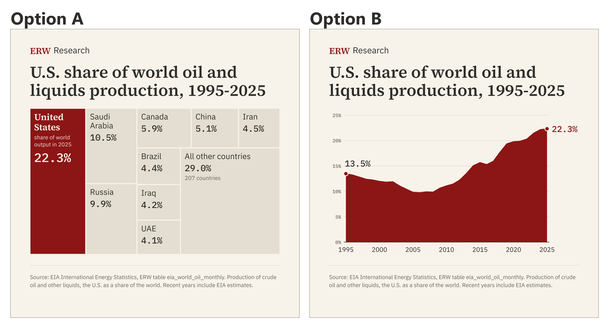

# ERW video posts, batch 2: nine posts, two chart options each (session 9901, 25 November 2026)

Branch `wip/linkedin-posts-2026-11-25`, not merged. Nothing posted, published or deployed. Model and API spend USD 0.

**Video status (read first).** Every option's stills are done and checked in all three shapes, and every comparison image is here. Videos exist for posts 1 to 4 (all 24) and for post 5 option A in the X and LinkedIn shapes. Claude Code stopped the render of the rest at 08:06 UTC because the machine ran low on memory, and its rule is not to restart such a job unasked; the commands that finish it are in `archive/sessions/SESSION_9901_REPORT.md` under "To finish". The comparison images of posts 5 to 9 are made from the same final frames rendered as stills.

How to review: open each post's comparison image (square final frames, A left, B right), pick one option, and play its video if you want to see the motion. Every option exists in three shapes: LinkedIn 1080 x 1350, X 1080 x 1080, Instagram 1080 x 1920 (rendered at scale 2), each with a thumbnail of its final frame.

- Videos: `docs/research/motion/posts/batch_2026-11-25/<post>/<post>_<a|b>_<linkedin|x|ig>.mp4`, thumbnails beside them (`..._thumb.png`).
- Data file of each post (every value, its ERW table, its original source, the method): `docs/research/motion/posts/batch_2026-11-25/data/<post>.json`.
- Specs: `motion/specs/posts/batch2/<post>_<a|b>.json`, written by `docs/research/motion/posts/batch_2026-11-25/scripts/build_9901.py`. Components: `motion/src/Batch2.tsx`.

What holds for every option:

- Header and title visible from frame 0; motion ends by frame 330; source line fades in at 368 to 382; still to frame 449.
- One cardinal element: the thing the title is about.
- Every bar, column, area and line starts at zero. Areas, lengths and heights are in exact proportion to the unrounded values; every printed figure is the source value rounded half up.
- No text below 18 px at 1080 scale (tick labels and clock-time labels are the smallest).
- Ten chart types across the 18 options; no option uses the ranked rows of the first post, and within each post A and B differ.

| # | Post | Option A | Option B | Status |
|---|---|---|---|---|
| 1 | Thanksgiving peak hour | Clock: two dots a region, the Thanksgiving dot slides | Two demand curves over the day (PJM) | A ready; B needs ruling |
| 2 | Thanksgiving gasoline | Weekly price line, Thanksgiving weeks marked | Seven columns, 2026 cardinal | ready |
| 3 | California batteries | One block (100%), filled year by year | Area by year | ready |
| 4 | Canada to New York | Flow band narrowing year by year | Seven columns | ready |
| 5 | Dominion demand | Staircase: 2019 level, yearly steps, total added | Line by year | ready |
| 6 | Texas solar in tight hours | 100 squares, stepping through the years | Line by year | ready |
| 7 | Texas late-January peak | Ladder: one column rising past each year | Seven columns | ready |
| 8 | Uranium of U.S. origin | 100 squares, 2025 (fallback, see caveat) | Line by year with EIA's gaps | ready |
| 9 | U.S. share of world oil | Proportional blocks by country, 2025 | Area by year | ready |

## 1. Hour of peak power demand, Thanksgiving vs normal days

- Finding: on Thanksgiving the grid peaks hours earlier than on a normal Thursday: nine hours earlier in the Plains, seven in the Midwest and Mid-Atlantic; California is the exception.
- Option A (clock, ready): each region on a 24-hour axis, the normal peak hour grey, the Thanksgiving peak hour cardinal, the cardinal dot sliding from evening to midday.
- Option B (two curves, needs ruling): the Mid-Atlantic grid (PJM), each hour's average demand on the 7 Thanksgivings and on the 21 Thursdays before them, each curve's peak marked. The plan said "a normal late-November Thursday"; one single Thursday would show one day's weather, so B averages the 21. Its peak hours (7 pm and noon) equal option A's PJM row. A single pair of days is a one-line change if you prefer it.
- Numbers (EIA-930, ERW table `eia930_ba_demand_hourly`, retrieved 20261124T181119Z; median of the hour ending, local prevailing time; MISO in Central):

| Region | Normal Thursday | Thanksgiving | Earlier by |
|---|---|---|---|
| Plains (SPP) | 7 pm | 10 am | 9 h |
| Midwest (MISO) | 6 pm | 11 am | 7 h |
| Mid-Atlantic (PJM) | 7 pm | noon | 7 h |
| New York (NYISO) | 6 pm | 1 pm | 5 h |
| Texas (ERCOT) | 4 pm | noon | 4 h |
| New England (ISO-NE) | 6 pm | 3 pm | 3 h |
| California (CAISO) | 6 pm | 6 pm | 0 h |

- Option B: normal Thursday peak 94,247 MW at hour ending 7 pm (94,247.095); Thanksgiving peak 86,132 MW at hour ending noon (86,132.143). Same table.
- Check: rerun of session 9900's `thanksgiving_peaks.py` on the current table gives a summary identical to the 24 November file, and every value equals section 5 of the prompt.
- Caveat: California's midday peaks in 2024 and 2025 are battery charging counted as demand (session 9900's finding); the source line says so. Clock times are the end of the peak hour.

## 2. U.S. gasoline price on Thanksgiving week, 2020-2026

- Finding: gasoline on Thanksgiving week 2026 ($3.642) is less than a cent below 2022 ($3.648) and 58 cents above 2025 ($3.061). Not a record; neither option says record or highest.
- Option A (weekly line, ready): every week since January 2020, Thanksgiving weeks as cardinal dots with their prices.
- Option B (columns, ready): seven columns, 2026 cardinal.
- Numbers (EIA weekly U.S. regular all formulations retail price, series EMM_EPMR_PTE_NUS_DPG, the Monday of Thanksgiving week, dollars per gallon):

| Year | Week of | Price | Drawn | From |
|---|---|---|---|---|
| 2020 | 2020-11-23 | 2.102 | $2.10 | `eia_retail_fuel_prices` |
| 2021 | 2021-11-22 | 3.395 | $3.40 | `eia_retail_fuel_prices` |
| 2022 | 2022-11-21 | 3.648 | $3.65 | `eia_retail_fuel_prices` |
| 2023 | 2023-11-20 | 3.289 | $3.29 | `eia_retail_fuel_prices` |
| 2024 | 2024-11-25 | 3.044 | $3.04 | `eia_retail_fuel_prices` |
| 2025 | 2025-11-24 | 3.061 | $3.06 | `eia_retail_fuel_prices` |
| 2026 | 2026-11-23 | 3.642 | $3.64 | EIA API v2, read 2026-11-25T07:29:55Z |

- Caveat: the ERW table on this machine was retrieved 20261120T150214Z and ends at 16 November 2026, so the week of 23 November comes from EIA's API (the table's own registered source, free). All 359 overlapping weeks from 2020-01-06 equal the table exactly. The source line names both. The spec of 24 November held $3.81 (16 November); it is replaced.

## 3. California's battery power vs peak-day demand, 2019-2025

- Finding: California's installed battery power went from 0.6% of its peak-day demand in 2019 to 46.6% in 2025.
- Title changed from the proposal ("California batteries as a share of peak demand") because the measure is installed power (MW) against the average demand of the ten highest days, not peak-hour demand; the proposal also ran to three lines in one wording.
- Option A (fill block, ready): one block is peak-day demand; the cardinal fill rises year by year; the year and share ride the fill's top.
- Option B (area, ready): the share by year, first and last labelled.
- Numbers (EIA-860M via `storage_buildout_monthly`, CAISO operating battery MW in December; EIA-930 via `eia930_daily_demand`, CISO; reproduce script `docs/findings/cross_family/battery-per-peak-caiso-bat-peak.reproduce.py`, rerun today): 2019 0.6% (0.554036), 2020 1.5% (1.545048), 2021 7.5% (7.531181), 2022 13.4% (13.402308), 2023 24.0% (23.991584), 2024 32.8% (32.807125), 2025 46.6% (46.619278).
- Caveat: batteries do not all run at full output at once; this is installed power, not delivered energy.

## 4. Power flow from Canada to New York, 2019-2025

- Finding: the average hourly flow from Canada into New York fell from 1,992 MW in 2019 to 211 MW in 2025.
- Option A (flow band, ready): a band from "Canada" to "New York" whose thickness is the megawatts, narrowing year by year, with the 2019 width kept as a dashed outline.
- Option B (columns, ready): seven columns, 2025 cardinal.
- Numbers (EIA-930 region-pair interchange, ERW table `eia930_region_pair_hourly`, entity `eia930:CAN-NY`, retrieved 20261124T181514Z; reproduce script `docs/findings/trade/pair-flow-rp-can-ny.reproduce.py`): 2019 1,992 MW (1,991.598516), 2020 1,975 (1,974.572404), 2021 1,889 (1,889.02032), 2022 1,655 (1,654.924087), 2023 778 (777.827397), 2024 553 (552.940005), 2025 211 (211.028082).
- Caveat: the two sides' reports of one flow differ; this is EIA's region-pair series as the ERW sums it.

## 5. Power demand in Dominion's Virginia zone, 2019-2025

- Finding: average hourly demand in the Dominion zone rose by 3,716 MW from 2019 to 2025 (11,687 to 15,403 MW), 1,204 MW of it in 2025 alone.
- Title changed from "Electricity demand in ..." (three lines) to "Power demand in ...".
- Option A (staircase, ready): the 2019 level as a grey column from zero, each year's change as a step, the total added since 2019 in cardinal.
- Option B (line, ready): one line by year, first and last labelled.
- Numbers (EIA-930 subregion demand, ERW tables `eia930_subba_demand_hourly_2019` to `_2025`, `eia930_subba:PJM:DOM`; reproduce script `docs/findings/demand/sub-mean-pjm-sub-dom.reproduce.py`): levels 2019 11,687 MW (11,686.987407), 2020 11,510 (11,509.635188), 2021 12,419 (12,418.987668), 2022 13,118 (13,118.070584), 2023 13,276 (13,275.504994), 2024 14,199 (14,198.916886), 2025 15,403 (15,403.008477). Steps: -177, +909, +699, +157, +923, +1,204; total +3,716 MW.
- Caveat: each step is rounded from its own unrounded change, so the six steps sum to 3,715 while the total rounds to 3,716; the source line says "Changes are rounded one by one". The steps are thin against a column from zero (the 2020 and 2023 steps are about 5 px): that is the honest scale.

## 6. Solar output in Texas's tightest grid hours, 2019-2025

- Finding: in ERCOT's 100 tightest hours, solar delivered 71.1% of its capacity in 2019 and 5.0% in 2025.
- Option A (100 squares, ready): the cardinal squares are the share, stepping through the years (the last square filled by its fraction, so 71.103 shows 71 squares and a tenth).
- Option B (line, ready): falling, first and last labelled.
- Numbers (ERW table `grid_stress_yearly`, `tight_solar_share_of_capacity_pct` of `iso:ercot`, from EIA-930 and EIA-860M, retrieved 20261006T095058Z; reproduce script `docs/findings/markets_operations/tight-solar-ercot-tight-solar.reproduce.py`): 2019 71.1% (71.103), 2020 73.8% (73.844), 2021 71.4% (71.434), 2022 57.6% (57.59), 2023 48.7% (48.655), 2024 33.1% (33.139), 2025 5.0% (5.022).
- Caveat: the tightest hours are the ERW's definition (the 100 hours of highest demand less wind less solar); another definition gives another share.

## 7. Texas peak power demand in late January, 2020-2026

- Finding: Texas's highest hour of demand from 23 January to 2 February reached 75,599 MW in 2026, above every year since 2020.
- Option A (ladder, ready): one cardinal column rises past each earlier year's level, ending at 2026. While it rises, its counter shows passing values; it stops on 75,599 MW.
- Option B (columns, ready): seven columns, 2026 cardinal.
- Numbers (EIA-930, ERW table `eia930_ba_demand_hourly`, region TEX, retrieved 20261124T181119Z; reproduce script `docs/findings/events/cold-2026-tex.reproduce.py`; every year holds all 264 hours): 2020 47,074 MW, 2021 51,607, 2022 53,813, 2023 65,552, 2024 54,806, 2025 70,603, 2026 75,599.
- Caveat: the window is the days the ERW's events page gives to the January 2026 cold; another window gives other peaks.

## 8. U.S.-origin share of uranium for U.S. reactors, 2003-2025

- Finding: 7.2% of the uranium bought for U.S. reactors in 2025 was of U.S. origin, against 18.0% in 2003.
- Title changed from "U.S.-origin uranium bought for U.S. reactors" to say it is a share; "bought" moved to the source line to keep two lines.
- Option A (100 squares, ready, fallback): the ERW table holds U.S. and foreign origin only, no country of origin, so the plan's fallback applies: a grid of 100 squares for 2025, with the pounds (3.4 million lb of 46.9 million lb). Note: this is the same chart type as post 6, option A.
- Option B (line, ready): the share by year, broken where EIA published no figure (2019, 2020, 2022), so 2021 stands alone as a dot.
- Numbers (EIA Uranium Marketing Annual Report, Form EIA-858, ERW table `eia_uranium_marketing_annual`, retrieved 20261023T070136Z; reproduce script `docs/findings/coal_uranium_metals/us-origin-uranium-us-uranium-origin.reproduce.py`): 2003 18.0% (18.036497), 2004 19.3, 2005 16.7, 2006 16.2, 2007 7.8, 2008 14.5, 2009 14.2, 2010 7.9, 2011 9.5, 2012 17.0, 2013 16.5, 2014 6.2, 2015 6.0, 2016 10.7, 2017 6.7, 2018 9.7, 2021 5.4, 2023 4.7, 2024 7.7, 2025 7.2% (7.249467). 2025 pounds: U.S. origin 3,400,000 lb, total 46,900,000 lb.
- Caveat: origin as owners report it; 2025 is EIA's latest report.

## 9. U.S. share of world oil and liquids production, 1995-2025

- Finding: the U.S. produced 22.3% of the world's oil and other liquids in 2025, more than Saudi Arabia (10.5%) and Russia (9.9%) together; in 1995 its share was 13.5%.
- Option A (proportional blocks, ready): 2025 production by country, the U.S. block in cardinal, the nine largest producers and all 207 other countries as one block. The block says "share of world output in 2025", since the title spans 1995-2025.
- Option B (area, ready): the U.S. share by year, 1995 to 2025, first and last labelled.
- Numbers (EIA International Energy Statistics, total petroleum and other liquids production, product 53, ERW table `eia_world_oil_monthly`, retrieved 20261023T101051Z):
  - B (reproduce script `docs/findings/oil_products_world/us-liquids-share-us-world-liquids.reproduce.py`): 1995 13.5% (13.481377), 2000 12.0, 2005 9.8, 2010 11.1, 2015 15.7, 2020 19.8, 2025 22.3% (22.322314); every year 1995 to 2025 is drawn.
  - A (2025, mean of 12 monthly values, thousand barrels a day, share of the world's 106,285.3): United States 23,725.3 (22.3%), Saudi Arabia 11,212.0 (10.5%), Russia 10,534.2 (9.9%), Canada 6,255.5 (5.9%), China 5,446.5 (5.1%), Iran 4,769.0 (4.5%), Brazil 4,650.4 (4.4%), Iraq 4,499.9 (4.2%), UAE 4,337.9 (4.1%), all other countries 30,854.5 (29.0%). The 216 countries sum to the world total within 0.7 thousand barrels a day.
- Caveat: other countries' recent figures are EIA estimates and are revised.

## Decisions taken without you

- Titles of posts 3, 5 and 8 changed (above) to fit two lines and say exactly what is measured.
- Post 1 B averages the 21 Thursdays and 7 Thanksgivings (needs ruling).
- Post 2 takes the week of 23 November 2026 from EIA's API (the ERW table here ends a week earlier).
- Posts 8 A and 9 A show the latest year under a title that spans the period, each labelled with its year.
- Each option of a post has the same title and source line, except post 1, where B (an average day of one grid) needs its own source line. Where an option shows only part of the numbers (8 A, 9 A), the source line still covers it.
