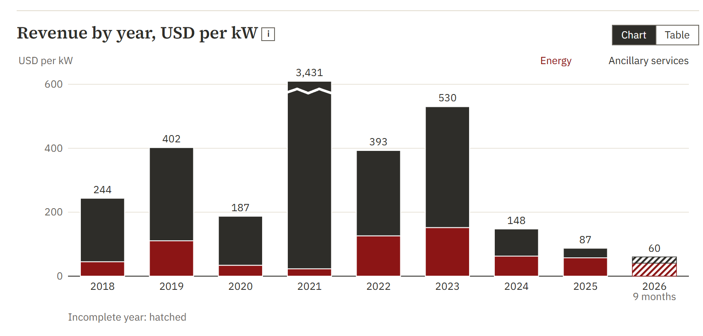
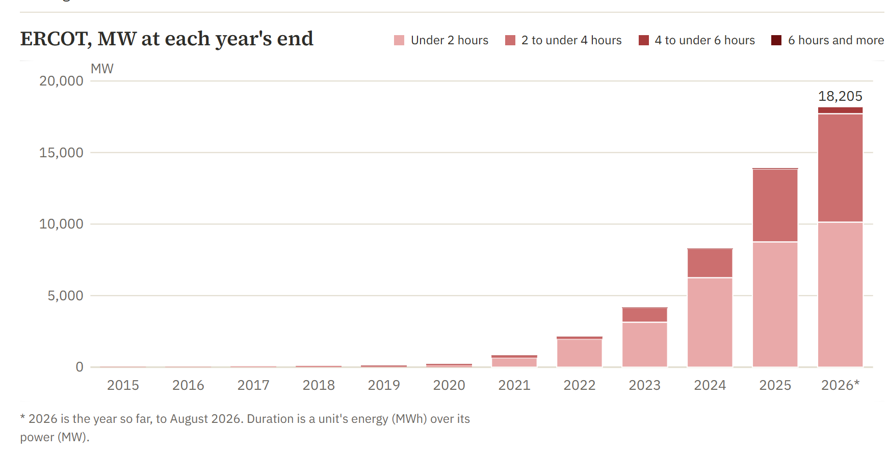
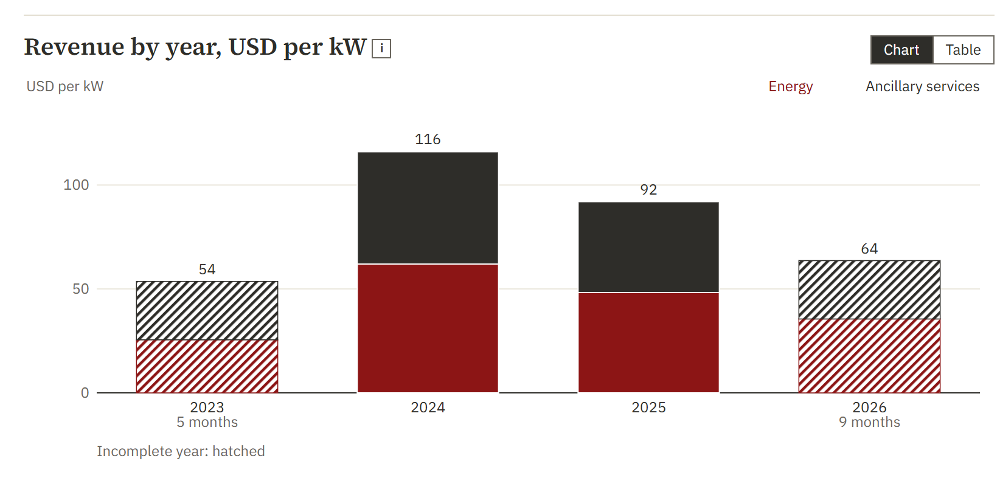

# The ERW newsletter, issue 1 (draft, not sent)

## What a battery in Texas earns, and why it earns a sixth of what it did

*Draft for Samuel's review, written by session 406 on 21 October 2026. Nothing has been sent. Every figure is the one the page computes, rounded as the page rounds it (read on 21 October from Supabase through the page's own code, since the pages could not be built that night: see the notes), and its footnote gives the page's address and the figure's check-values key (the `data-check` attribute the page writes beside the number). The sceptic's notes are in [`issue-001-notes.md`](issue-001-notes.md).*

*The three charts are not made yet. Their places are marked below, each with the page and the element it is cut from; on 21 October the local build failed three times on Supabase statement timeouts, so no page could be drawn. `issue-001/shots-406.mjs` makes all three from the next build, and the session report (`archive/sessions/SESSION_406_REPORT.md`, "To finish") has the commands. Until then the image links below point at files that do not exist.*

---

### The question

How much does a grid battery in ERCOT earn in a year, from which streams, and how has that changed as Texas filled up with batteries?

The answer is usually sold, or given as one fleet average with no split. The ERW's battery page answers it for one battery you can set yourself, every year since 2018, split stream by stream and hour by hour, with the code and the prices it was computed from. This issue reads the page's default battery: 100 MW, 4 hours, at ERCOT's hub average, on the page's upper bound, which knows every price in advance.

### The figures

Over the last twelve months, October 2025 to September 2026, that battery earned USD 81.40 per kW[^1], 33 percent of it from ancillary services[^2]. At the page's default costs and debt it covered its debt 2.63 times[^3].

Year by year[^4]:

| Year | Total, USD per kW | Energy, USD | Ancillary services, USD |
|---|---|---|---|
| 2018 | 243.69 | 4.52 million | 19.85 million |
| 2019 | 402.18 | 11.07 million | 29.14 million |
| 2020 | 187.48 | 3.41 million | 15.34 million |
| 2021 | 3,430.56 | 2.3 million | 340.75 million |
| 2022 | 393.10 | 12.61 million | 26.7 million |
| 2023 | 530.14 | 15.2 million | 37.81 million |
| 2024 | 147.67 | 6.27 million | 8.5 million |
| 2025 | 87.44 | 5.74 million | 3.01 million |
| 2026, January to September | 60.19 | 4.08 million | 1.94 million |

*Chart 1. The battery page's year chart, energy and ancillary services stacked, USD per kW. On the page's default scale a year more than two and a half times the next is drawn to the top of the scale with a break and its value written, so 2021 should be (the caption is to be checked against the PNG when it is made). From `/cost-of-power/battery`, the element `[data-series-chart="years"]`.*

Over the same years, ERCOT's operating battery fleet at each year's end[^5]:

| Year's end | Operating battery power, MW |
|---|---|
| 2022 | 2,130 |
| 2023 | 4,174 |
| 2024 | 8,294 |
| 2025 | 13,909 |
| August 2026, the newest month held | 18,205 |

*Chart 2. The storage page's buildout chart for ERCOT, operating MW at each year's end, split by duration. From `/storage?tab=buildout&grid=ercot`, the first chart frame (the figure titled "ERCOT, MW at each year's end").*

The same battery on a more modest assumption, scheduled against day-ahead prices only and paid those prices, earned USD 459.63 per kW in 2023, 127.14 in 2024 and 78.71 in 2025[^6], and 73.00 over the last twelve months[^7].

And the same battery in California, at the SP15 hub on the same upper bound, earned USD 116.01 per kW in 2024 and 92.00 in 2025[^8]; over the last twelve months 79.31, 43 percent of it from ancillary services[^9].

*Chart 3. The battery page's year chart for CAISO. From `/cost-of-power/battery?grid=caiso&dur=4&strat=foresight`, the element `[data-series-chart="years"]`. CAISO is held from August 2023, so its 2023 is an incomplete year, which the page marks as such.*

### The reading

**The fall is real, and it is mostly one stream.** From 2023 to 2025 the battery's total fell from 530.14 to 87.44 USD per kW: 2025 is about a sixth of 2023. Ancillary services did most of it, from 37.81 million to 3.01 million dollars. Energy fell too, from 15.2 million to 5.74 million, but by less. In 2023 ancillary services were about seven dollars in ten of what the battery earned; in 2025 about a third, and over the last twelve months 33 percent.

**The battery changed trades.** Until 2023 a Texas battery was paid mostly to stand ready: to hold power for regulation and reserves (in this model it is never asked to deliver them). That income was large while few batteries offered it. By 2025 the battery earned most of its money the plain way, charging when power is cheap and selling when it is dear. The page calls that stream "energy (charge low, sell high)", and it is now the larger one.

**The fleet grew while the income fell.** ERCOT's operating battery power more than tripled from the end of 2023 to the end of 2025, from 4,174 MW to 13,909 MW, and stood at 18,205 MW in August 2026. The amount of reserves a grid operator buys is set by what the grid needs to stay reliable, not by how many batteries want to sell them. When three times as many batteries bid for roughly the same need, the price of being ready falls. The warehouse does not prove that cause on its own; it shows the two lines moving together, and the order in which they moved.

**2021 is a different kind of year.** It was the battery's best year by far, the year of Winter Storm Uri: 3,430.56 USD per kW, more than the other seven full years together, almost all of it from ancillary services. Any average that includes 2021 is mostly a statement about that one year. That is why the page lets you leave a stress event out of a window, and why this issue reads year by year rather than an average.

**Texas is no longer the richer market for this battery.** In 2025 the same model battery earned 92.00 per kW at California's SP15 hub against 87.44 at ERCOT's hub average, and California's earnings lean more on ancillary services. Neither number is large next to 2023 in Texas.

**What it still covers.** At the page's default costs, a 4-hour battery financed with the page's default debt still covered that debt 2.63 times over the last twelve months. The debt is light in that case, and the cover is not the return. A reader with a different cost of capital should set the page to it, which is what the page is for.

### What the model cannot see

This is the page's upper bound, and it is high. It knows every real-time price in advance. It sells energy at the hub, not at the battery's own node. Its reserves are paid for being held and are never called. It is a price taker: one battery that never moves a price. Each of these makes it earn more than a real battery would.

The page sets its day-ahead ancillary income beside what ERCOT's real storage resources were awarded. From January to July 2026 the model took USD 2.25 per kW a month; the fleet was awarded USD 0.40 per kW of its power a month; the model is 5.66 times the awards[^10]. The method note's reading is that the model sells more megawatts into reserves than the fleet does, not that it finds better prices. Read every figure above as the ceiling of what one battery could have earned, not as what batteries did earn.

### What we will watch

On 5 December 2025 ERCOT cut the duration a battery must hold behind each reserve product, under its rule for ancillary services with real-time co-optimization (NPRR 1282, which the method note cites): thirty minutes for regulation and Responsive Reserve, one hour for ECRS. The 2026 column is the first under the new rules, and it holds nine months. The next issue that returns to this page will read 2026 whole.

### Where to look

- The battery: `/cost-of-power/battery`, and the same page set to any grid, duration, size, cost and strategy.
- The fleet: `/storage?tab=buildout&grid=ercot`.
- The method, every step and its sources: `docs/methods/battery_stack.md` and `docs/methods/battery_earns_algorithm.md`.

---

[^1]: USD 81.40 per kW, last twelve months. `/cost-of-power/battery`; key `bs|grid=ercot&dur=4&strat=foresight&mw=100&fom=22&ds=2261119|l12_kw:total`.
[^2]: 33 percent from ancillary services, last twelve months. `/cost-of-power/battery`; key `bs|grid=ercot&dur=4&strat=foresight&mw=100&fom=22&ds=2261119|l12_share:ancillary`.
[^3]: Debt coverage 2.63 times, last twelve months. `/cost-of-power/battery`; key `bs|grid=ercot&dur=4&strat=foresight&mw=100&fom=22&ds=2261119|cover`.
[^4]: The income table and the year chart of `/cost-of-power/battery`. Each row's keys are `bs|grid=ercot&dur=4&strat=foresight&mw=100&fom=22&ds=2261119|yr_kw:<year>:total` (total, USD per kW), `...|yr:<year>:energy` and `...|yr:<year>:ancillary` (US dollars for 100 MW), for each year from 2018 to 2026; 2026 holds January to September.
[^5]: `/storage?tab=buildout&grid=ercot`; keys `series|storage_buildout_monthly|iso:ercot|battery_operating_mw|<year>-12-01T00:00:00Z` for 2022 to 2025, and `series|storage_buildout_monthly|iso:ercot|battery_operating_mw|2026-08-01T00:00:00Z`. Source: Form EIA-860M, as the page says.
[^6]: `/cost-of-power/battery?grid=ercot&dur=4&strat=dayahead`; keys `bs|grid=ercot&dur=4&strat=dayahead&mw=100&fom=22&ds=2261119|yr_kw:2023:total`, `...|yr_kw:2024:total`, `...|yr_kw:2025:total`.
[^7]: `/cost-of-power/battery?grid=ercot&dur=4&strat=dayahead`; key `bs|grid=ercot&dur=4&strat=dayahead&mw=100&fom=22&ds=2261119|l12_kw:total`.
[^8]: `/cost-of-power/battery?grid=caiso&dur=4&strat=foresight`; keys `bs|grid=caiso&dur=4&strat=foresight&mw=100&fom=22&ds=2261119|yr_kw:2024:total`, `...|yr_kw:2025:total`.
[^9]: `/cost-of-power/battery?grid=caiso&dur=4&strat=foresight`; keys `bs|grid=caiso&dur=4&strat=foresight&mw=100&fom=22&ds=2261119|l12_kw:total`, `...|l12_share:ancillary`.
[^10]: `/cost-of-power/battery`, the line under the income table; keys `bsa|foresight_4h|model` (2.25), `bsa|foresight_4h|fleet` (0.40), `bsa|foresight_4h|ratio` (5.66). The window, January to July 2026, is the page's.
