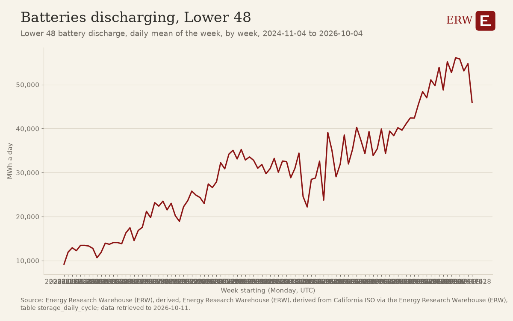

# Session 806: W40 and W41 regenerated without the model

## 2026-W40: roundup.py exit 0

### The week in five numbers (new)
- **Price move of the week:** Henry Hub natural gas closed at 3.18 USD/MMBtu on 2026-09-29, against 2.90 USD/MMBtu on 2026-09-22 (+0.28 USD/MMBtu, +9.7%) [5].
- **US48 peak demand:** 585,785 MW in the hour starting 2026-09-30 21:00 UTC [6].
- **Deal of the week, by US dollars:** USD 50 billion, South Korea and Glenfarne Group, Alaska LNG (project finance, 2026-10-02; `energy_deals` deal:7cb1018102cc16d5).
- **Largest new datacenter load first reported this week:** 250 MW, operator not stated, site not stated, Pyhäjoki (`datacenter_projects` datacenter:f9d364c08c60d2a4).
- **From the chart of the week:** deals in the latest ended month: 59 deals in 2026-09 (template `deals_by_month`, `docs/analysis/2026-W40/chart_of_the_week.json`).

### Weekend: 3 items stored, 3 regenerated, 2 also lines
- stored: 1. **G7 agrees to release 100 Million Barrels of diesel and crude from emergency stocks** (oil, 5 stories)  
- stored: 2. **OPEC+ agrees to keep November oil output targets steady amid Middle East tensions** (oil, 2 stories)  
- stored: 3. **OPEC+ has a deal outline for steady November quotas, delegates say** (oil, 1 story)  
- new: 1. **G7 Agrees to Release 100 Million Barrels of Diesel and Crude After Trump Pressure** (oil, 5 stories)  
- new: 2. **Iran says Strait of Hormuz will not reopen until conditions are met** (geopolitics, 1 story)  
- new: 3. **Amazon Tries to Boost Nuclear Power in Maryland After Scrapping Data Center Deal** (nuclear, 1 story)  
  Also on this topic: OPEC, Allies Hold Oil Output Steady Amid Middle East Tensions (WSJ); OPEC+ Has Deal Outline for Steady November Quotas, Delegates Say (Bloom
  Also on this topic: EXCLUSIVE: Ukraine will hit Russian refineries in response to Moscow's 'new doctrine' of airstrikes, Zelenskiy says (Reuters).

### The five stories of the week: 5 items stored, 5 regenerated, 2 also lines
- stored: 1. **South Korea to invest $120 billion in U.S. nuclear projects, including eight large reactors** (nuclear, 1
- stored: 2. **US Commerce outlines USD120 billion framework for six AP1000 and two APR1400 units** (nuclear, 1 story)  
- stored: 3. **Senators strike bipartisan permitting deal that would expand federal role in transmission siting** (polic
- stored: 4. **Constellation and Amazon sign 20-year power deal, 190 MW, for Maryland nuclear plant** (ppa, 6 stories)  
- stored: 5. **FERC only partially approves PJM backstop plan; PJM delays its power auction** (policy, 1 story)  
- new: 1. **South Korea to invest in U.S. nuclear projects, including 8 large reactors** (nuclear, 1 story)  
- new: 2. **The Senate’s Big Bipartisan Permitting Deal, Explained** (policy, 12 stories)  
- new: 3. **Constellation, Amazon sign 20-year power deal to support Maryland nuclear plant** (ppa, 6 stories)  
- new: 4. **Over 600 Projects Enter Phase 1 of PJM’s New Interconnection Process** (interconnection, 1 story)  
- new: 5. **Shell Greenlights Project to Double LNG Canada Capacity** (lng, 3 stories)  
  Also on this topic: TVA receives construction permit for Clinch River (ANS Nuclear Newswire); The United States Department of Commerce and the Government of the
  Also on this topic: FERC chair slams PJM ‘mess’ as country’s largest grid operator delays power auction (Utility Dive); FERC Accepts PJM Reliability Backstop Pr

### ERW's Numbers This Week: 14 regenerated lines differ from the stored issue
- | ERCOT | HB_NORTH | not in the warehouse (144 of 168 hours) | 41.84 | not computed | [1] |
- | CAISO | TH_SP15_GEN-APND | not in the warehouse (144 of 168 hours) | 36.84 | not computed | [1] |
- | NYISO | N.Y.C. | not in the warehouse (120 of 168 hours) | 39.36 | not computed | [2] |
- | MISO | INDIANA.HUB | not requested: paused by the ERW since 2026-10-04 | 40.45 | not computed | [1] |
- | SPP | SPPSOUTH_HUB | not in the warehouse (144 of 168 hours) | 33.96 | not computed | [1] |
- | ISO-NE | .H.INTERNAL_HUB | not in the warehouse (120 of 168 hours) | 36.12 | not computed | [3] |
- **Highest real-time price of the week:** 1064.25 USD/MWh at TEXAS.HUB (MISO), interval starting 2026-09-28 18:00 local (2026-09-28 23:00 UTC), lmp_rtm [4], MISO's real-time locational marginal price, 
- **Fuel spot prices, change over a week** (EIA, trading dates; the newest close held and the newest close a week or more before it):
- | Price | Newest close | Close a week before | Change | Table |
- | Henry Hub natural gas | 3.18 USD/MMBtu on 2026-09-29 | 2.90 on 2026-09-22 | +0.28 (+9.7%) | [5] |
- | WTI Cushing crude | 96.16 USD/bbl on 2026-09-29 | 96.41 on 2026-09-22 | -0.25 (-0.3%) | [5] |
- | Brent crude | 113.96 USD/bbl on 2026-09-29 | 114.89 on 2026-09-22 | -0.93 (-0.8%) | [5] |

### ERW's Chart of the Week: 4 regenerated lines differ from the stored issue
- **Energy deals in the news, by month** (the rule's pick; no finding was chosen for this week)
- Source: ANS Nuclear Newswire, Bloomberg, Bloomberg.com, Data Center Dynamics, Data Center Frontier, Electrek, Energy-Storage.news, Financial Times, Hart Energy, JPT Homepage, LNG Prime, Natural Gas In
- It is also the measure most related to the week's top stories: it shares deal with 'Amazon Tries to Boost Nuclear Power in Maryland After Scrapping Data Center Deal'.
- <!-- Generated by warehouse/news/roundup.py at 2026-10-22 10:34 UTC; run log warehouse/output/logs/news_roundup_20261022T103417Z.log; model none (the daily model cap was reached). -->

## 2026-W41: roundup.py exit 0

### The week in five numbers (new)
- **Price move of the week:** Henry Hub natural gas closed at 3.18 USD/MMBtu on 2026-09-29, against 2.90 USD/MMBtu on 2026-09-22 (+0.28 USD/MMBtu, +9.7%) [4].
- **US48 peak demand:** not in the warehouse for this week.
- **Deal of the week, by US dollars:** USD 12 billion, Shell and Equinor, Bay du Nord Oil Project (acquisition, 2026-10-09; `energy_deals` deal:1c055d98aed350fd).
- **Largest new datacenter load first reported this week:** 1,600 MW, Firmus, Project Southgate, place not stated (`datacenter_projects` datacenter:38c940ab1e5331b8).
- **From the chart of the week:** Lower 48 battery discharge, daily mean of the week: 45,968 MWh a day in 2026-09-28 to 2026-10-04 (template `watch_battery_discharge_us`, `docs/analysis/2026-W41/chart_of_the_week.json`).

### Weekend: 3 items stored, 3 regenerated, 1 also lines
- stored: 1. **Russia Lifts Ban on Diesel Exports as Part of Trump-Putin Deal** (oil, 10 stories)  
- stored: 2. **IEA Urges More Diesel Releases as Global Market Tightens** (oil, 2 stories)  
- stored: 3. **Energy Department Authorizes Strategic Petroleum Reserve Exchange to Address Supply Disruptions Due to Hu
- new: 1. **Iran says US response to its proposal to reopen Hormuz was 'insufficient'** (geopolitics, 1 story)  
- new: 2. **Russia Lifts Ban on Diesel Exports as Part of Trump-Putin Deal** (oil, 11 stories)  
- new: 3. **Tanker Rates Soar to Record as Oil Crisis Becomes Shipping Crisis** (transport, 1 story)  
  Also on this topic: IEA Urges More Diesel Releases as Global Market Tightens (Bloomberg.com); Energy Department Authorizes Strategic Petroleum Reserve Exchange 

### The five stories of the week: 5 items stored, 5 regenerated, 1 also lines
- stored: 1. **Google enters massive 3.6-GW power deal with Constellation Energy** (nuclear, 11 stories)  
- stored: 2. **Amazon, Constellation sign 20-year PPA to expand Maryland nuclear plant** (ppa, 1 story)  
- stored: 3. **Shell Advances LNG Canada Growth Plan With Phase 2 FID** (lng, 1 story)  
- stored: 4. **Energy Department Supports FERC’s Call for PJM to Protect Ratepayers and Build More Reliable Power** (pol
- stored: 5. **Energy Department Announces $4.2 Billion Investment to Boost Nuclear Power and Help Lower Energy Costs in
- new: 1. **Google enters massive 3.6-GW power deal with Constellation Energy** (nuclear, 11 stories)  
- new: 2. **Shell Advances LNG Canada Growth Plan With Phase 2 FID** (lng, 1 story)  
- new: 3. **Energy Department Supports FERC’s Call for PJM to Protect Ratepayers and Build More Reliable Power** (pol
- new: 4. **Emera bulks up for power demand boom with $10 billion Canadian Utilities deal** (deal, 4 stories)  
- new: 5. **Hurricane Isaias Shuts Almost Three-Quarters of Gulf Oil Output** (oil, 9 stories)  
  Also on this topic: Energy Department Announces $4.2 Billion Investment to Boost Nuclear Power and Help Lower Energy Costs in Pennsylvania and Ohio ([DOE newsro

### ERW's Numbers This Week: 14 regenerated lines differ from the stored issue
- | ERCOT | HB_NORTH | not in the warehouse (0 of 168 hours) | not in the warehouse (144 of 168 hours) | not computed | [1] |
- | CAISO | TH_SP15_GEN-APND | not in the warehouse (0 of 168 hours) | not in the warehouse (144 of 168 hours) | not computed | [1] |
- | NYISO | N.Y.C. | not in the warehouse (0 of 168 hours) | not in the warehouse (120 of 168 hours) | not computed | [2] |
- | MISO | INDIANA.HUB | not requested: paused by the ERW since 2026-10-04 | not requested: paused by the ERW since 2026-10-04 | not computed | [1] |
- | SPP | SPPSOUTH_HUB | not in the warehouse (0 of 168 hours) | not in the warehouse (144 of 168 hours) | not computed | [1] |
- | ISO-NE | .H.INTERNAL_HUB | not in the warehouse (0 of 168 hours) | not in the warehouse (120 of 168 hours) | not computed | [3] |
- **Highest real-time price of the week:** no real-time table covers this week.
- **Fuel spot prices, change over a week** (EIA, trading dates; the newest close held and the newest close a week or more before it):
- | Price | Newest close | Close a week before | Change | Table |
- | Henry Hub natural gas | 3.18 USD/MMBtu on 2026-09-29 | 2.90 on 2026-09-22 | +0.28 (+9.7%) | [4] |
- | WTI Cushing crude | 96.16 USD/bbl on 2026-09-29 | 96.41 on 2026-09-22 | -0.25 (-0.3%) | [4] |
- | Brent crude | 113.96 USD/bbl on 2026-09-29 | 114.89 on 2026-09-22 | -0.93 (-0.8%) | [4] |

### ERW's Chart of the Week: 6 regenerated lines differ from the stored issue
- **Batteries discharging, Lower 48** (the rule's pick; no finding was chosen for this week)
- 
- Lower 48 battery discharge, daily mean of the week: 45,968 MWh a day in the week of 2026-09-28 to 2026-10-04, down 8,790.43 from 54,758.43 the week before. Lower 48 battery discharge, daily mean of th
- Source: Energy Research Warehouse (ERW), derived, Energy Research Warehouse (ERW), derived from California ISO via the Energy Research Warehouse (ERW), table storage_daily_cycle; data retrieved to 202
- The week's stories point elsewhere: US crude oil exports (US crude oil exports: 4,765 kbbl/d in the week of 2026-09-28 to 2026-10-04, up 1,195 from 3,570 the week before. Of the 104 week-to-week moves
- <!-- Generated by warehouse/news/roundup.py at 2026-10-22 10:34 UTC; run log warehouse/output/logs/news_roundup_20261022T103437Z.log; model none (the daily model cap was reached). -->

