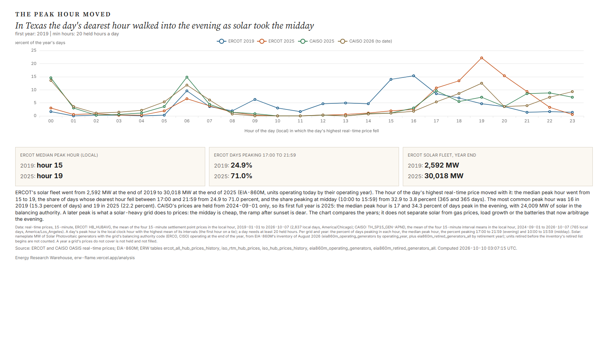

# ERW's Roundup, 2026-W41

ERW's weekly roundup of energy news for 2026-10-05 to 2026-10-11, to 2026-10-11 23:22 UTC, from 1806 scored stories.

This week's headlines are the publishers' own titles, and the written summary of the numbers is left out: the day's model budget was reached.

## Weekend

1. **Russia Lifts Ban on Diesel Exports as Part of Trump-Putin Deal** (oil, 10 stories)  
   Added Russian diesel could ease tight global distillate markets and shift diesel price and sanctions dynamics. Sources: [Bloomberg.com](https://news.google.com/rss/articles/CBMiswFBVV95cUxPNDhlVFZLREFzdExSTEswU3d1N2RuU0lzMXdBaU9sSnI5UXhOcnZNOEhHT0xwN2xlald2VTJfZkFUMGYzbDk2WEJrVndfOWlBT2kxR0prMktwTjlaa1pOdzVTdTJvaXJHS3o0bll5SEJndVU5cUo5Y1NJRVc0Q0loQnFzQlhnTjRaZ1A4Sm50cFR0YmZXVEFCWlZiTUR5UXJvOW9xVkhSMjVEbm1CWWRmM1poNA?oc=5), [Bloomberg.com](https://news.google.com/rss/articles/CBMivAFBVV95cUxPaGpYY2xaOHMzZVpPVXp0NG9qbVpvbDNkOWhBSmJ2X01wczJQU05EZzg0akkzdWpCZURMWEkxaS1ZaG9PeVI4R01NWWRzNXNQUG50S0p0ZUxQOGYzNFRhbTA5d095VzVSWDlxNUxGWUNEbDFPdVlRV0U0amFvSlN3N3dPMi1WOVZadjNUb2JMQUlESlFfLTBneUJaMXJYYndaY3hQeWtzdHgyUjRCaWE0QkJaQmp4Umo5djlvcw?oc=5), [WSJ](https://news.google.com/rss/articles/CBMimAFBVV95cUxOeU9BSDQteGd2OEd3NGN4SlBoNl84eE9XRU1HcUxBUWstUTVOQkt1aXhwNkUycFJMMVFYZ1pvWlJiVVlxVUtWei0zMHBuZDliRmRjZHlyYUV5blg5c3J5UkdLY3ZFaFl2YW5iRVppRWhPSWNfS0V5TUtLNmlEVnJxamhwNjV3ZnlTM1VrWWJlV0pjYzZLeDRUQg?oc=5)
2. **IEA Urges More Diesel Releases as Global Market Tightens** (oil, 2 stories)  
   IEA push for stock releases signals acute distillate tightness affecting prices, refiners and inventories. Sources: [Bloomberg.com](https://news.google.com/rss/articles/CBMiqwFBVV95cUxOWGVtbXhFZ0ZZelkzUklqOEVTUVp6SWE5ZGJlVGxSU01sQW1WXzVpNVB1a3IyXy1kbFlvM1V4T043XzR6cEpuYS1tbEdhT0xxQ1RWT1d4cGx5cVlyUWlPd0taejIwVHUwSTE0eFhseEthaUhPZDMwYnMzcjRJYlVfMmFxQkRIQVBzaDVhRWpkQnJURm5vN01hcVd2enA2R0J5MWxZeTI2aHRITG8?oc=5), [IEA - International Energy Agency](https://news.google.com/rss/articles/CBMilAFBVV95cUxPc05ZWUdWSTh5TEU4bjNJVHVLa196ME1XWFdibDBmQ0VlTlp4Vm9leFVKR2RDOV9EZlNBSDItZVlZTXp0czdYTnpvSVp0RXdvVkQxQjdGNUlqNm51OHpSeS02ejhxWVlKcGhpMlBRSTV6ZXB5Wkt6R2ltWm1DYXM1bW5ySzF6Z1FQVFhIMVp0cVR6WDZ1?oc=5)
3. **Energy Department Authorizes Strategic Petroleum Reserve Exchange to Address Supply Disruptions Due to Hurricane** (oil, 1 story)  
   Federal crude release to Gulf refiners signals supply stress after most Gulf output was shut in. Sources: [DOE newsroom](https://www.energy.gov/articles/energy-department-authorizes-strategic-petroleum-reserve-exchange-address-supply)

## The five stories of the week

1. **Google enters massive 3.6-GW power deal with Constellation Energy** (nuclear, 11 stories)  
   Gigawatt-scale nuclear offtake between a hyperscaler and the largest nuclear fleet owner, setting a benchmark for clean firm power. Sources: [Reuters](https://news.google.com/rss/articles/CBMitwFBVV95cUxQUGptbnU1SUxQWEJrRlFLQUhoSU9WMDhMQmhtZ29ZSGtMRHdvaFI4MGdJXzFWbmVuSHc0bFVkamJVTzBfY3VjRmVmNjN3ekpFMEtyS1Bxc2NMTmhiZlJGQUk5Tml5b2Q0NGZPc1REcExtWElITFFlOW01VWNETGMyZXVMM0x0cGJjWVFfaXZqSzlSNlUxdnFvVFNOMUg2ekVPRktkdVptSFRHa3lNcHREaktPU2RTZGs?oc=5), [Utility Dive](https://www.utilitydive.com/news/constellation-google-deal-will-bring-890-mw-of-new-nuclear-to-pjm/832223/), [World Nuclear News](https://www.world-nuclear-news.org/articles/new-end-user-agreements-support-long-term-us-plant-operations)
2. **Amazon, Constellation sign 20-year PPA to expand Maryland nuclear plant** (ppa, 1 story)  
   Long-term nuclear PPA at a 1,790-MW plant with upgrades, showing hyperscaler backing of existing nuclear capacity. Sources: [Utility Dive](https://www.utilitydive.com/news/amazon-constellation-sign-20-year-ppa-to-expand-maryland-nuclear-plant/832145/)
3. **Shell Advances LNG Canada Growth Plan With Phase 2 FID** (lng, 1 story)  
   An LNG FID adds Pacific-coast export capacity and signals long-term gas demand from Asia. Sources: [JPT Homepage](https://news.google.com/rss/articles/CBMif0FVX3lxTE9lUUtaVWNrZDZIb1FpbzVNRFNGRFpGOHY1d0pLbnJDV3c2WUJBUUhnZUJLRzJhWndJc0l4a3Z5U2pUYW0tZnNlTTQtLTljYjFBRDI1TjRWbEIxTV94ak1hbjhpQ18xSlNudjBicmJWLTB5WTJIQTBCcnBaeE82WVE?oc=5)
4. **Energy Department Supports FERC’s Call for PJM to Protect Ratepayers and Build More Reliable Power** (policy, 1 story)  
   Federal push for large new users to fund generation and infrastructure shapes cost allocation across the largest US power market. Sources: [DOE newsroom](https://www.energy.gov/articles/energy-department-supports-fercs-call-pjm-protect-ratepayers-and-build-more-reliable-power)
5. **Energy Department Announces $4.2 Billion Investment to Boost Nuclear Power and Help Lower Energy Costs in Pennsylvania and Ohio** (nuclear, 6 stories)  
   Large federal nuclear funding aimed at PJM supply and demand growth and prices. Sources: [DOE newsroom](https://www.energy.gov/articles/energy-department-announces-42-billion-investment-boost-nuclear-power-and-help-lower), [POWER Magazine](https://www.powermag.com/vistra-in-line-for-doe-loan-package-to-uprate-nuclear-plants-in-ohio-and-pennsylvania/), [Utility Dive](https://www.utilitydive.com/news/doe-intends-to-loan-vistra-42b-for-nuclear-fleet-improvements/832236/)

## Deals of the week

| Date | Type | Buyer | Seller | Asset | MW | US dollars | Status | Story |
|---|---|---|---|---|---|---|---|---|
| 2026-10-05 | m_and_a | Ithaca Energy | Suncor Energy | Suncor's stakes in oil projects offshore Newfoundland and Labrador | not stated | 1,110,000,000 | signed | [1](https://news.google.com/rss/articles/CBMiqwFBVV95cUxQS1VtN3d5VkdnOTA1VzJidHFtNXhOeFJ4YS1CcEtaSVhGTU50OXdWeVJ2Umo4XzBmVVd6MzduaThnajYwSE45OF9QUElHbENEcmRoM2F5Q09uS3JQejZGb242dVFCa0JoS25UUDRxNkROdW0yME9XeVpXTUhXNGF1OVk0dnpTczdsVVVUUmJhN1NRNXF3NWtKUHAzVHdBY0ROemVFNVE0UFZMb3c?oc=5) |
| 2026-10-05 | other | not stated | Baker Hughes | Venezuela energy infrastructure across the natural gas value chain | not stated | not stated | signed | [1](https://lngprime.com/americas/baker-hughes-in-venezuela-move/197943/) |
| 2026-10-05 | debt | not stated | BPCL | Brazil oil bet | not stated | 3,000,000,000 | announced | [1](https://news.google.com/rss/articles/CBMizwFBVV95cUxPU1U5WHkwaExoSkk1UmwydThidk5RMGllYkFFaWtobU5TSFVodTNXTzVwSGpGY0tTSDFRSUVQU1JRMkt2N2psNm9VU1RydG83Uk9UQzBPWlZBNVJhOGpiN1NFSk1aQXhCR0FRRjdxUlRrc2hkZXdEd29CbWhGUy1pb280cWZER3R2TXMtcVpjYlE1SjZNVEU2bFFHbXRQOWVYSEZ6UlVRUk1VQUF4aU9DZnJ0TEFteG5lWHdLYk1naEg2VE5ibW0tMkxQRldSUzQ?oc=5) |
| 2026-10-05 | m_and_a | Cenovus | Athabasca Oil | Athabasca Oil | not stated | 4,000,000,000 | announced | [1](https://news.google.com/rss/articles/CBMiqwFBVV95cUxOcTlBTU5yTGVqd2E1N0JROHBiaUk5RUZ6UHZiTDhyTTFoV281cGVhU1hnMmwzNTNIZUdGOUgtWTRESERHRGc2V0dIaklfbUNLaWZtaGZKdUxjS09QRzdLZkxmOGlwY29OcktPb28tOXVyUTBMa0cyZUt6TTl4ZUlWLThDZ3lzN1d3anZhS2IyZEhPTE1BQWxidmVMcmRqb08wSU9xVGxCbVdsQm8?oc=5) |
| 2026-10-05 | equity_raise | not stated | ECP | Houston Plant continuation vehicle | not stated | 834,000,000 | closed | [1](https://news.google.com/rss/articles/CBMi0AFBVV95cUxNZEpKTTJtVU1BcVlKSjRJeXdpVE9ObmlmRUpsTVhvcXYwclpLbEtLeHlhRFhBay1ZOGNXb09fUFBoSFpvRGJXYkU1V1B6RWNVbEpsUVNnb1kxMGNhU3JSNEwxMDNHTE1LRGZQbU9JbHI4bHYwVjZER255WVlFYVFCWU5DR3Vvb2FTbWpCZXVsZnA4TjlVTmtFSl9tX0RLMWxmNjFkQ0ozU21FRFpWaFFTVGo2NFJObWJHb0JoTFQySW96RkpyNWZySElSc3NUOFRM?oc=5) |
| 2026-10-05 | fuel_supply | Gulf Development | Adnoc | LNG | not stated | not stated | signed | [1](https://lngprime.com/asia/adnoc-gulf-seal-lng-supply-deal/197946/) |
| 2026-10-05 | debt | Department of Energy | Vistra | Beaver Valley, Davis-Besse and Perry nuclear plants | 433 | 4,200,000,000 | announced | [1](https://www.energy.gov/articles/energy-department-announces-42-billion-investment-boost-nuclear-power-and-help-lower) |
| 2026-10-05 | m_and_a | Centalion | Silver Hill Energy Partners | Haynesville upstream and midstream natural gas assets | not stated | not stated | closed | [1](https://news.google.com/rss/articles/CBMiqgFBVV95cUxPYjNDVDkxRVk4RWJxMVZTQzE5MjlId1lzN0RSTDIxdDAyQ2NUR3NlRUtVRFo2eG1scUFQVUFvNWtKY1R6UWVxczhFVlZCazd6cHBWQ1FrM2IwQVR4ZENRdm1xU1NlaHdDWV81NnY0NXUzSi0tbUpuOGg5bUxhSVNUVzhlbmpEV2dYN1lDR3BIN3ZNQ1JPOHpISzRLYXBMQVRmSU5DNVczVkFUQQ?oc=5) |
| 2026-10-05 | behind_the_meter | not stated | Enerflex | behind-the-meter gas power for data centers | 450 | not stated | signed | [1](https://news.google.com/rss/articles/CBMioAFBVV95cUxNcWFWNlNtUGtmUXVhcFRzUnNBZTQ3c3JoMi1fVmt2UWFydVVjQ28yYS0xSUlFU250SGJFemw4MkNGSHN3eUtpQ1lrdkZHRC04SUVDS2R6Y253UnNsOEFRVlNDa2RHaHFIQVBkZnFoc3pyVDlER3hSUlZXNDZwMElTMU1PZFUteGEwTVpnOTJPNVB0bVE1aTBsclRuUks0dTBl?oc=5) |
| 2026-10-06 | ppa | Google | Constellation Energy | not stated | 3,600 | 4,300,000,000 | signed | [1](https://news.google.com/rss/articles/CBMivAFBVV95cUxOQnB3VGQ4am5pajBjVTZZeTAtTU9KVHZFc3p3R3hWYkNBVzFEcENOYUI5WGVobTk1OEYtZm8tVGFHTFc3ZzdzY1I2allEUm1lN0ZkSjREZ1Z6QjlXczNrTmlRcEFZMEJkYldSYzVIVUxMYzV4bFVuSDZTcFlvTTI4N2V1UHdWUWtIWl9KbUREWWN4a0VYMjJFLUg4MEZLWV9YcTF1OTFSZG53MXdkMnJkWFlhQkV6N2VjRGZVNg?oc=5) |
| 2026-10-06 | equity_raise | not stated | LS Power | flagship fund | not stated | 6,000,000,000 | closed | [1](https://news.google.com/rss/articles/CBMiswFBVV95cUxOWFEtUEVUNkFVUW5zZ1RDWXBfY0JXa1U5Y3kzdWVqM1lhcjhDem1ZV1pFejBNRWJPRWZqMER0dFNpQnJpWW1jeF9UVElqenE1M2ZiYVYyY1I3V1JaV3c2NjB0NWRzU3FSckxZbVl4eHUxUmswQk9XWjg5WC0tSEhmNFV4VjdMeGxONEJsRVE5TEZ3MmhGUjJUYWYwbGg4a0h3SHlHMDFBbjlCUlRXV0NLSEt6dw?oc=5) |
| 2026-10-06 | ppa | EDP | Zelestra | two hybrid solar-plus-storage PPAs | not stated | not stated | signed | [1](https://www.energy-storage.news/zelestra-and-edp-expand-solar-plus-storage-ppa-partnership-with-another-462mwh-of-batteries-in-spain/) |
| 2026-10-06 | m_and_a | Energy Transfer | not stated | Vaquero Midstream | not stated | 2,630,000,000 | announced | [1](https://news.google.com/rss/articles/CBMiswFBVV95cUxQaXBmRnVNVFNpZzVrY2RDclA1TlAyZVZhclVkZnl5NHFIY3ZUTlRSMmhoV0lVNU8xQi1VRElYc2pMZzlvSEFxTWxUU3ZBN2FJT1Vkdi01ZWdMX0VDSldmblJlVGphRXBjWnZEckNCRjJHZjZ5cVhhZmhhVmhnT3dLeWhXLVlfRnk0bmdOcU9OQzZmcWlCNTBlRkZDZ3c0THVfdThNalNWdElhM3dZeUdjZ1MyZw?oc=5) |
| 2026-10-06 | ppa | Amazon | Constellation Energy | nuclear expansions | not stated | not stated | signed | [1](https://www.utilitydive.com/news/constellation-google-deal-will-bring-890-mw-of-new-nuclear-to-pjm/832223/) |
| 2026-10-06 | fuel_supply | Chinese buyers | Venture Global | US LNG | not stated | not stated | rumored | [1](https://news.google.com/rss/articles/CBMitgFBVV95cUxOUEFySHRLRjVVTHMwdW5DNmJRak1BYVRaMXh5ZGZKNjdTTnEtSmFCSm9xVjhyb1hMU1ZVSHdrSmg1bHJrS3ItZTdoZ1JVVTVndC1MXzl6VnlrM0Y2Q3IwUWZ3VE9BYVo5UXZVcEpLMWpJOUVwWGdPV3ZUS1BDbU9tamdibnNjYTlxYzlwaVBnRnB5Nmo1TmI4WkhRZlZTN0NabHVNdEpuMXV5cVpnLURfSUdXZ1lQdw?oc=5) |
| 2026-10-06 | m_and_a | Emera | Canadian Utilities | Canadian Utilities | not stated | 10,000,000,000 | announced | [1](https://news.google.com/rss/articles/CBMitAFBVV95cUxNa0tpN2JTVUpicE5yUmEzc2d3UHV5a3R3NmdlaUFud0k3QVlDQUFaUF9fYzVNTkVFV2lWRzdtbVFLYlVYMUg2alBocXdjUXhmbHphZG5uR1FWeXJmblpmMWNuMF96LXExYmIyQVpkWG5BN3lkNG9FNWRIbjhYdm0tTTJ4eUd0TnhCUkNNaWhheGtGUGhSeEVFM3hQNjlkQmRfaTlCenVPXzdVRVhfbVVickQwMnQ?oc=5) |
| 2026-10-06 | other | not stated | Black Hills | power for Google's data center | not stated | 1,800,000,000 | announced | [1](https://news.google.com/rss/articles/CBMiuAFBVV95cUxOQkl1VUxHdjl1Q2g0c0xiXy12bG8tYWVPMC1mV1RpQ1RnTzcteWgwVGRBcmdpMG5iSE4yYllhZkFWVWdYVWdUM0FLVFVtV0phVEZlbHVWVE9KQ1pRV3FtbW94Tmw4bHRKalV4TDNfaG8zcUF2WTc1WlI1TWUxSU5DVnFYYVBkaml0b1doaHVuOFVUTXU0M0w5UEV1eU9BNTNSSzVaSmk0TUhpR29HSnZ3bnVIYXhoVWFv?oc=5) |
| 2026-10-07 | debt | Bank of China, Industrial and Commercial Bank of China Limited (ICBC), Agricultural Bank of China (ABC), and China Construction Bank (Asia) | QatarEnergy | QatarEnergy loan | not stated | 3,000,000,000 | signed | [1](https://oilprice.com/Latest-Energy-News/World-News/QatarEnergy-Secures-3-Billion-Loan-From-Chinese-Banks-as-LNG-Exports-Stall.html) |
| 2026-10-07 | m_and_a | Apollo | not stated | Uniper | not stated | not stated | rumored | [1](https://news.google.com/rss/articles/CBMiwgFBVV95cUxPaGx1XzF0em1TZkNycEZ5cHR1MzJIZW4zMWNfOUdLTUhUaGVyenhVenZGTjdnR0VUNFFLQUhIUjBRSVZ1RFExX0ZWNjhpWWpxN3k2emFtbDZTd0V2d1ZxTjgzY0VlVnB0WGR3UEFoaW5jYjNvSXRpa2pjcVd4cU9SV25ZbWpaZE5WeWkyck8yRWNzSXdyUmhzby1mNjN1WXQ4WDR5RWZUcklMUWhJWXNjOGhZOVp6R1NVclh5a3RQbWNsdw?oc=5) |
| 2026-10-07 | m_and_a | Golar | NYK Line | LNG carrier Grace Dahlia | not stated | not stated | signed | [1](https://lngprime.com/asia/golar-buys-conversion-vessel-for-fourth-flng/198042/) |
| 2026-10-07 | equity_raise | Brookfield | American Real Estate Partners | American Real Estate Partners and its PowerHouse Data Centers platform | not stated | not stated | not stated | [1](https://www.datacenterfrontier.com/hyperscale/article/55409162/brookfields-arep-deal-extends-the-ai-infrastructure-stack-to-powered-land) |
| 2026-10-07 | ppa | not stated | BKV | Texas power deal | 1,200 | 800,000,000 | not stated | [1](https://news.google.com/rss/articles/CBMinAFBVV95cUxPN19qMHA5NDc0X25sQk1NVHREQWxqNm40eFpoTWNzTEVvbl9TUVQ3VEF3aGNYbW95OXhUSFVSSjR6c0tKbXdSNmpadHRtMFhtXzdJQXNoR0lTdEkzM0UyTlJSZzVzU3R0eFZsTWMyVDhmbE9zVDA1dm5HTTJUTVdNd0Y5VW1udjZzbGcta3J5aUh6eUFWMHZDenhSaGo?oc=5) |
| 2026-10-07 | smr | not stated | BWX Technologies | BWXT Advanced Nuclear Reactor (BANR) power plant project | not stated | not stated | announced | [1](https://www.ans.org/news/2026-10-07/article-8471/bwxts-banr-selected-for-canadian-project/) |
| 2026-10-07 | m_and_a | Japex | Verdad | Verdad | not stated | 1,260,000,000 | not stated | [1](https://news.google.com/rss/articles/CBMilAFBVV95cUxNWmdFVjdNQ1FjWlJ3RWlvU0NpR3ZhWjlSNy1BZnotNjRqa1h6aE12QTZiNjVndWliRXZmZ05ENXJDUjU5NWVDXzl5LWtmRVQ3dUhFTkx6ZkNETWhIYjZCSXM1YnNiQklUQjRLU0pCblg5TGRyeWxqZk1OX1FCTnl5dkQxRnhaUFduSU05dzI3QU5SUzhM?oc=5) |
| 2026-10-07 | m_and_a | Japex | Fundare | Fundare | not stated | 278,000,000 | not stated | [1](https://news.google.com/rss/articles/CBMilAFBVV95cUxNWmdFVjdNQ1FjWlJ3RWlvU0NpR3ZhWjlSNy1BZnotNjRqa1h6aE12QTZiNjVndWliRXZmZ05ENXJDUjU5NWVDXzl5LWtmRVQ3dUhFTkx6ZkNETWhIYjZCSXM1YnNiQklUQjRLU0pCblg5TGRyeWxqZk1OX1FCTnl5dkQxRnhaUFduSU05dzI3QU5SUzhM?oc=5) |
| 2026-10-07 | m_and_a | Oneok | Brazos | Midland Basin assets | not stated | 4,400,000,000 | closed | [1](https://news.google.com/rss/articles/CBMijwFBVV95cUxPejNIazhwQmoybXMxVzBydUQ2bjBlZGx6cm5nTTl2NWl0RXBkLVZQelJMLTR0S1ByTW4ydHdPbVByRmU2WWV3Z0I1bzFmX1V6U0tZM2tGT0kwSmkzT2w2U3VyQ1Z2MFVXbGV3RDFMVTVKbzhWY1NjQnZnRHNZMENOM0FzTlRPcW9XbFJpWmRnSQ?oc=5) |
| 2026-10-08 | other | not stated | Chevron | Hess Midstream stake and Bakken, DJ assets | not stated | not stated | announced | [1](https://www.rigzone.com/news/chevron_exits_hess_midstream_as_it_restructures_bakken_dj_assets-08-oct-2026-184799-article/?rss=true) |
| 2026-10-08 | other | Westinghouse | Hyundai Engineering & Construction | FEED studies for two AP1000 nuclear plants in the Netherlands | not stated | not stated | signed | [1](https://www.world-nuclear-news.org/articles/westinghouse-teams-up-with-hyundai-ec-for-dutch-feed-studies) |
| 2026-10-08 | equity_raise | not stated | Voltus | Voltus | not stated | 225,000,000 | closed | [1](https://www.latitudemedia.com/news/voltus-raises-225-million-to-scale-byoc-for-data-centers/) |
| 2026-10-08 | m_and_a | not stated | ČEZ | JESS | not stated | 211,000,000 | closed | [1](https://www.world-nuclear-news.org/articles/slovakia-buys-out-czech-stake-in-new-nuclear-project) |
| 2026-10-08 | other | Polskie Elektrownie Jądrowe | Westinghouse | long-lead items for the first unit of Poland's first nuclear power plant, three AP1000 reactors | not stated | not stated | signed | [1](https://www.world-nuclear-news.org/articles/poland-begins-ordering-long-lead-components-for-first-ap1000) |
| 2026-10-08 | m_and_a | not stated | Oryx Energies | Oryx Energies | not stated | not stated | closed | [1](https://news.google.com/rss/articles/CBMirwFBVV95cUxQOXdXU0h4Z2N3X0I3WVdrWkRFV2RtWVJoYmJGcWZuZG1NVE5zbElFa19KVmNod0dZSXVjWHRsSXZVd1g2Qll5SkVOZEVIWHV4RldSbmFuTlNaZU05Skd0RTg2NnYzUDl2VTVMM3V0Um9ZVF95RWtkaEVZY3dGajRJeDRhVkpCVlZJMVdDZFlhTEtDaFc1dFV2aktLLURWc21mS0xCSlFSaU81Q3hnOTYw?oc=5) |
| 2026-10-08 | m_and_a | Crescent Energy | Devon Energy | Eagle Ford Position | not stated | 4,200,000,000 | announced | [1](https://news.google.com/rss/articles/CBMimgFBVV95cUxPT1VKS2ZTN3dsdGk0WW5PVmtRTDhZNVVkdk1hM1BIZlRfSFVDZTRsX0FpQXZGZDRab1dFOTdndzcyMllFVEU3MkZ2Skt4WV9wOG1ObEFWbEU4bEtXS1A4ZUNJZFJQQjRxSmtDbDFYa0I2LTRvZWlGRm5PcTJTMkkyUklYR2czOE5Pek9FYXRpRmtwREFwVC1JOS1R?oc=5) |
| 2026-10-08 | m_and_a | Carlyle | Lukoil | Lukoil International Assets | not stated | not stated | cancelled | [1](https://news.google.com/rss/articles/CBMitgFBVV95cUxQSTY2MnpqTGV6cGlQU1RkQ0R3NmhQM0duRkxmYlhXdndiZjE5MzFGVDVhQ3g3SldyeG54R2RXUk12R0pqREJJYlBCcl9qN3J6NUZId29aZ29DUjRWOHVLdTUyWmZWLVZYVzJUdFpMbUtzd1hZR3l2VmtGeHJ4MHVUQlo4ZFoyYlVnS2t6VUx1M2Z5a3lJcm9XZGhoOUl0a1NWaXFrWFREelZkemZPQUJGVDVkOGhrUQ?oc=5) |
| 2026-10-08 | equity_raise | not stated | Vivek Ramaswamy’s Nuclear Startup | Vivek Ramaswamy’s Nuclear Startup | not stated | 1,900,000,000 | closed | [1](https://news.google.com/rss/articles/CBMisgFBVV95cUxPck56V19lY1NhV09qWk1Sc3F0dWRnTC1GSWVDeFRERzBUWUpRS0J0d1Z6MmNBV2dHemRtLTVhZDVKMW1RR1hkM2p1blQ5OGc0REFhT3pJV1pIVnNWUzA0bkhlM1RBdzdHdXpieVZROEtVMHFTRk5qLW9tMzZWZlVoNGpCQVNGYld3V3BBdkNnZ2NWZ1E0ZzIxNDQ1WkN2YWU4MkNqcDZSbXdDbXpmRU9pUUln?oc=5) |
| 2026-10-09 | debt | not stated | Aditya Birla unit | Shell arm Solenergi | not stated | 1,500,000,000 | not stated | [1](https://news.google.com/rss/articles/CBMiuwFBVV95cUxNYnVZWEJRVFBzT0I4Um1xQnE4UEY0eVg4emROS3VSNm9Rc1UtWndXa3JNa2NUWXdnZ01ZMS11MnJxUS1QUW9oM3N3aHFBLVBQWXJENWJXRzFrOXl4MHdDWDBiT0hObEhiVktWa2lJUmNyUXVtdkhPRlY1ZUN6aGF4a0gyWXRWb2FROUVDMnNOWWY3RjJqM3IzMEQ3R1l3WmpvYWVYMFliZkN2dzNrWkpUaTdYSkpWNFlibldB?oc=5) |
| 2026-10-09 | ppa | Tesla | ContourGlobal | 509 MW solar-plus-storage project | 509 | not stated | signed | [1](https://pv-magazine-usa.com/2026/10/09/contourglobal-breaks-ground-on-509-mw-solar-plus-storage-project-in-arizona/) |
| 2026-10-09 | other | not stated | Pacific Coast Energy | onshore Cabimas and Delta blocks | not stated | 3,500,000,000 | signed | [1](https://www.rigzone.com/news/pacific_coast_energy_secures_agreements_with_pdvsa_to_revive_oilfields-09-oct-2026-184817-article/?rss=true) |
| 2026-10-09 | fuel_supply | US | Russia | diesel | not stated | not stated | signed | [1](https://news.google.com/rss/articles/CBMilgFBVV95cUxQU3RwVkZ4Mkg3Vy1fdGF2T2t4RmRLV3lQaU5LcXdnd3hKd21HRlZqR1dBTDlEbmNheE1MYVNjZldOLVlUd2lpMDdSaDd5c0tSUEpVRWJPLU1rTU9hSVhTYlF3Z2JPUlQydXgyb0VraVpvMUlwdHlFY2RoNEZ3WUE4Y0JjNnlHMV9VakFsdzMzOFFzUnQ3MlE?oc=5) |
| 2026-10-09 | m_and_a | Matador | Ridge Runner | Ridge Runner | not stated | not stated | not stated | [1](https://news.google.com/rss/articles/CBMixgFBVV95cUxPNzFabWNvSTc3Z3pSUjlSZ3M0amt6aG4zcS1TNGdyb0l0M0laZlBKa1FUQ3pKeVJxZ3hFZU8xb3I4cHE5OUY0b1dOa2dHM0tQN282cWxtWXB3UHl3TWxkUlVkeUFDYmNadGJPandZRlI5ODQ2M193Mk45WGxQZUZHSXhLYUtubGdKa2lQV0paY1l1akZDWTRCaWNSNjl1aW1TWVByZzZtTU9IelFMNC1IWVB0Vm1tWUNUM3hYTHVfZjFfZU9KbUE?oc=5) |
| 2026-10-09 | m_and_a | Shell | Equinor | Bay du Nord Oil Project | not stated | 12,000,000,000 | not stated | [1](https://news.google.com/rss/articles/CBMiswFBVV95cUxQSWVxRFVRdUFrQVc5QVlSNm9ld3JYRDhIVEVkWVRlZGEyOFN0d3NleHJSNFlBNkkxTENPa185c0Y5eHFaVTRuc0hDU19uY1Z5N0JnR2RZaDhlMGg4emhtOVpZWHdnNTNDOW5QTFM5dzFib0pRdnZsVkE2Wm01RkJ4M09ENjVhTlhqZzdHV0k0Y2RKMV9xYjJLWXVpNlhXX2tIVkFSSjBGU083MUh1NGp2RmhlTQ?oc=5) |

Table: `energy_deals` (41 deals; extracted from the scored stories by `warehouse/deals/extract.py`, every number checked against its story).

## Datacenter announcements of the week

| First reported | Operator | Site | Place | MW | Status | Story |
|---|---|---|---|---|---|---|
| 2026-10-05 | not stated | not stated | Kansas City | not stated | announced | [1](https://www.datacenterknowledge.com/data-center-site-selection/vertical-data-centers-face-cost-proximity-trade-offs) |
| 2026-10-05 | Continent 8 Technologies | not stated | Johannesburg | not stated | operating | [1](https://www.datacenterdynamics.com/en/news/continent-8-technologies-launches-data-center-in-johannesburg-south-africa/) |
| 2026-10-05 | atNorth | not stated | Salo | 75 | announced | [1](https://www.datacenterdynamics.com/en/news/atnorth-to-build-75mw-data-center-in-salo-finland/) |
| 2026-10-05 | not stated | Fawley Power Station | not stated | not stated | not stated | [1](https://www.datacenterdynamics.com/en/news/former-uk-power-station-site-could-become-data-center-campus/) |
| 2026-10-05 | Blackstart Digital | IBM's Almaden Research Center | San Jose | not stated | announced | [1](https://www.datacenterdynamics.com/en/news/former-ibm-research-campus-in-silicon-valley-set-to-be-acquired-by-data-center-firm/) |
| 2026-10-05 | Applied Digital | Ellendale data center campus | Ellendale, ND | 75 | operating | [1](https://www.datacenterdynamics.com/en/news/applied-digital-adds-75mw-of-capacity-at-ellendale-data-center-campus-in-north-dakota/) |
| 2026-10-06 | Firmus | Project Southgate | not stated | 1,600 | cancelled | [1](https://www.datacenterdynamics.com/en/news/firmus-and-cdc-end-16gw-project-southgate-collaboration-deploy-just-42mw/) |
| 2026-10-06 | Axe Compute | not stated | Columbus, GA | not stated | not stated | [1](https://www.datacenterdynamics.com/en/news/axe-compute-acquires-full-ownership-of-ai-cluster-in-columbus-georgia/) |
| 2026-10-06 | not stated | not stated | KY | 1,000 | not stated | [1](https://www.datacenterdynamics.com/en/news/terawulfs-kentucky-campus-to-reach-1gw-in-2029/) |
| 2026-10-06 | not stated | not stated | not stated | 1,000 | announced | [1](https://www.datacenterdynamics.com/en/news/applied-digital-to-develop-1gw-data-center-campus-in-finland/) |
| 2026-10-06 | not stated | not stated | Luzerne County, PA | not stated | permitted | [1](https://www.powermag.com/fit-energy-will-use-gas-powered-fuel-cells-for-pennsylvania-data-center-project/) |
| 2026-10-07 | Firmus | not stated | not stated | not stated | under construction | [1](https://www.datacenterdynamics.com/en/news/firmus-tops-out-data-center-building-in-tasmania/) |
| 2026-10-07 | not stated | not stated | not stated | 600 | not stated | [1](https://www.datacenterdynamics.com/en/news/1000-year-old-scottish-castle-could-be-destroyed-to-make-way-for-hyperscale-data-center/) |
| 2026-10-07 | AirTrunk | not stated | Inzai | not stated | announced | [1](https://www.datacenterdynamics.com/en/news/airtrunk-plans-additional-1bn-investment-in-data-center-campus-in-inzai-japan/) |
| 2026-10-08 | not stated | not stated | Jämsä | 600 | announced | [1](https://www.datacenterdynamics.com/en/news/sesterce-to-invest-10bn-in-600mw-ai-data-center-campus-in-j%C3%A4ms%C3%A4-finland/) |
| 2026-10-08 | KT Cloud | not stated | Incheon | 50 | announced | [1](https://www.datacenterdynamics.com/en/news/kt-cloud-plans-50mw-data-center-project-in-incheon-south-korea/) |
| 2026-10-08 | Google | not stated | not stated | not stated | not stated | [1](https://www.datacenterknowledge.com/regulations/permits-not-power-halt-google-s-finland-data-centers) |
| 2026-10-09 | ThisWay Global | RELLIS Campus | Bryan, TX | 73 | announced | [1](https://www.datacenterknowledge.com/ai-data-centers/thisway-global-to-convert-bankrupt-rellis-site-into-73-mw-ai-hub) |
| 2026-10-09 | Yandex | not stated | Kaluga | not stated | not stated | [1](https://www.datacenterdynamics.com/en/news/second-yandex-data-center-hit-in-drone-strikes-in-russia/) |
| 2026-10-09 | Bitdeer AI | not stated | not stated | 67 | not stated | [1](https://www.datacenterdynamics.com/en/news/bitdeer-ai-signs-67mw-ai-cloud-agreement-in-malaysia/) |
| 2026-10-09 | not stated | not stated | Cedar Creek, TX | not stated | applied | [1](https://www.datacenterdynamics.com/en/news/anthropic-linked-366m-data-center-project-filed-for-in-cedar-creek-texas/) |

Table: `datacenter_projects` (21 facilities; `warehouse/datacenters/extract.py`, every field only as its story states it).

## ERW's Policy of the Week

**Tennessee Valley Authority; Clinch River Nuclear Unit 1; Construction Permit and Record of Decision** (NRC notice, 2026-10-05; docket Docket No. 50-615, NRC-2024-0146)

The NRC has given TVA a permit to start building a nuclear reactor at its Clinch River site in Roane County, Tennessee. The permit took effect on 2026-09-28, and the NRC found that safety and environmental requirements were met. [Source](https://www.federalregister.gov/documents/2026/10/05/2026-20345/tennessee-valley-authority-clinch-river-nuclear-unit-1-construction-permit-and-record-of-decision)

Timeline: The permit was issued on 2026-09-28 and is immediately effective. The notice is dated 2026-10-01. No comment deadline is stated.

Also this week:

- Fermi America LLC (dba Fermi America); Project Matador Advanced Energy and Intelligence Campus AP1000 Units 1-4; Project Matador Nuclear Units 1-4; Draft Environmental Impact Statement (NRC notice, 2026-10-09): Draft EIS on the combined license application for four AP1000 units is a key licensing step for a large new-build nuclear project. [source](https://www.federalregister.gov/documents/2026/10/09/2026-20742/fermi-america-llc-dba-fermi-america-project-matador-advanced-energy-and-intelligence-campus-ap1000)

Table: `policy_actions` (scored with the news rubric) and `policy_reads` (impact reads, each field kept only when its words are in the action's own text); every action is on [/policy](/policy).

## ERW's Numbers This Week

**Day-ahead average, main hub, over the ISO's local week, and the change from the week before**

| ISO | Hub or zone | This week USD/MWh | Week before USD/MWh | Change | Table |
|---|---|---|---|---|---|
| ERCOT | HB_NORTH | 41.94 | 37.45 | +4.49 | [1] |
| CAISO | TH_SP15_GEN-APND | 57.60 | 44.53 | +13.07 | [1] |
| NYISO | N.Y.C. | 39.78 | 45.94 | -6.16 | [2] |
| MISO | INDIANA.HUB | not in the warehouse (0 of 168 hours) | not in the warehouse (144 of 168 hours) | not computed | [1] |
| SPP | SPPSOUTH_HUB | not in the warehouse (144 of 168 hours) | 29.60 | not computed | [1] |
| ISO-NE | .H.INTERNAL_HUB | 34.67 | 39.11 | -4.44 | [3] |
| PJM | | | | | no PJM price table (no API key) |

**Highest real-time price of the week:** 1027.12 USD/MWh at SPPNORTH_HUB (SPP), interval starting 2026-10-08 17:45 local (2026-10-08 22:45 UTC), lmp_rtm_15m_mean [4].

**Fuel spot prices, weekly change** (EIA, trading dates; the last close of the week and the last close before it):

| Price | Last close this week | Last close before | Change | Table |
|---|---|---|---|---|
| Henry Hub natural gas | 3.03 USD/MMBtu on 2026-10-06 | 2.90 on 2026-10-02 | +0.13 (+4.5%) | [5] |
| WTI Cushing crude | 96.24 USD/bbl on 2026-10-06 | 97.89 on 2026-10-02 | -1.65 (-1.7%) | [5] |
| Brent crude | 125.44 USD/bbl on 2026-10-06 | 135.51 on 2026-10-02 | -10.07 (-7.4%) | [5] |

**US48 peak demand of the week:** 575,114 MW in the hour starting 2026-10-08 22:00 UTC (Thursday 2026-10-08, 18:00 Eastern), from 144 hours of the week to 2026-10-10 23:00 UTC [6].

Tables: [1] `iso_dam_hub_prices` (caiso:PRC_LMP, ercot:NP4-190-CD, miso:da_expost_lmp, spp:DA-LMP-SL); [2] `nyiso_dam_zone_prices` (nyiso:damlbmp); [3] `isone_dam_zone_prices` (isone:da_lmp_hourly); [4] `iso_rtm_hub_prices` (caiso:PRC_INTVL_LMP, ercot:NP6-785-ER, ercot:NP6-905-CD, miso:rt_lmp_final, miso:rt_lmp_prelim, spp:RTBM-LMP-SL); real-time tables read, and how far each reaches this week: iso_rtm_hub_prices (caiso_rtm) to 2026-10-11 06:45 UTC, iso_rtm_hub_prices (ercot_rtm) to 2026-10-11 04:45 UTC, iso_rtm_hub_prices (spp_rtm) to 2026-10-10 04:45 UTC, isone_rtm_zone_prices to 2026-10-11 03:45 UTC, isone_rtm_zone_prices_hourly to 2026-10-09 03:00 UTC, nyiso_rtm_zone_prices to 2026-10-11 03:45 UTC; [5] `eia_fuel_spot_prices` (eia:natural-gas/pri/fut, eia:petroleum/pri/spt); [6] `eia930_all_demand` (eia:electricity/rto/region-data); balancing authority us48.

## ERW's Chart of the Week

**THE PEAK HOUR MOVED** (chosen for this Roundup)

*In Texas the day's dearest hour walked into the evening as solar took the midday*

- ERCOT median peak hour (local): hour 15 (2019), hour 19 (2025)
- ERCOT days peaking 17:00 to 21:59: 24.9% (2019), 71.0% (2025)
- ERCOT solar fleet, year end: 2,592 MW (2019), 30,018 MW (2025)

ERCOT's solar fleet went from 2,592 MW at the end of 2019 to 30,018 MW at the end of 2025 (EIA-860M, units operating today by their operating year). The hour of the day's highest real-time price moved with it: the median peak hour went from 15 to 19, the share of days whose dearest hour fell between 17:00 and 21:59 from 24.9 to 71.0 percent, and the share peaking at midday (10:00 to 15:59) from 32.9 to 3.8 percent (365 and 365 days). The most common peak hour was 16 in 2019 (15.3 percent of days) and 19 in 2025 (22.2 percent). CAISO's prices are held from 2024-09-01 only, so its first full year is 2025: the median peak hour is 17 and 34.3 percent of days peak in the evening, with 24,009 MW of solar in the balancing authority. A later peak is what a solar-heavy grid does to prices: the midday is cheap, the ramp after sunset is dear. The chart compares the years; it does not separate solar from gas prices, load growth or the batteries that now arbitrage the evening.

Source: ERCOT and CAISO OASIS real-time prices; EIA-860M; ERW tables ercot_all_hub_prices_history, iso_rtm_hub_prices, iso_hub_prices_history, eia860m_operating_generators, eia860m_retired_generators_all. The card, its data, Python and Stata do-file are on [/analysis/card/peak_hour_moved](/analysis/card/peak_hour_moved).

ERW

---

[How this is made.](/about#digest)

<!-- Generated by warehouse/news/roundup.py at 2026-10-11 23:22 UTC; run log warehouse/output/logs/news_roundup_20261011T232235Z.log; model none (the daily model cap was reached). -->
