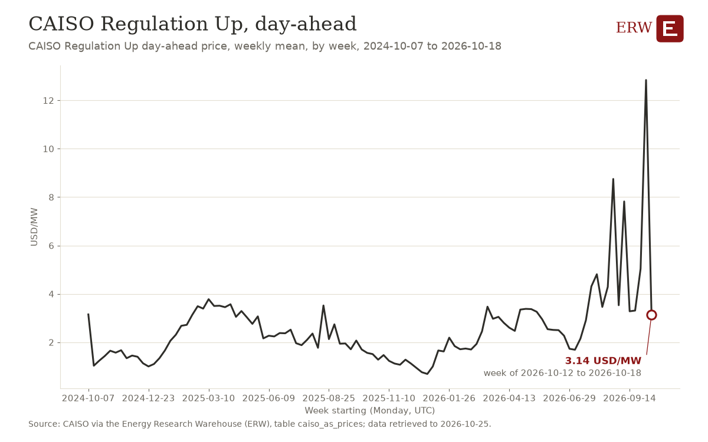

# ERW's Roundup, 2026-W43

ERW's weekly roundup of energy news for 2026-10-19 to 2026-10-25, to 2026-10-25 23:20 UTC, from 1516 scored stories.

## Weekend

1. **US executives quit $25bn gas venture over claims of undisclosed Russian control** (geopolitics, 2 stories)  
   LNG or gas project faces executive departures and alleged Russian involvement claims; geopolitical risk to US energy sector. Sources: [Financial Times](https://news.google.com/rss/articles/CBMihAFBVV95cUxOa0lZSndwUTJjQUtnTnd2cXBVSWtGUmQtS2RSVi11RkUxc1ZmSzZyMlJOZ3hKbWxGVmZ3VXF0ZVNwbmxYaVJkN3VMT0dzenExMkRyeVpzcV9GckVJSWtjdFN0dUJuX1BSS09VX1E1M2xWWmpXU0RiZTcxeXpDZVVpY3doWGE?oc=5) (via Google News), [WSJ](https://news.google.com/rss/articles/CBMivAFBVV95cUxPNkFiU1FYZGlkMjdSWFp0bVJuVUpfTXRIVFdZZkh3ZUtpLTVhMmswZ2l3SU5IeGF6dkh1SlVKcjRWLVVwRkd0b2c2OGIwYVBndTVGMlRRWkdVczJReTJ1MDZnM1Y1UWE4ajUyUl9ENUNWMEgyNy1vbktiOGhrRzBoTGRxRl9CbHlHTHJBZFFhY1lZSkNLUGo4SjByZ1lxRzE2TlpOaDFidUxxLWFlaXJkUVdkWUV5MGwtRXFrXw?oc=5) (via Google News)
2. **Record tanker rates cut U.S. crude oil flows to Asia as the Iran war disrupts shipping** (oil, 1 story)  
   Iran war disrupts shipping economics, cutting US exports and raising global crude logistics costs. Sources: [OilPrice.com](https://oilprice.com/Energy/Crude-Oil/Record-Tanker-Rates-Cripple-US-Crude-Oil-Flows-to-Asia.html)
3. **Power outages leave Kyiv dreading its worst winter of the war** (grid conditions, 1 story)  
   Power system damage threatens civilian heating supply amid geopolitical conflict. Sources: [WSJ](https://news.google.com/rss/articles/CBMinAFBVV95cUxPazkyOWh6YWJnMGtOY19fQUdsa0xHVDdicnBmOHpiSW40QnU5U2pCQU43UnFRNG0tT2pWQjB0bUJFYUIxNXBjMUZTU2M1SlJqeUI1MkhfNlRsYUJhdHhTRWNBY1Z3WWRsUmJyeGt6RExxS2FsXzRZNUNGOXZRNzBlQXN6R2pnem9JNUFrYjBVSUEzeFd1UV9wVXpRVkU?oc=5) (via Google News)

## The five stories of the week

4. **The Nuclear Company proposes 6,600 MW of AP1000 reactors in Kentucky** (nuclear, 5 stories)  
   Largest proposed US nuclear project in decades; generation FID for Kentucky. Sources: [ANS Nuclear Newswire](https://www.ans.org/news/2026-10-22/article-8511/six-ap1000-reactors-eyed-for-kentucky-nuclear-power-facility/), [World Nuclear News](https://www.world-nuclear-news.org/articles/nuclear-company-proposes-66-gw-kentucky-project), [Heatmap News](https://heatmap.news/energy/the-nuclear-company-prosperity-one)
5. **Cheniere signs long-term LNG supply deals with QatarEnergy for 4 million tonnes per annum through 2054** (lng, 3 stories)  
   Decade-spanning LNG contract locks in supply volumes and reshapes global LNG trade flows. Sources: [LNG Prime](https://lngprime.com/contracts-and-tenders/cheniere-inks-long-term-lng-supply-deals-with-qatarenergy/198822/), [Bloomberg.com](https://news.google.com/rss/articles/CBMisgFBVV95cUxQaXV4a2huUEhKdW5KbG85VllTQ1pQN2E2TGc1Y3p6VXJmMlhjV0p6bUYtYlg2TUFleS11aXRNSmhMYkhFNDJCOXR0Q0g4OEhJZWRRLW1YYzBGRDBXQTQ2d3hLak8yVUUwMjU1LWtWVXpIdVdaUkc5NE1rajRsaTlNOVhKZV93Z3l3Q2ZETVBBS2FBaHVBV0NIZjRjU3VhX1kzS1g2QUhZU2ItR2JCSXRXRE5R?oc=5) (via Google News), [Hart Energy](https://news.google.com/rss/articles/CBMimgFBVV95cUxOMGVWSVlvR0p4dDdqaVFaS3BxUnRYRWlXZHpHelF1b0laamRyd1I3aFRzMFNlRElJYlU1bkMwNF8zQXNRTm8wd3NhUEFsWTBiUERzdUJHTWk2ODBkZ1JxWVdYMEg1VmpiX056QjZjUzdqd1RTZHdsUEN4UFRZMFBRb2hiR0owZkc4R3dIbEtOQnFzMmxXWF9nWXVn?oc=5) (via Google News)
6. **Nscale and Anthropic are in talks on a $45 Billion cloud computing deal** (deal, 3 stories)  
   AI datacenter infrastructure deal signals power demand and capital commitment. Sources: [Bloomberg](https://news.google.com/rss/articles/CBMisgFBVV95cUxOWElPM1lSczhESmRndWxlZjZIbWhtVS0zZXBjS2Z2Qi12ZVIwcXR0c2lZTWNSYjQxc2lTUnBGaEVBQWZpbUFhNUxQcUhNeVByZVFPQ0hJbm52TVVrX2c0WFFaMDJHSjktNHV3VFVhcDZoY2Ewc1Q4Yks2N0FTek1HR0lYYVoxV0ZYb0Y0c2RmUUtRdVlSbDRNYWJvcm5PeFdqQkVOeFVfQ1RMZTZTeGtzcDFR?oc=5) (via Google News), [Reuters](https://news.google.com/rss/articles/CBMiwgFBVV95cUxPcGMyclR5X0JrXzBKem90Uk1sZnBQNkcyRnlyc3ZnWTM4Q0ZoUWtKUzRrd1Y3aHlqaDRjT1pfaFdmV0pHYUFROFI3TFhTWVhtczJsM01PSF8tSEtXejB4emlhVjZGMmQzeWh0RXJoaS0tNDQ1SDhlZDRJZU5hZG5ibE85N3dxU21DS2ZKYm1NV2pVUUF4ZjF3XzQ1ZncwaHVMdXlWZ2FsWjRtQ1d0eFN2YUVQc2x4cTd6YjNwSTVuVUFQZw?oc=5) (via Google News), [Financial Times](https://news.google.com/rss/articles/CBMihAFBVV95cUxNU1NLVUZHTjRBSTloV1dqSi0wVmZXTUkwSmpzT2NpVG5ia29za0NIdkpGbWJDMnVVSmY2M2FvQTF5NnlrdWRkM0duNUZtNEdRQmVTLWxTZm1DN3V5NFBmQmxCOEJWZG4yNWRyN295NjYtc3A5Z1pzQ1QwUVJDY0VaZmNqbFI?oc=5) (via Google News)
7. **AEP, Amazon and X-energy plan a 960 MW nuclear plant in Indiana** (nuclear, 7 stories)  
   Datacenter power deal: 960 MW of small modular reactors for Amazon in Indiana. Sources: [Financial Times](https://news.google.com/rss/articles/CBMimAFBVV95cUxON1U3dDJrZmhleVQ1ZzBwVkZhT3BPMlhEYUwzSUNOaU1adXJfMHo1ZDZMb1lzOEI1X1RhZmlUazA4RnFrNGNWdzV0elBjdHM4WU5KQjFPSE9vTkFoLW9aUHlQQWszZ0NkVmUyd3ZIdW5NM0pZZEhMaHpucHFxeFRrTUlmQWoya3BRQW9IUmFKMU1KcG1Sb0Y5WQ?oc=5) (via Google News), [World Nuclear News](https://www.world-nuclear-news.org/articles/aep-amazon-and-x-energy-plan-12-smr-plant), [Utility Dive](https://www.utilitydive.com/news/aep-signs-advanced-960-mw-nuclear-amazon-x-energy/833341/)
8. **Google and Voltus plan 1 GW of virtual power plant capacity in PJM** (datacenter power, 5 stories)  
   1 GW VPP to support data center power demand in constrained PJM grid. Sources: [Canary Media](https://www.canarymedia.com/articles/virtual-power-plants/google-plans-big-virtual-power-plant-in-energy-strapped-pjm-grid), [Latitude Media](https://www.latitudemedia.com/news/google-is-purchasing-1-gw-of-distributed-capacity-in-pjm/), [Heatmap News](https://heatmap.news/climate-tech/google-virtual-power-plant-voltus)

## Deals of the week

| Date | Type | Buyer | Seller | Asset | MW | US dollars | Status | Story |
|---|---|---|---|---|---|---|---|---|
| 2026-10-19 | other | LNG Canada | Tecnicas Reunidas | second phase of the Coastal GasLink pipeline | not stated | not stated | signed | [1](https://lngprime.com/americas/tecnicas-reunidas-scores-lng-canada-pipeline-gig/198610/) |
| 2026-10-19 | power purchase agreement | Microsoft | NiSource | planned data center | not stated | not stated | signed | [1](https://www.datacenterdynamics.com/en/news/microsoft-signs-20-year-power-deal-with-indiana-utility-nisource-for-planned-data-center-in-the-state/) |
| 2026-10-19 | equity raise | not stated | Blackstone | Blackstone Energy Transition Partners V | not stated | 8,700,000,000 | closed | [1](https://news.google.com/rss/articles/CBMirgFBVV95cUxPamg1MDY0VmlNSExrbE55R2RlSXlhajFmaDZFUDdTSjdzdFBKTVMybUFQaGVLc3VhQnpXM0lYTjY3ZDlVcjU1VDBDa21Lc0tEZGo0ZEJ6TDZCRE5SNURMYlVmd1hvX19Dbng3LWtoNnJmODluajBOV2JadVFKcG15SWZBbU1DZE41M2ZMWTZGNTB2TExNTFpKMmlRLUZ5TG5ON0t0TkRvT2toMFA4TUE?oc=5) |
| 2026-10-19 | lease | Microsoft | Nscale | U.K. data-center deal | not stated | not stated | cancelled | [1](https://news.google.com/rss/articles/CBMirgFBVV95cUxPOFBSano2YWNRY1dzTTFvSmc4NjZ0NEtuRVZDa2ZDMGFmYzVFekJMVzR2aTd5aWZmVEFvLWFKQ052cFJYU3NfUGFpMGhla0c3VUYzR1VfUEQ4bHlfdDFCTnZuN2pvUzJNTDd2UWN0MmlqbVhYQ0V4dmdiT1VkUmUzb2preEF0ZHpnRlc2dGJwTnhTYm5zSTljbzZGMC1EdXF4OFRTUjBHa2E4Q2t5eHc?oc=5) |
| 2026-10-19 | power purchase agreement | PT Pembangkit Listrik Nuklir | Rosatom | floating nuclear power plants | not stated | not stated | signed | [1](https://www.world-nuclear-news.org/articles/rosatom-signs-floating-nuclear-power-deal-for-indonesia) |
| 2026-10-19 | small modular reactor | Amazon | AEP | 960 MW project at a former coal plant site in Sullivan County, Indiana | 960 | not stated | signed | [1](https://news.google.com/rss/articles/CBMiswFBVV95cUxNY0QzSUNjTkNzZEppTURpTGxwaWV6blV6NmpUY3RvVzFpMTlZcHpubDZNTkQ5UFY1UDI5WDRfZndCYS02czBoVVdSNGFfRkNfeXlvbVRJeHZ5MVRPUGl1WWVEY3V1LVhlWW9yYVFqN1NRNUJoYnYyVVd0bTFSTFhySENVdHM5NFdDY01uU1gxWmxHOC1uMGpQTXhvcWV4X3NhX01vR0wzaHdhNWgwVDhUSDZDbw?oc=5) |
| 2026-10-19 | acquisition | not stated | Alcoa | New York aluminum smelter | not stated | 315,000,000 | announced | [1](https://www.datacenterdynamics.com/en/news/alcoa-sells-new-york-aluminum-smelter-to-data-center-developer-for-315-million/) |
| 2026-10-19 | fuel supply | Lebanon | Qatar | LNG supply deal and two power plants | not stated | not stated | not stated | [1](https://news.google.com/rss/articles/CBMiyAFBVV95cUxOWTItdGRQank5NVFPZGVycjUxaVZrTFJjRkxJb2VoWHJtdEE5NnUybkZDOTFGQWZ5WS1ZT2dvaFZTNTVwaTdEWWhrcWJSRUozMFlRU3JHWWYtdV9hNEVJMEpIcFhVUGMxcXY1bjdjLWs0bWpqaUVOYWktRmtKTEhqT2xwdXh5cC16aHZOejVyM3FIY3FJOEFvVzFINW90dlp2aWtSZURsb203YkdBVGxkTmpsZmhaemczeWpLVlloeDNEamxtMzZhTQ?oc=5) |
| 2026-10-19 | project finance | Sasol | Mozambique | new gas project offshore Mozambique at Inhassoro and Beira | not stated | 250,000,000 | rumored | [1](https://oilprice.com/Latest-Energy-News/World-News/Mozambique-Pitches-Sasol-and-ROMPCO-on-250-Million-Gas-Project.html) |
| 2026-10-19 | offtake | Anthropic | Nscale | cloud computing deal | not stated | 45,000,000,000 | rumored | [1](https://news.google.com/rss/articles/CBMisgFBVV95cUxOWElPM1lSczhESmRndWxlZjZIbWhtVS0zZXBjS2Z2Qi12ZVIwcXR0c2lZTWNSYjQxc2lTUnBGaEVBQWZpbUFhNUxQcUhNeVByZVFPQ0hJbm52TVVrX2c0WFFaMDJHSjktNHV3VFVhcDZoY2Ewc1Q4Yks2N0FTek1HR0lYYVoxV0ZYb0Y0c2RmUUtRdVlSbDRNYWJvcm5PeFdqQkVOeFVfQ1RMZTZTeGtzcDFR?oc=5) |
| 2026-10-19 | acquisition | EnCap | not stated | Permian minerals | not stated | 3,500,000,000 | not stated | [1](https://news.google.com/rss/articles/CBMiowFBVV95cUxOVTR0dG5lY1UwakFlR2NBVzZnbm5YcEZpTFJ4OUlSRGJJekZEa3FOV2JWdVBJZ0ljUDlkSFVoeXdaUlY1akRIdzREcFhfTDYyZkl3VkIwR2xJZjVZS0F0QTFsdmptZFRfak5jNjBVSHdCN2t0VjdhQTBNV3JmOVB3Z2FQX0dsbndXQlphaEdBNHdWeUV0bkE4YnEwMkllRmN5LWk4?oc=5) |
| 2026-10-19 | power purchase agreement | NTPC Limited | 247 Solar | Concentrated Solar Power project | not stated | not stated | signed | [1](https://www.powermag.com/indias-largest-utility-signs-ppa-with-virginia-based-solar-group-will-use-advanced-csp-technology/) |
| 2026-10-20 | other | not stated | not stated | Indiana nuclear power plant with up to eight CANDU reactors | 6,000 | not stated | signed | [1](https://www.world-nuclear-news.org/articles/indiana-considering-6-gw-candu-nuclear-project) |
| 2026-10-20 | equity raise | not stated | Ara Partners | Energy fund targeting power, fuels | not stated | 2,500,000,000 | closed | [1](https://news.google.com/rss/articles/CBMinwFBVV95cUxOQVRVTlVjSklINDFybjdVWFZiLWo3TUdVdUY1OHAwRWtEOUVWMUNoOWo2UWtyNllXblJEREFJM1MtSHRaa3pZWHF2aWZNTXBkalRtYUh0UnhMMUhXbXplY253d3J0QnViam1ULWRWcnJjTk92YklRZFI3TGJuRGY2MG9GcE5CQ0h0aGJVYkFwV1hnSWRFaEV3TUdoVURGOG8?oc=5) |
| 2026-10-21 | fuel supply | France | Qatar | Qatar LNG supplies | not stated | not stated | signed | [1](https://news.google.com/rss/articles/CBMiswFBVV95cUxQc2dMTTVwT2hSbXhSQ3N1bEppNVhKUEU3VzNPLTZZeGZXSGkzNVFySE9USVREYkItaXBqeU5zS2NibEExOGRtMVU4NloxN3dfb3JJd3FOVGV5SGpYeW90UHhacDFwM2dsZnBPazlrdnZNbnd5aEJ4RlBzcGRCWnQtYVpmSW9tTEN1bkpUTngwMXZIdU1DMGpkM1BEWmZrYjdlc3ZELWNyMWxsSzRvV1Z2VGJkZw?oc=5) |
| 2026-10-21 | acquisition | Dangote | not stated | 25% stake in Kenya's oil pipeline network | not stated | not stated | signed | [1](https://news.google.com/rss/articles/CBMirwFBVV95cUxPMHJDRTZkX1B0YlRMX1Yyby1BbThTYTBmanFWNjNxMmREUTRUSlJLQThGM19YdlJfRzY1S28wMEpVOVJHR1k3WmNOeDNoZkROeG5TVGMxaVRaOERoczYtRWVzaHlXQ0h5cEptYlFRNUU0SHRTbmR3a2tld2d3VUxJX2FpbmxYX1lBMUVUdjJlVXhXVTFNVEdmOUIxaDlnXy1NN1FOSE9fM29MRFhEQVR3?oc=5) |
| 2026-10-21 | offtake | not stated | Duos | data center capacity | 20 | 700,000,000 | signed | [1](https://www.datacenterdynamics.com/en/news/duos-secures-cloud-provider-as-customer-for-20mw-of-data-center-capacity/) |
| 2026-10-22 | other | US Navy | Radiant | Kaleidos microreactor at Naval Weapons Station Crane | not stated | not stated | signed | [1](https://www.world-nuclear-news.org/articles/radiant-microreactor-selected-for-deployment-by-us-navy) |
| 2026-10-22 | lease | ChronoScale | Soluna | Dorothy 3 data center | 50 | not stated | announced | [1](https://www.datacenterdynamics.com/en/news/soluna-and-applied-digital-to-build-50mw-data-center-in-texas/) |
| 2026-10-22 | offtake | Nebius | Humain and DataVolt | Oxagon data center | 50 | not stated | signed | [1](https://www.datacenterdynamics.com/en/news/nebius-signs-on-for-50mw-at-neoms-oxagon-data-center-in-saudi-arabia/) |
| 2026-10-22 | offtake | Google | Voltus | virtual power plant capacity in PJM | not stated | not stated | announced | [1](https://www.latitudemedia.com/news/google-is-purchasing-1-gw-of-distributed-capacity-in-pjm/) |
| 2026-10-22 | acquisition | ADNOC's XRG | Eni | Eni's Libya oil and gas business | not stated | not stated | rumored | [1](https://news.google.com/rss/articles/CBMiugFBVV95cUxQR1g2NkVwaGlBeGlfNkxLTFhLYzdVOW42cThDUFRoVDJJa3RsSF9xdGxleFhFTXdHbHdTZFJFNk9UaTMwOXhtZHYteGJKWWgtNVctU0lwcWppNUZQWGl4SlpQUHhUbWZmbXFxWVNxbUlBNkx0U0NSTFQybWExWU9aLWVGa0lHaWNDOGNoYm4weENEVU9GbmtoZzlSVVZEdHNJbU9QU2JxQjNsM1B5NFNYcEtuSWw1TGVEMHc?oc=5) |
| 2026-10-22 | equity raise | Nvidia | Firmus | Firmus | not stated | not stated | rumored | [1](https://www.datacenterdynamics.com/en/news/nvidia-in-talks-to-invest-in-firmus-after-failed-ipo-report/) |
| 2026-10-22 | joint venture | not stated | not stated | planned UK BWRX-300 fleet | not stated | not stated | signed | [1](https://www.world-nuclear-news.org/articles/joint-venture-to-operate-planned-uk-bwrx-300-fleet) |
| 2026-10-22 | fuel supply | QatarEnergy | Cheniere | LNG | not stated | not stated | signed | [1](https://lngprime.com/contracts-and-tenders/cheniere-inks-long-term-lng-supply-deals-with-qatarenergy/198822/) |
| 2026-10-22 | other | not stated | Liberty | power generation business expansion | not stated | not stated | signed | [1](https://news.google.com/rss/articles/CBMiiwFBVV95cUxPWThNS3E0Sks3REVYUGRxUno3b1luRXRaNmhlTVp5a1FhY0pTZWsyYnhJZ0wyVEREZFZVVmhwZG1IeE9ELWZ5ckQ5LTJUMzRCckdxQkZZNVI3MjI1YXZZTzZjZUtuYnRIdE1ubktnTlJXQlRWcUkzNmd6TnliY1VydVVhTER1QVBmeExv?oc=5) |
| 2026-10-22 | fuel supply | QatarEnergy | Venture Global | LNG | not stated | not stated | rumored | [1](https://news.google.com/rss/articles/CBMiywFBVV95cUxQWURhT3VUeGtQdDZGb0d4dnpPTUhGWW5NM0g2R3QwZFRWTUtaSm5ONEI0aFk1aUxRa0U0cUFFMHV6aDgxUjZCREo3TVNTNTBJNjE4QnJ0RUlyelh1RHI4eXdjWUdQdHVXOFBtN3k1VXhXUTh2LVY0UTdpSWVfQWFxd2FoeW1mV0IzR1RleTZLUDYxOFpTLUhydEJaT29QUXJTZE5KVkhkRGs5dWR5V1NwQXVXUUhjV2Vsd044WFZaaEdqWUR1SmdFaHdJaw?oc=5) |
| 2026-10-23 | power purchase agreement | Solar Energy Corporation of India (SECI) | ACME Solar | solar-plus-storage portfolio | 300 | not stated | signed | [1](https://www.energy-storage.news/acme-solar-ppa-seci-clean-energy-solar-india-renewables-assets/) |
| 2026-10-23 | other | not stated | Welspun | US gas pipeline order tied to data centre buildout | not stated | 580,000,000 | signed | [1](https://news.google.com/rss/articles/CBMiywFBVV95cUxNcWphMFNwdGZkOGo5TGZxMXk3SFhidGZOWXpKWV8xN2hYeXY2MlRITjRIZDM0ZE1RYnpPRTNzdzlaVEwwMGZnR0pqWG9Kd0xJbC1KX1gtUVZfRTZ2T0ZOZUw0bjJ2a3hBYWU4bDl0eWRQQXpUYllPTndTVEJxYzhXLWtETldoYmdOYkVLNUE4RWRPRGcyc1hBWFZUQmNsSXkxdTJkWnlQcURjOVJHZWhYZmc0X2x5OVlQSGpYMTRhb1lWOXBWNU8wLTh0UQ?oc=5) |
| 2026-10-23 | acquisition | not stated | Shell, ExxonMobil | chemicals JV | not stated | 8,000,000,000 | rumored | [1](https://www.rigzone.com/news/wire/shell_exxonmobil_said_to_put_chemicals_jv_up_for_sale-23-oct-2026-184914-article/?rss=true) |
| 2026-10-23 | other | undisclosed US data center developer | Innio | gas engine order | 620 | not stated | signed | [1](https://www.datacenterdynamics.com/en/news/innio-signs-620mw-gas-engine-order-with-undisclosed-us-data-center-developer/) |
| 2026-10-23 | debt | not stated | NextEra Energy | federal energy 'hub' projects | not stated | 5,700,000,000 | signed | [1](https://www.utilitydive.com/news/nextera-energy-secures-57b-to-support-federal-energy-hub-projects/833810/) |
| 2026-10-23 | equity raise | General Motors' venture arm | Peak Energy | Peak Energy | not stated | 108,000,000 | closed | [1](https://pv-magazine-usa.com/2026/10/23/sodium-ion-storage-maker-peak-energy-raises-108-million-in-gm-led-round/) |
| 2026-10-23 | debt | Citi | Nebius | Senior secured facility | not stated | 3,500,000,000 | signed | [1](https://www.datacenterdynamics.com/en/news/neocloud-nebius-secures-35bn-in-financing-from-citi/) |
| 2026-10-23 | lease | Neysa | STTGDC | Noida 2 data center facility | not stated | not stated | not stated | [1](https://www.datacenterdynamics.com/en/news/sttgdc-to-host-neysa-gpus-at-data-center-in-noida-india/) |
| 2026-10-23 | other | Eni | not stated | Cyprus Gas Project infrastructure contracts | not stated | 1,800,000,000 | announced | [1](https://news.google.com/rss/articles/CBMi7AFBVV95cUxQMEw4Y3hfdWNYbC1XMkI5NGRwVG1mbzNoMGlxUGN3QjVTZFd4UU9CY0RnNFhMdkJ2QkZiMENoUlQ1dVUyTjIydnVweDQ4ZnViLXNBYllHUW5vX1BaMTRQb3RIR2xUSngzX3MwX3lvWXdTbzVPbk9uZFFKbXRLeWhyWjl2ZVc2V2VqazlyZU9sOUtvQWxrWGduamoyUVM5aUotSks1Y0hJR2NfU2NLNEMxMTg2Z1hMcWc3RGNFUF9SaVdfMnkxU1ZRWUNwX3pGSDFIOE1vRjNDaEtKalBEQTFENEFiamJ1dWNxNF9QNQ?oc=5) |
| 2026-10-23 | other | Phillips 66 | Department of Energy | Strategic Petroleum Reserve emergency exchange to Lake Charles refinery | not stated | not stated | signed | [1](https://news.google.com/rss/articles/CBMiwAFBVV95cUxPN09NY3ROanZFXzE0MUt5cTZmYkozTFNRNng5X0tUUkhHeENpY3oxTlBYVG5HWmdVdnhYcFhmZnhaRTlxWlZMRXZmczNqZTRUbzlJWnJ3WFVURmJORklmeVd0WG03VzY1VVl3THUwT0pxTUNXQVRiLWFFSUU4ZnFKZXdjZHhzNXItQ0NWb1Y3N3NERW1IUHkyMjRoclBqRXZyN1dMVTZRblB6TGFXZTZuQ1hmb1lCeUtOQkhKY0RjdEE?oc=5) |
| 2026-10-23 | fuel supply | QatarEnergy | Woodside | Woodside's Louisiana plant | not stated | not stated | rumored | [1](https://news.google.com/rss/articles/CBMiwAFBVV95cUxNLWo4ZHBtWXB5blhDUlU3d0lLRXRUX2NfeUVuY3FQSjYzenBjVlppVDA3Nk42VnJaUWtMQWtLZzdLSTNPMWhDc1NmSjVJa1UzN1pGb2dTWEg0Q2lHTzVjamdndGVZRml5VGFjSnlJcjAzcHdwQ21EUkxNZGdiclJjNkYySnFkVVVzYThVV2FGcThsS3hfb25jZTZXdzZxRE45ejF0YzNYcjBjc1pVTFlidElOWWxjeG9zdHZqdldQUUQ?oc=5) |

Table: `energy_deals` (38 deals; extracted from the scored stories by `warehouse/deals/extract.py`, every number checked against its story).

## Datacenter announcements of the week

| First reported | Operator | Site | Place | MW | Status | Story |
|---|---|---|---|---|---|---|
| 2026-10-19 | Microsoft | not stated | not stated | not stated | not stated | [1](https://www.datacenterdynamics.com/en/news/microsoft-signs-20-year-power-deal-with-indiana-utility-nisource-for-planned-data-center-in-the-state/) |
| 2026-10-19 | VK | not stated | not stated | not stated | not stated | [1](https://www.datacenterdynamics.com/en/news/vk-data-center-near-st-petersburg-russia-struck-by-drone/) |
| 2026-10-19 | not stated | not stated | Michałowice | not stated | not stated | [1](https://www.datacenterdynamics.com/en/news/real-estate-developer-hillwood-polska-changes-data-center-design-in-poland-in-response-to-local-opposition/) |
| 2026-10-19 | Sharon AI | not stated | Sydney | not stated | not stated | [1](https://www.datacenterdynamics.com/en/news/greensquare-launches-first-phase-of-data-center-campus-in-sydney-australia/) |
| 2026-10-19 | Microsoft | not stated | Loughton | not stated | cancelled | [1](https://www.datacenterdynamics.com/en/news/microsoft-pulls-out-of-delayed-nscale-data-center-in-loughton-essex/) |
| 2026-10-19 | not stated | not stated | NY | not stated | not stated | [1](https://www.datacenterdynamics.com/en/news/alcoa-sells-new-york-aluminum-smelter-to-data-center-developer-for-315-million/) |
| 2026-10-19 | not stated | not stated | Atlanta, GA | 4 | not stated | [1](https://www.datacenterdynamics.com/en/news/carrier-connect-secures-customer-for-4mw-data-center-outside-atlanta-georgia/) |
| 2026-10-19 | not stated | not stated | Youngstown, OH | 18 | not stated | [1](https://www.datacenterdynamics.com/en/news/valor-energy-acquires-computing-site-in-youngstown-ohio/) |
| 2026-10-19 | not stated | not stated | Cardiff | 50 | announced | [1](https://www.datacenterdynamics.com/en/news/curtis-hall-proposes-temporary-499mw-gas-power-plant-for-cardiff-data-center-campus-report/) |
| 2026-10-19 | Stack | Lancaster campus | Lancaster, TX | not stated | applied | [1](https://www.datacenterdynamics.com/en/news/stack-files-for-second-building-at-lancaster-campus-texas/) |
| 2026-10-19 | Google | Wood Haven Technology Park | Roanoke County, VA | not stated | not stated | [1](https://www.datacenterdynamics.com/en/news/google-explores-data-center-site-in-roanoke-county-virginia/) |
| 2026-10-19 | Anthropic | not stated | not stated | not stated | not stated | [1](https://www.datacenterdynamics.com/en/news/anthropic-named-as-customer-of-everwinds-data-center-project-in-nova-scotia/) |
| 2026-10-19 | not stated | NAVWAR HQ | San Diego, CA | 400 | not stated | [1](https://www.datacenterdynamics.com/en/news/400mw-data-center-eyed-at-old-navy-cyber-site-in-san-diego-california/) |
| 2026-10-19 | 5C Data Centers | former Fred's distribution complex | Memphis | 84 | not stated | [1](https://www.datacenterfrontier.com/hyperscale/article/55411657/beyond-colossus-5c-advances-575m-memphis-ai-factory-expansion) |
| 2026-10-21 | atNorth | not stated | Espoo | not stated | under construction | [1](https://www.datacenterdynamics.com/en/news/atnorth-tops-out-latest-data-center-in-espoo-finland/) |
| 2026-10-21 | NorthC | not stated | Geneva | 4 | under construction | [1](https://www.datacenterdynamics.com/en/news/northc-breaks-ground-on-data-center-in-geneva-switzerland/) |
| 2026-10-22 | Crusoe | Tørdal campus | not stated | 40 | not stated | [1](https://www.datacenterdynamics.com/en/news/crusoe-signs-on-for-polar-dcs-upcoming-40mw-data-center-in-norway/) |
| 2026-10-22 | OVHcloud | not stated | Roubaix | not stated | operating | [1](https://www.datacenterdynamics.com/en/news/ovhcloud-wins-approval-to-connect-data-centers-in-roubaix-france-to-local-district-heating-network/) |
| 2026-10-22 | not stated | not stated | Newport | 1,000 | announced | [1](https://www.datacenterdynamics.com/en/news/era4-reveals-details-of-hyperscale-data-center-planned-for-former-steelworks-in-newport-wales/) |
| 2026-10-22 | ChronoScale | Dorothy 3 | TX | 50 | announced | [1](https://www.datacenterdynamics.com/en/news/soluna-and-applied-digital-to-build-50mw-data-center-in-texas/) |
| 2026-10-22 | Nebius | Oxagon data center | not stated | 50 | not stated | [1](https://www.datacenterdynamics.com/en/news/nebius-signs-on-for-50mw-at-neoms-oxagon-data-center-in-saudi-arabia/) |
| 2026-10-23 | KT | not stated | Ansan | 50 | under construction | [1](https://www.datacenterdynamics.com/en/news/kt-breaks-ground-on-50mw-data-center-in-ansan-south-korea/) |
| 2026-10-23 | not stated | Noida 2 | Noida | not stated | not stated | [1](https://www.datacenterdynamics.com/en/news/sttgdc-to-host-neysa-gpus-at-data-center-in-noida-india/) |
| 2026-10-23 | not stated | not stated | Zaragoza | 225 | announced | [1](https://www.datacenterdynamics.com/en/news/krolmap-plans-a-225mw-off-grid-data-center-in-zaragoza-spain/) |
| 2026-10-23 | not stated | not stated | San Mateo de Gállego | not stated | announced | [1](https://www.datacenterdynamics.com/en/news/o-green-plans-data-center-campus-in-zaragoza-spain/) |
| 2026-10-23 | Meta | Prometheus data center campus | OH | not stated | operating | [1](https://www.datacenterdynamics.com/en/news/meta-details-ohio-prometheus-data-center-campus-with-first-phase-live/) |
| 2026-10-23 | not stated | not stated | Paducah, McCracken County, KY | not stated | not stated | [1](https://heatmap.news/plus/the-fight/spotlight/the-most-important-data-center-election-youve-never-heard-of) |
| 2026-10-24 | not stated | Colossus 2 | not stated | not stated | not stated | [1](https://news.google.com/rss/articles/CBMiwAFBVV95cUxQZ1oxbFRkLVB1Y3RHcGgtdk1TZ0swMHBxazFvZksxM2FqQmpERUhRZ3lGMWVPdncwUEZnTE03WV9xU1FZSlBBQVJCMkpFV19jTy01SEZyRXdQa3ZGcFV5RUFMa3M0S29lZmcwdnFnTEdtS2xsUk9HekJObC0wSFBSSG1Xa1dLZ1hKbjZQTFNMTklTU1dTdUxJUmFlRDM2WWk0V2hNcjZEeUFLekxBR0JITlFqdGt3dlVELXJuZUE2V3Q?oc=5) |

Table: `datacenter_projects` (28 facilities; `warehouse/datacenters/extract.py`, every field only as its story states it).

## ERW's Policy of the Week

**Notice of Availability of Draft Policy Statement on Efficient Environmental Reviews of Natural Gas Project Applications (Environmental Review of Natural Gas Act Applications)** (FERC notice, published 2026-10-20; docket PL26-3-000)

FERC has drafted a policy under which it would usually stop asking gas project applicants for air dispersion modeling at compressor stations and liquefied natural gas facilities. It would look at other information, such as state and federal air rules and the applicant's compliance, and it is taking comments until November 16, 2026. [Source](https://www.federalregister.gov/documents/2026/10/20/2026-21442/environmental-review-of-natural-gas-act-applications-notice-of-availability-of-draft-policy)

Timeline: Comments are due by 5:00 p.m. Eastern Time on November 16, 2026, before the final version is issued. The notice is dated October 15, 2026.

Also this week:

- Authorizations for Certain Activities at Liquefied Natural Gas Plants (FERC proposed rule, published 2026-10-20): A proposed rule could cut approval steps for activities at LNG plants. [source](https://www.federalregister.gov/documents/2026/10/20/2026-21443/authorizations-for-certain-activities-at-liquefied-natural-gas-plants)
- Texas LNG Brownsville LLC; Request for Extension of Export Commencement Deadline (DOE notice, published 2026-10-20): A deadline extension request for non-FTA LNG exports signals project timing for the Brownsville terminal. [source](https://www.federalregister.gov/documents/2026/10/20/2026-21425/texas-lng-brownsville-llc-request-for-extension-of-export-commencement-deadline)

Table: `policy_actions` (scored with the news rubric) and `policy_reads` (impact reads, each field kept only when its words are in the action's own text); every action is on [/policy](/policy).

## ERW's Numbers This Week

Day-ahead power was dearest at NYISO's N.Y.C., 47.64 USD/MWh, and cheapest at SPP's SPPSOUTH_HUB, 20.15, though SPP has no week-before figure to compare. ERCOT's HB_NORTH fell the most, 7.88 USD/MWh below the week before, while CAISO's TH_SP15_GEN-APND rose 3.35. The highest real-time price was 1165.64 USD/MWh at LONGIL (NYISO), and WTI crude closed at 107.89 USD/bbl on 2026-10-20, up 12.50 on the week.

**Day-ahead average, main hub, over the ISO's local week, and the change from the week before**

| ISO | Hub or zone | This week USD/MWh | Week before USD/MWh | Change | Table |
|---|---|---|---|---|---|
| ERCOT | HB_NORTH | 25.73 | 33.61 | -7.88 | [1] |
| CAISO | TH_SP15_GEN-APND | 42.53 | 39.18 | +3.35 | [1] |
| NYISO | N.Y.C. | 47.64 | 48.42 | -0.78 | [2] |
| MISO | INDIANA.HUB | not requested: paused by the ERW since 2026-10-04 | not requested: paused by the ERW since 2026-10-04 | not computed | [1] |
| SPP | SPPSOUTH_HUB | 20.15 | not in the warehouse (144 of 168 hours) | not computed | [1] |
| ISO-NE | .H.INTERNAL_HUB | 40.34 | 40.89 | -0.55 | [3] |
| PJM | | | | | no PJM price table (no API key) |

**Highest real-time price of the week:** 1165.64 USD/MWh at LONGIL (NYISO), interval starting 2026-10-21 20:00 local (2026-10-22 00:00 UTC), lmp_rtm_15m_mean [4], NYISO's real-time locational marginal price.

**Fuel spot prices, change over a week** (EIA, trading dates; the newest close held and the newest close a week or more before it):

| Price | Newest close | Close a week before | Change | Table |
|---|---|---|---|---|
| Henry Hub natural gas | 3.10 USD/MMBtu on 2026-10-20 | 3.14 on 2026-10-13 | -0.04 (-1.3%) | [5] |
| WTI Cushing crude | 107.89 USD/bbl on 2026-10-20 | 95.39 on 2026-10-13 | +12.50 (+13.1%) | [5] |
| Brent crude | 115.22 USD/bbl on 2026-10-20 | 125.78 on 2026-10-13 | -10.56 (-8.4%) | [5] |

**US48 peak demand of the week:** 519,440 MW in the hour starting 2026-10-20 22:00 UTC (Tuesday 2026-10-20, 18:00 Eastern), from 144 hours of the week to 2026-10-24 23:00 UTC [6].

Tables: [1] `iso_dam_hub_prices` (caiso:PRC_LMP, ercot:NP4-190-CD, miso:da_expost_lmp, spp:DA-LMP-SL); [2] `nyiso_dam_zone_prices` (nyiso:damlbmp); [3] `isone_dam_zone_prices` (isone:da_lmp_hourly); [4] `nyiso_rtm_zone_prices` (nyiso:realtime); real-time tables read, and how far each reaches this week: iso_rtm_hub_prices (caiso_rtm) to 2026-10-25 06:45 UTC, iso_rtm_hub_prices (ercot_rtm) to 2026-10-25 04:45 UTC, iso_rtm_hub_prices (spp_rtm) to 2026-10-25 04:45 UTC, isone_rtm_zone_prices to 2026-10-25 03:45 UTC, isone_rtm_zone_prices_hourly to 2026-10-25 03:00 UTC, nyiso_rtm_zone_prices to 2026-10-25 03:45 UTC; [5] `eia_fuel_spot_prices` (eia:natural-gas/pri/fut, eia:petroleum/pri/spt); [6] `eia930_all_demand` (eia:electricity/rto/region-data); balancing authority us48.

## ERW's Chart of the Week

**CAISO Regulation Up, day-ahead** (the rule's pick; no finding was chosen for this week)

The chart shows the weekly mean CAISO Regulation Up day-ahead price, which was 3.14 USD/MW in the week of 2026-10-12 to 2026-10-18, down 9.7 from 12.84 the week before. It is the largest week-to-week move of the last 105, within a range of 0.69 to 42.63 USD/MW over the 168 weeks held.

Source: CAISO via the Energy Research Warehouse (ERW), table caiso_as_prices; data retrieved to 2026-10-25. Template `watch_caiso_regup`; every template's latest run is on [/research](/research).

ERW

---

[How this is made.](/about#digest)

<!-- Generated by warehouse/news/roundup.py at 2026-10-25 23:20 UTC; run log warehouse/output/logs/news_roundup_20261025T232002Z.log; model claude-sonnet-5-5. -->
