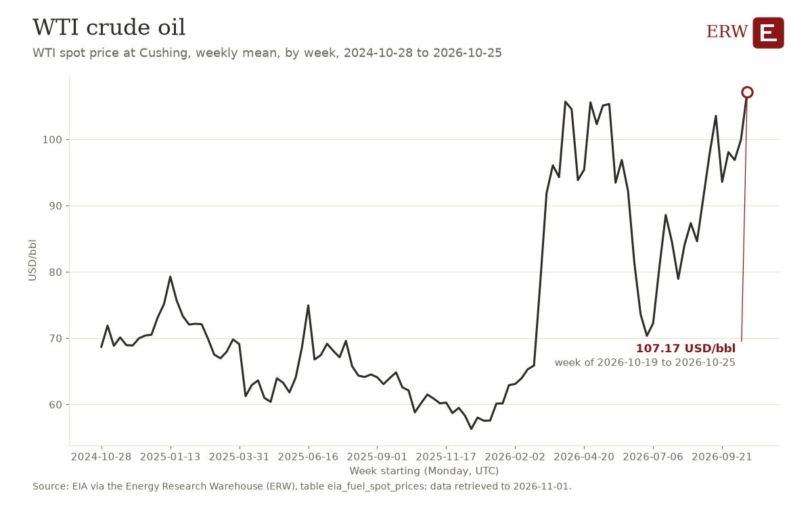

# ERW's Roundup, 2026-W44

ERW's weekly roundup of energy news for 2026-10-26 to 2026-11-01, to 2026-11-01 23:28 UTC, from 67 scored stories.

## Weekend

- no scored story was published on 2026-10-31 or 2026-11-01 (UTC).

## The five stories of the week

1. **Gingerah Energy refers a 1GW data centre with 5GWh battery storage in Western Australia to EPBC Act** (datacenter power, 1 story)  
   Large data center with battery backup capacity signals AI/compute power demand growth. Sources: [Energy-Storage.news](https://www.energy-storage.news/1gw-data-centre-with-5000mwh-battery-storage-system-submitted-to-australias-epbc-act-for-approval/)
2. **Oil dips but holds above $100; Brent trades at $114.42 per barrel amid Middle East hostilities** (oil, 1 story)  
   Sustained USD 100+ crude driven by ongoing Houthi-Saudi conflict and Iranian tanker threats; material price regime. Sources: [OilPrice.com](https://oilprice.com/Latest-Energy-News/World-News/Oil-Prices-Dip-but-Hold-Above-100-as-Middle-East-Supply-Threats-Mount.html)
3. **Singapore plans 26% more power capacity in early 2030s and targets 1GWh of energy storage** (generation, 2 stories)  
   Generation capacity expansion signals rising electricity demand in city-state. Sources: [Reuters](https://news.google.com/rss/articles/CBMiowFBVV95cUxPMllMTFFUczdyRE4xblBaZk5OSFVuY3R6a3Y3d3I4ZW1WaUhqZzNlVGxpNVQ0eWQ5ZGUxX01KRUxyVDd4OXlMenpqNmIzSWFPazlvVnBtMXFlSmQ0aWhJdDZPVFBKMmZKVVB1SE1QOE5UclFGRDdtN19sRkkzdDAxV0ZYQWlfWEt4VVo2UmVwS3BtdjhINGcwcU8yR2h0WkY0clhJ?oc=5) (via Google News), [Energy-Storage.news](https://www.energy-storage.news/singapore-targets-1gwh-of-energy-storage-in-energy-infrastructure-plan-to-meet-rising-demand-for-electricity/)
4. **Pentagon rules restricting Chinese-origin rare earths in weapons systems take effect January 1, 2027** (capital, 1 story)  
   Defense procurement rule effective January 2027 affects rare earth supply chain and magnets for weapons. Sources: [OilPrice.com](https://oilprice.com/Energy/Energy-General/The-Pentagons-Rare-Earth-Deadline-Is-Almost-Here-Is-Anyone-Ready.html)
5. **Welspun wins $580MM pipeline order for the Permian, reflecting a shift in the basin's gas demand** (transmission, 1 story)  
   Pipeline infrastructure investment signals rising gas demand in US basin. Sources: [Hart Energy](https://news.google.com/rss/articles/CBMinwFBVV95cUxNSmo1TG1Qb3ExR3k0OWV3QWU0ZlZCaVlWbVpWZmZnRldBSEdOd3RfNEVocTVDS1laTUZYaVQ1TTlHYkZCTDliV0NhVHpaOVJBaGdWSE83eTVXT1FrV051TGNhRkEtcmVsVnpMZjBvSlJ2dVFnUGFvNzVlWnVsOXdfVFBsTlcyZml5QXRZMWZqRnZUQlRiWWJJR3pkRmZlYjA?oc=5) (via Google News)

## Deals of the week

- no deal in `energy_deals` is dated this week.

## Datacenter announcements of the week

- no datacenter facility in `datacenter_projects` was first reported this week.

## ERW's Policy of the Week

**NRC Reviews of Reactor Designs Previously Authorized by U.S. Department of Energy or Department of War** (NRC final rule, published 2026-10-26; dockets NRC-2025-1503, 3150-AL60)

The NRC now lets companies building commercial reactors point to earlier DOE or Department of War safety authorizations of tested demonstration reactors. The aim is faster NRC license reviews, and applicants must still explain any design or siting changes. [Source](https://www.federalregister.gov/documents/2026/10/26/2026-21801/nrc-reviews-of-reactor-designs-previously-authorized-by-us-department-of-energy-or-department-of-war)

Timeline: The final rule takes effect on November 25, 2026. A similar provision in a separate proposed microreactor rule would apply only if that rule is finalized.

Also this week:

- Ohio Regulatory Program (Interior final rule, published 2026-10-26): State coal mining program rules covering permits, maps and self-bonding are updated. [source](https://www.federalregister.gov/documents/2026/10/26/2026-21807/ohio-regulatory-program)
- Wyoming Regulatory Program (Interior final rule, published 2026-10-26): Resolves provisions left unapproved in the January 2024 partial approval of Wyoming's coal exploration regulations. [source](https://www.federalregister.gov/documents/2026/10/26/2026-21835/wyoming-regulatory-program)

Table: `policy_actions` (scored with the news rubric) and `policy_reads` (impact reads, each field kept only when its words are in the action's own text); every action is on [/policy](/policy).

## ERW's Numbers This Week

This week's day-ahead averages are not in the warehouse for any hub, because each has too few hours (for example 120 of 169 at ERCOT's HB_NORTH), so no weekly changes are computed; MISO is paused and PJM has no price table. The highest real-time price of the week was 588.05 USD/MWh at CAPITL (NYISO), in the interval starting 2026-10-29 17:30 local. Henry Hub fell to 2.76 USD/MMBtu on 2026-10-27 (-11.0%) and WTI to 103.37 USD/bbl (-4.2%), while Brent rose to 123.10 USD/bbl (+6.8%).

**Day-ahead average, main hub, over the ISO's local week, and the change from the week before**

| ISO | Hub or zone | This week USD/MWh | Week before USD/MWh | Change | Table |
|---|---|---|---|---|---|
| ERCOT | HB_NORTH | not in the warehouse (120 of 169 hours) | 25.73 | not computed | [1] |
| CAISO | TH_SP15_GEN-APND | not in the warehouse (120 of 169 hours) | 42.53 | not computed | [1] |
| NYISO | N.Y.C. | not in the warehouse (144 of 169 hours) | 47.64 | not computed | [2] |
| MISO | INDIANA.HUB | not requested: paused by the ERW since 2026-10-04 | not requested: paused by the ERW since 2026-10-04 | not computed | [1] |
| SPP | SPPSOUTH_HUB | not in the warehouse (120 of 169 hours) | 20.15 | not computed | [1] |
| ISO-NE | .H.INTERNAL_HUB | not in the warehouse (120 of 169 hours) | 40.34 | not computed | [3] |
| PJM | | | | | no PJM price table (no API key) |

**Highest real-time price of the week:** 588.05 USD/MWh at CAPITL (NYISO), interval starting 2026-10-29 17:30 local (2026-10-29 21:30 UTC), lmp_rtm_15m_mean [4], NYISO's real-time locational marginal price.

**Fuel spot prices, change over a week** (EIA, trading dates; the newest close held and the newest close a week or more before it):

| Price | Newest close | Close a week before | Change | Table |
|---|---|---|---|---|
| Henry Hub natural gas | 2.76 USD/MMBtu on 2026-10-27 | 3.10 on 2026-10-20 | -0.34 (-11.0%) | [5] |
| WTI Cushing crude | 103.37 USD/bbl on 2026-10-27 | 107.89 on 2026-10-20 | -4.52 (-4.2%) | [5] |
| Brent crude | 123.10 USD/bbl on 2026-10-27 | 115.22 on 2026-10-20 | +7.88 (+6.8%) | [5] |

**US48 peak demand of the week:** 500,531 MW in the hour starting 2026-10-29 21:00 UTC (Thursday 2026-10-29, 17:00 Eastern), from 96 hours of the week to 2026-10-29 23:00 UTC [6].

Tables: [1] `iso_dam_hub_prices` (caiso:PRC_LMP, ercot:NP4-190-CD, miso:da_expost_lmp, spp:DA-LMP-SL); [2] `nyiso_dam_zone_prices` (nyiso:damlbmp); [3] `isone_dam_zone_prices` (isone:da_lmp_hourly); [4] `nyiso_rtm_zone_prices` (nyiso:realtime); real-time tables read, and how far each reaches this week: iso_rtm_hub_prices (caiso_rtm) to 2026-10-30 06:45 UTC, iso_rtm_hub_prices (ercot_rtm) to 2026-10-30 04:45 UTC, iso_rtm_hub_prices (spp_rtm) to 2026-10-29 04:45 UTC, isone_rtm_zone_prices to 2026-10-30 03:45 UTC, isone_rtm_zone_prices_hourly to 2026-10-30 03:00 UTC, nyiso_rtm_zone_prices to 2026-10-30 03:45 UTC; [5] `eia_fuel_spot_prices` (eia:natural-gas/pri/fut, eia:petroleum/pri/spt); [6] `eia930_all_demand` (eia:electricity/rto/region-data); balancing authority us48.

## ERW's Chart of the Week

**WTI crude oil** (the rule's pick; no finding was chosen for this week)

The chart shows the weekly mean WTI spot price at Cushing, by week, with the latest week at 107.17 USD/bbl. That is up 7.24 from 99.93 the week before, and 13 of the 104 week-to-week moves before it were as large.

Source: EIA via the Energy Research Warehouse (ERW), table eia_fuel_spot_prices; data retrieved to 2026-11-01. Template `watch_wti`; every template's latest run is on [/research](/research).

ERW

---

[How this is made.](/about#digest)

<!-- Generated by warehouse/news/roundup.py at 2026-11-01 23:28 UTC; run log warehouse/output/logs/news_roundup_20261101T232824Z.log; model claude-sonnet-5-5. -->
