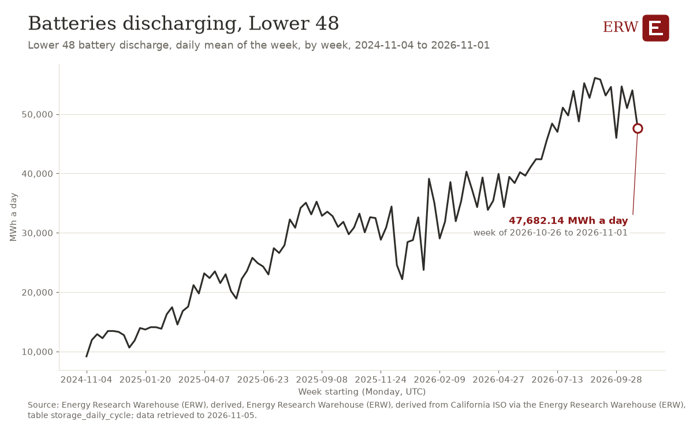

# ERW Weekly Roundup, 2026-W45

**Week ending 8 November 2026.** Sources through 18:26 ET, 23:26 UTC.

<!-- subject: ERW Weekly | Brent down 13.1% on the week; AEP and Google advance a USD 4 billion, 702 MW Bloom Energy fuel-cell... -->

<!-- opening: move -->

ERW's weekly roundup of energy news for 2026-11-02 to 2026-11-08, to 2026-11-08 23:26 UTC, from 287 scored stories.

## The opening number

**Brent crude closed at 107.03 USD/bbl on 2026-11-03, against 123.10 USD/bbl on 2026-10-27 (-16.07 USD/bbl, -13.1%) [5].** Status: calculated from observed prices (the warehouse's tables).

## The week in five numbers

- **Price move of the week:** Brent crude closed at 107.03 USD/bbl on 2026-11-03, against 123.10 USD/bbl on 2026-10-27 (-16.07 USD/bbl, -13.1%) [5].
- **US48 peak demand:** 502,100 MW in the hour starting 2026-11-02 23:00 UTC [6].
- **Deal of the week, by US dollars:** USD 938 million, Deutsche Bank and Rabobank and Return, Germany BESS portfolio (project finance, 2026-11-05).
- **Largest new datacenter load first reported this week:** no facility first reported this week with its MW passes the datacenter table's floor (3 under it); in its place, the week's next price move: WTI Cushing crude closed at 99.64 USD/bbl on 2026-11-03, against 103.37 USD/bbl on 2026-10-27 (-3.73 USD/bbl, -3.6%) [5].
- **From the chart of the week:** Lower 48 battery discharge, daily mean of the week: 47,682 MWh a day in 2026-10-26 to 2026-11-01 (the week before: the chart's latest period ends before this week).

Tables: the deal of the week, `energy_deals` deal:bf5c6cf108d504e1; the chart's figure, template `watch_battery_discharge_us`, `docs/analysis/2026-W45/chart_of_the_week.json`.

## What mattered

1. **AEP and Google advance a USD 4 billion, 702 MW Bloom Energy fuel-cell project in Cheyenne** (datacenter power, 1 story)  
   Hyperscale power deal combining fuel cells, natural gas, and private microgrid infrastructure for datacenter demand. What the evidence does not establish: the 702 MW is the outlet's figure, not a warehouse table's; one outlet has reported it so far. Sources: [Data Center Frontier](https://www.datacenterfrontier.com/energy/article/55413102/aep-google-advance-4-billion-fuel-cell-project-to-power-cheyenne-data-centers)
2. **IEA publishes World Energy Outlook 2026** (policy, 1 story)  
   Annual forecast of global energy trends shapes investment and policy decisions. What the evidence does not establish: no capacity or sum is stated; one outlet has reported it so far. Sources: [IEA - International Energy Agency](https://news.google.com/rss/articles/CBMiYkFVX3lxTE1rel9yc0pyRWJ2WXd2c3lPRXlhQmNwZjgxUXhGamd4RHNQUksyekhmdEE4V05TdnNCZ0JaVUtxUGdLRXR0cnduWWY2RmZnOXNFVXlWLW1ta3ZFeC1zaGRuQUFR?oc=5) (via Google News)
3. **Orsted completes Revolution Wind, a 704 MW offshore wind farm now in commercial operation** (renewables, 3 stories)  
   What the evidence does not establish: the 704 MW is the outlet's figure, not a warehouse table's. Sources: [POWER Magazine](https://www.powermag.com/revolution-wind-offshore-wind-project-enters-commercial-operation/), [Canary Media](https://www.canarymedia.com/articles/offshore-wind/revolution-wind-fully-operational), [Bloomberg.com](https://news.google.com/rss/articles/CBMisAFBVV95cUxOSGFnSVZaSlZGQXhCdFQ4WFBVN2Itc2RPaWg5WXAwTk1XclFiTVpLVFplTXhMWmZYcWJXRWZuaF9BckxjenNDOHAtSkMyWGtxMGxxbEQ2dmhOSXJMVWdpWTh3S1V5NkhZcUp2QlN5al8wMEl4ZmR2TXl3eS10N3JlSUpqZ1htN2cxSno2aVB5R2REY0pxc3RncVlNNnZ2NXRKcXNkU3Q3VU9tRkx4YWsxWg?oc=5) (via Google News)

## More

### Weekend

- no story of 2026-11-07 or 2026-11-08 (UTC).

### The five stories of the week

1. **Heatmap Pro poll asks Americans whether they would support a data center planned near their home** (datacenter power, 2 stories)  
   Public backlash against datacenter siting shifts permitting landscape and power infrastructure deployment calculus. Sources: [Heatmap News](https://heatmap.news/daily/2026-midterms-democrats-climate-energy), [Latitude Media](https://www.latitudemedia.com/news/voters-just-proved-how-much-they-hate-data-centers/)
2. **ConocoPhillips raises its dividend after profit beats estimates on higher oil prices** (oil, 2 stories)  
   Sources: [OilPrice.com](https://oilprice.com/Latest-Energy-News/World-News/ConocoPhillips-Doubles-Profit-to-4-Billion-Raises-Dividend.html), [Reuters](https://news.google.com/rss/articles/CBMitgFBVV95cUxPWmVXLVh5bHBBQWh5ZkFmckpmSkRNMVB2UGZwaDFuYVc1TE93TVZKcjl4c1lPSjVQb1doc1pJdm11S01RTGtwTDRUblRGVWp2M3hrb2ZLakV3R0poTGRjcmRyOEI2M2hNOEJFVllydTcyQ043WFVSRURkREJvZWxtaWJmaDJNRllnc3lPZllyM1JtMEhnY09NLWRpZzNuQWt0YU1jTFpCMlQ2UG1ZQVVtYVF5dUlZZw?oc=5) (via Google News)
3. **Worley signs reimbursable EPC contract for Venture Global's CP2 LNG expansion in Louisiana** (deal, 1 story)  
   Sources: [LNG Prime](https://lngprime.com/americas/worley-clinches-epc-gig-for-venture-globals-cp2-lng-expansion-project/199493/)
4. **EQT's Zelestra unveils a USD 12 billion plan to meet US AI demand** (deal, 1 story)  
   Large capital commitment to power infrastructure for datacenter AI load. Sources: [Bloomberg.com](https://news.google.com/rss/articles/CBMisAFBVV95cUxQRHlEdFRkMlJHUlhvRDdZQVBmemZNcWVULWRITjNrVlBnNl9XVWlacTlyV28zb01jYlFCNjJSbXBFVUJwb3M5clVUbEhOVnBKY091XzlmTXBtRFBPYkhTUXVINE9sTkJFV3lURFFWeTlCVTZlcF85TXRPM0JTQ1R5ZHRNaGY1X0lLbkZmdU9EMnNtb2JzVURTYlRsZGc0VHZJbWFwS2xyeUZtVFpQX0tkLQ?oc=5) (via Google News)
5. **AI data center demand is reviving nuclear energy; whether SMRs, restarts and fusion can deliver quickly is uncertain** (nuclear, 1 story)  
   Sources: [Data Center Knowledge](https://www.datacenterknowledge.com/energy-power-supply/ai-data-centers-are-fueling-a-nuclear-comeback)

### Deals of the week

| Date | Type | Buyer | Seller | Asset | MW | US dollars | Status | Story |
|---|---|---|---|---|---|---|---|---|
| 2026-11-04 | other | Venture Global | Worley | CP2 LNG expansion project | not stated | not stated | signed | [1](https://lngprime.com/americas/worley-clinches-epc-gig-for-venture-globals-cp2-lng-expansion-project/199493/) |
| 2026-11-04 | acquisition | Energy Capital Partners | not stated | gas-fired power portfolio | 892 | not stated | not stated | [1](https://news.google.com/rss/articles/CBMilgFBVV95cUxPOUR6dC1LMlRwNml3OXgyMUtGQ2lQVDE0ZzdmSjBYZlo0RzhsQkRpakJGWl9wQzJGZjM0ODMwbmkyWXBNeDhUOF9tRExlM2x5ODd3ZWR0RHFtOWtIVkJOLVRNem9lT1h1NnVpYmcxajRmSENmVGpEbHQ5b20tUXBmbDZLRTJyRmlvZlA0cE0yVVIzanVaemc?oc=5) |
| 2026-11-04 | fuel supply | Jiangsu Guoxin Group | TotalEnergies | LNG supply | not stated | not stated | signed | [1](https://lngprime.com/asia/totalenergies-inks-preliminary-lng-supply-deal-with-chinas-jiangsu-guoxin/199496/) |
| 2026-11-05 | other | Delfin Midstream | Wartsila | engines and thrusters for first 4.4 mtpa FLNG unit | not stated | not stated | signed | [1](https://lngprime.com/asia/wartsila-scores-delfin-lng-gig/199584/) |
| 2026-11-05 | fuel supply | AxDo | Excelerate | LNG supply agreement for Bahamas LNG hub | not stated | not stated | signed | [1](https://lngprime.com/americas/excelerate-seals-bahamas-lng-deal/199574/) |
| 2026-11-05 | project finance | Deutsche Bank and Rabobank | Return | Germany BESS portfolio | not stated | USD 938 million | signed | [1](https://www.energy-storage.news/return-secures-835-million-germany-bess-rollout-targets-1gw-annually/) |
| 2026-11-05 | acquisition | Belgian state | Engie | Belgium's seven nuclear power reactors | not stated | not stated | rumored | [1](https://www.world-nuclear-news.org/articles/belgian-nuclear-power-plant-negotiations-extended) |

Table: `energy_deals` (7 deals shown: confidence 0.7 or more and a party, an asset or MW stated, US first, at most 15; 0 more pass, 4 fall under the floor; [the whole table](/data#energy_deals)). Extracted from the scored stories by `warehouse/deals/extract.py`, every number checked against its story.

### Datacenter announcements of the week

| First reported | Operator | Site | Place | MW | Status | Story |
|---|---|---|---|---|---|---|
| 2026-11-05 | Lambda | not stated | Lowndes County, AL | not stated | not stated | [1](https://www.datacenterdynamics.com/en/news/lambda-to-develop-four-building-data-center-campus-in-lowndes-county-alabama/) |
| 2026-11-05 | Google | not stated | WY | not stated | announced | [1](https://news.google.com/rss/articles/CBMiqgFBVV95cUxNNE1UblF4V2JrTFJGbnZvOWxFaURSZ3d6Y1VFRjcwWHVCcXlMQm94STFoeF95ekVHclBNbWtURXppSW1iV2NpWVFJNXdwZlU5MFd2UjlOWEhubnIyX2t5N1hhUU12MWh1QVJHZDljSjdOQk5EMHZNeWRMQ2tWUGhqdFpqR1JmMTBoUjdtZFpSSlFWU3FpaElDQV9mUzB5RWtSdnRQVmF3QTF5Zw?oc=5) |

Table: `datacenter_projects` (2 facilities shown: confidence 0.7 or more and an operator, a site or MW stated, US first, at most 15; 0 more pass, 3 fall under the floor; [the whole table](/data#datacenter_projects)). `warehouse/datacenters/extract.py`, every field only as its story states it.

### ERW's Policy of the Week

**Streamlining Contested Adjudications in Licensing Proceedings** (NRC final rule, published 2026-11-03; dockets NRC-2025-1501, 3150-AL58)

The NRC has changed its hearing rules so that disputes over nuclear licenses are settled faster and with less paperwork. [Source](https://www.federalregister.gov/documents/2026/11/03/2026-22443/streamlining-contested-adjudications-in-licensing-proceedings)

Timeline: The final rule takes effect on December 3, 2026, and applies to contested adjudicatory proceedings noticed on or after that date. The rule aims to complete adjudications within 11 to 13.5 months, or faster for expedited proceedings.

Also this week:

- Last Energy, Inc; Phased Construction Permit Application-Limited Work Authorization (NRC notice, published 2026-11-05):  [source](https://www.federalregister.gov/documents/2026/11/05/2026-22577/last-energy-inc-phased-construction-permit-application-limited-work-authorization)
- Natural Gas Pipeline Company of America, LLC; Notice of Scoping Period Requesting Comments on Environmental Issues for the Proposed Amarillo Expansion Project (FERC notice, published 2026-11-05): Pipeline expansion in the Texas Panhandle enters environmental review, a step toward added gas transport capacity. [source](https://www.federalregister.gov/documents/2026/11/05/2026-22608/natural-gas-pipeline-company-of-america-llc-notice-of-scoping-period-requesting-comments-on)

Table: `policy_actions` (scored with the news rubric) and `policy_reads` (impact reads, each field kept only when its words are in the action's own text); every action is on [/policy](/policy).

### ERW's Numbers This Week

The warehouse holds only 120 of 168 hours of day-ahead prices for this week, so no hub has a weekly average or a change; the week before, SPPSOUTH_HUB was cheapest at 27.62 USD/MWh and CAISO's TH_SP15_GEN-APND dearest at 44.34. The highest real-time price was 302.71 USD/MWh at ERCOT's HB_SOUTH, in the 15-minute interval starting 2026-11-03 17:45 local. Henry Hub closed at 2.63 USD/MMBtu on 2026-11-03, down 4.7%, WTI at 99.64 USD/bbl, and Brent at 107.03 USD/bbl, down 13.1%.

**Day-ahead average, main hub, over the ISO's local week, and the change from the week before**

| ISO | Hub or zone | This week USD/MWh | Week before USD/MWh | Change | Table |
|---|---|---|---|---|---|
| ERCOT | HB_NORTH | not in the warehouse (120 of 168 hours) | 33.19 | not computed | [1] |
| CAISO | TH_SP15_GEN-APND | not in the warehouse (120 of 168 hours) | 44.34 | not computed | [1] |
| NYISO | N.Y.C. | not in the warehouse (120 of 168 hours) | 40.90 | not computed | [2] |
| MISO | INDIANA.HUB | not requested: paused by the ERW since 2026-10-04 | not requested: paused by the ERW since 2026-10-04 | not computed | [1] |
| SPP | SPPSOUTH_HUB | not in the warehouse (120 of 168 hours) | 27.62 | not computed | [1] |
| ISO-NE | .H.INTERNAL_HUB | not in the warehouse (120 of 168 hours) | 40.28 | not computed | [3] |
| PJM | | | | | no PJM price table (no API key) |

**Highest real-time price of the week:** 302.71 USD/MWh at HB_SOUTH (ERCOT), interval starting 2026-11-03 17:45 local (2026-11-03 23:45 UTC), spp_rtm [4], ERCOT's real-time settlement point price, a 15-minute interval. The grids' real-time series differ in interval length (a 15-minute mean beside an hourly value), so this is the highest interval value held, not one measure across grids.

**Fuel spot prices, change over a week** (EIA, trading dates; the newest close held and the newest close a week or more before it):

| Price | Newest close | Close a week before | Change | Table |
|---|---|---|---|---|
| Henry Hub natural gas | 2.63 USD/MMBtu on 2026-11-03 | 2.76 on 2026-10-27 | -0.13 (-4.7%) | [5] |
| WTI Cushing crude | 99.64 USD/bbl on 2026-11-03 | 103.37 on 2026-10-27 | -3.73 (-3.6%) | [5] |
| Brent crude | 107.03 USD/bbl on 2026-11-03 | 123.10 on 2026-10-27 | -16.07 (-13.1%) | [5] |

**US48 peak demand of the week:** 502,100 MW in the hour starting 2026-11-02 23:00 UTC (Monday 2026-11-02, 18:00 Eastern), from 72 hours of the week to 2026-11-04 23:00 UTC [6].

Tables: [1] `iso_dam_hub_prices` (caiso:PRC_LMP, ercot:NP4-190-CD, miso:da_expost_lmp, spp:DA-LMP-SL); [2] `nyiso_dam_zone_prices` (nyiso:damlbmp); [3] `isone_dam_zone_prices` (isone:da_lmp_hourly); [4] `iso_rtm_hub_prices` (caiso:PRC_INTVL_LMP, ercot:NP6-785-ER, ercot:NP6-905-CD, miso:rt_lmp_final, miso:rt_lmp_prelim, spp:RTBM-LMP-SL); real-time tables read, and how far each reaches this week: iso_rtm_hub_prices (caiso_rtm) to 2026-11-05 07:45 UTC, iso_rtm_hub_prices (ercot_rtm) to 2026-11-05 05:45 UTC, isone_rtm_zone_prices to 2026-11-05 04:45 UTC, isone_rtm_zone_prices_hourly to 2026-11-05 04:00 UTC, nyiso_rtm_zone_prices to 2026-11-05 04:45 UTC; [5] `eia_fuel_spot_prices` (eia:natural-gas/pri/fut, eia:petroleum/pri/spt); [6] `eia930_all_demand` (eia:electricity/rto/region-data); balancing authority us48.

## ERW's Chart of the Week

**Batteries discharging, Lower 48** (the rule's pick; no finding was chosen for this week)

The chart shows the Lower 48 battery discharge, daily mean of the week, for each of the 104 weeks held, which ran from 9188.86 MWh a day (2024-11-04 to 2024-11-10) to 56102.57 MWh a day (2026-08-31 to 2026-09-06). In the week of 2026-10-26 to 2026-11-01 it was 47682.14 MWh a day, down 6,317.57 from 53,999.71 the week before, and 8 of the 102 earlier week-to-week moves were as large.

Source: Energy Research Warehouse (ERW), derived, Energy Research Warehouse (ERW), derived from California ISO via the Energy Research Warehouse (ERW), table storage_daily_cycle; data retrieved to 2026-11-05. Template `watch_battery_discharge_us`; every template's latest run is on [/research](/research).
The week's stories point to US crude oil exports, whose chart is on [/research](/research) (template `watch_crude_exports`).

## Next week

- **9 November 2026**: Regulatory Enhancements for Reactor Licensing, Decommissioning, and Operational Oversight (NRC). Comments are due by 11:59 p.m. eastern time on November 9, 2026, through regulations.gov under Docket ID NRC-2025-1138. ([source](https://www.federalregister.gov/documents/2026/09/24/2026-19568/regulatory-enhancements-for-reactor-licensing-decommissioning-and-operational-oversight))
- **9 November 2026**: Cheniere Corpus Christi Pipeline, LP, Corpus Christi Liquefaction Stage IV, LLC, Corpus... (FERC). FERC must receive comments on the draft EIS by 5:00 p.m. Eastern Time on November 9, 2026. ([source](https://www.federalregister.gov/documents/2026/09/23/2026-19447/cheniere-corpus-christi-pipeline-lp-corpus-christi-liquefaction-stage-iv-llc-corpus-christi))
- **9 November 2026**: National Petroleum Reserve in Alaska Production Site Development (BLM). Comments on the proposed rule are due to the BLM by November 9, 2026. ([source](https://www.federalregister.gov/documents/2026/09/08/2026-18261/national-petroleum-reserve-in-alaska-production-site-development))

## ERW's Fun Fact

In 2002, GE acquired the wind power assets of Enron during its bankruptcy proceedings, and Enron Wind was the only surviving U.S. manufacturer of large wind turbines at the time.

Sources: [Wikipedia, General Electric](https://en.wikipedia.org/wiki/General_Electric).

ERW

---

[How this is made.](/about#digest)

Corrections: [open an issue](https://github.com/SamuelEnrique/erw/issues). Preferences and topics: [subscribe](/subscribe). Every email carries its own unsubscribe link.

<!-- Generated by warehouse/news/roundup.py at 2026-11-08 23:26 UTC; run log warehouse/output/logs/news_roundup_20261108T232602Z.log; model claude-sonnet-5-5. -->
