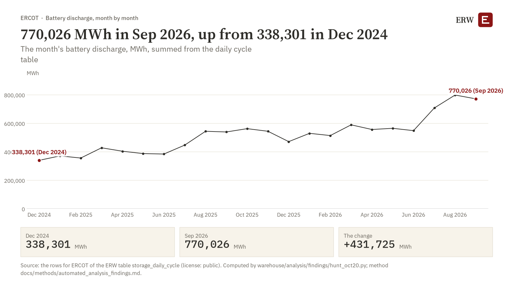

# ERW's Roundup, 2026-W43 (draft)

ERW's weekly roundup for 2026-10-19 to 2026-10-25. A draft written on the night of 20 October 2026 by the findings hunt (warehouse/analysis/findings/hunt_oct20.py): the three findings below are the issue, and the first one's wide chart is the chart of the week. The week's stories, deals and policy sections are written by warehouse/news/roundup.py on Sunday; this draft holds the findings only. Nothing here has been sent or posted, and no finding is approved until it is marked so at /internal/findings (run check.do in Stata first). Every number below is computed from the ERW's own tables; the claims state a change and not its cause.

## ERW's Chart of the Week

**BATTERY DISCHARGE, MONTH BY MONTH** (the hunt's first finding; approval pending)

*ERCOT: the month's battery discharge, MWh, summed from the daily cycle table, 770,026 MWh in September 2026, up from 338,301 MWh in December 2024. The direction holds in 21 of the 21 complete months after December 2024.*

- ERCOT, December 2024: 338,301 MWh
- ERCOT, September 2026: 770,026 MWh
- The change: +431,725 MWh, 10.8 typical moves of the series

Source: the rows for ERCOT of the ERW table storage_daily_cycle (license: public). Computed by warehouse/analysis/findings/hunt_oct20.py; method docs/methods/automated_analysis_findings.md. The finding's data, Stata do-file and caption are on /internal/findings.

## Three findings of the week

### 1. BATTERY DISCHARGE, MONTH BY MONTH

ERCOT: the month's battery discharge, MWh, summed from the daily cycle table, 770,026 MWh in September 2026, up from 338,301 MWh in December 2024. The direction holds in 21 of the 21 complete months after December 2024.

The two ends of the series are different months of the year; every complete month between them is on the chart.

Checked before it was drafted:

- Holds in more than one month: 21 of the 21 complete months after 2024-12 lie above 2024-12's value (passed).
- Survives a change of window: from 2025-01 to 2026-09 the change is 400,446, from 2024-12 to 2026-08 it is 458,659 (passed).
- Sample large enough: 2024-12 holds 31 and 2026-09 holds 29 observations; the floor is 28 (passed).
- Half the change remains without the first month: from 2025-01 to 2026-09 the change is 400,446, 92.8 percent of the change from 2024-12 (passed).
- At least one typical monthly move: the change is 10.81 typical monthly moves (39,932 MWh a month, the median move between complete months); the floor is 1 (passed).

Source: the rows for ERCOT of the ERW table storage_daily_cycle (license: public). Computed by warehouse/analysis/findings/hunt_oct20.py; method docs/methods/automated_analysis_findings.md.

### 2. BATTERY DISCHARGE IN THE EVENING, MONTH BY MONTH

ERCOT: share of the month's battery discharge (hourly net battery output above zero) delivered from 5 PM to 10 PM local, 85.8 percent of discharge in September 2026, up from 47.6 percent of discharge in December 2024. The direction holds in 19 of the 21 complete months after December 2024.

The two ends of the series are different months of the year; every complete month between them is on the chart.

Checked before it was drafted:

- Holds in more than one month: 19 of the 21 complete months after 2024-12 lie above 2024-12's value (passed).
- Survives a change of window: from 2025-01 to 2026-09 the change is 40.4, from 2024-12 to 2026-08 it is 40.8 (passed).
- Sample large enough: 2024-12 holds 31 and 2026-09 holds 30 observations; the floor is 28 (passed).
- Half the change remains without the first month: from 2025-01 to 2026-09 the change is 40.4, 105.7 percent of the change from 2024-12 (passed).
- At least one typical monthly move: the change is 5.02 typical monthly moves (7.6 percent of discharge a month, the median move between complete months); the floor is 1 (passed).

Source: the rows for ERCOT of the ERW table eia930_all_storage (license: public). Computed by warehouse/analysis/findings/hunt_oct20.py; method docs/methods/automated_analysis_findings.md.

### 3. CURTAILMENT, THIS YEAR SO FAR

CAISO: curtailed wind and solar output from 1 January to 30 September, MWh was 5,115,404 MWh in 2026, the highest of the 12 complete years held; the previous high was 3,452,749 MWh in 2025.

The window is 1 January to 30 September of each year.

Checked before it was drafted:

- History long enough: 11 complete years before 2026; the floor is 5 (passed).
- The record period is complete: 2026 holds 273 observations, 100 percent of a whole year's (passed).
- No gap in the window: every year from 2015 to 2026 is complete (passed).
- A margin over the previous record: 2026 stands 48.2 percent above 2025, the previous high; the floor is 5 percent (passed).

Source: the rows for CAISO of the ERW table caiso_curtailment_daily (license: public). Computed by warehouse/analysis/findings/hunt_oct20.py; method docs/methods/automated_analysis_findings.md.

The other seven findings of the hunt, in the hunt's order: Till queue do us part, by cohort (PJM); Battery discharge, month by month (CAISO); The queue's biggest year (ERCOT); Till queue do us part, by cohort (CAISO); Hours below zero, this year so far (ERCOT, the West hub); Wind and solar curtailed (CAISO); The peak premium (ERCOT, the hub average). Each is on /internal/findings with its files.

ERW

---

[How this is made.](/about#digest)

<!-- Draft written by the findings hunt of 2026-10-20 (hunt_oct20.py 1.0.0); the Roundup itself is written by warehouse/news/roundup.py on Sunday 25 October 2026. Not sent. -->
